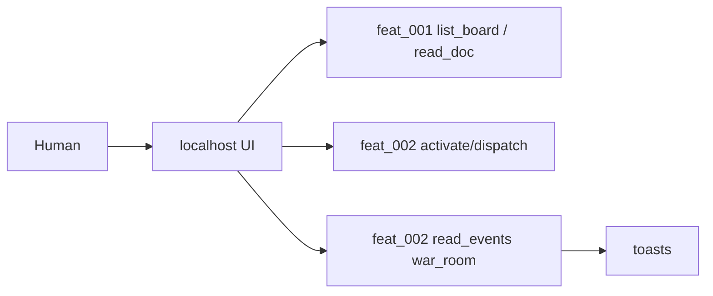

# Local War Room UI

## Parent Epic

[epic_001](../../epics/2_active/epic_001_functional_mvp.md) — Functional MVP.

Constraints this feature must honor:

- Localhost only (`127.0.0.1`). No remote UI.
- Default home is the Epic Team chat + board + toasts.
- Human messages enter the attached graph only.
- Task graphs have no room; show local branch / merge, not a SWE transcript.
- Activate Epic and dispatch controls must call feat_002 principals as `human`.
- UI toolkit is this feature's choice; it is not an Epic ABI.

## Scope

**In**

- Local web app on localhost: board columns, War Room transcript, toast stream
- Human actions: `activate_epic`, `dispatch_feature`, `dispatch_task`, `merge_task_branch` (merge wired in feat_007/008; button may stub)
- Attach/detach chrome (wired in feat_005; rooms may be placeholders)
- Amendment pane chrome (wired in feat_006; may be a closed stub)
- Comment thread view chrome (wired in feat_005), including a human-only `blocking` toggle

**Out**

- Agent inference
- Implementing amendment accept/reject (feat_006)
- Boss brain (feat_008); a "ask Boss to dispatch" button may enqueue a `war_room` / `boss` event

## Data structures

```text
UiAttachment
  graph_id: str | null       # default: active epic
  tier: epic | feature

Toast
  kind: amendment | comment | blocked | task_failed | task_merged | illegal_dispatch
  body: str
  link: str | null

BoardView
  epics / features / tasks: columns -> [WorkMeta]
```

Transcripts: one list per persisting graph, stored with that graph's checkpointer / a local sidecar. Do not merge Feature tokens into the Epic pane.

## API contracts

Server (localhost):

```text
GET  /api/board              -> BoardView
GET  /api/doc/{id}           -> WorkDoc
POST /api/activate_epic      {id}              -> DispatchResult   # by=human
POST /api/dispatch_feature   {id}              -> DispatchResult   # by=human
POST /api/dispatch_task      {id, skills?}     -> DispatchResult   # by=human; skills overrides Task list
GET  /api/toasts?after=      -> [Toast]
GET  /api/chat/{graph_id}    -> [Message]
POST /api/chat/{graph_id}    {body}            -> Message          # only if attached
POST /api/attach             {graph_id}        -> briefing pack stub until feat_005
POST /api/detach             {graph_id}
```

All binds: `127.0.0.1`. Binding `0.0.0.0` is a defect.

Human chat POST is a no-op (202 + stored) until feat_004/005 graphs subscribe.

## Logic flow



## Task breakdown

_(empty — Feature Team mints tasks after dispatch)_

Depends on: feat_001, feat_002 completed.

## Risks & upward questions

- Toolkit choice (lightweight Python templates vs a TS SPA) must stay localhost and must not pull a cloud auth SDK.
- Until feat_004 exists, War Room chat has no agent replies. Ship the pane anyway so dispatch can be tested without an LLM.

## Decision log

_(empty — lock entries when this feature is active)_
