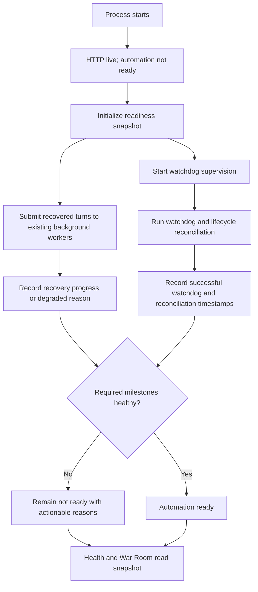

# Supervisor readiness state and non-blocking recovery

## Parent Epic

epic_012

## Scope

### In scope

- Define one authoritative, read-only supervisor status projection.
- Track startup progress, recovered-turn recovery, watchdog activity, and lifecycle reconciliation.
- Start watchdog supervision independently of potentially long recovered model turns.
- Expose the projection through the existing health and War Room status path.
- Add focused integration coverage for the readiness transition and observation side-effect boundaries.

### Out of scope

- New lifecycle transitions, dispatch behavior, or queue semantics.
- A second status store or a new health transport.
- Broad monitoring, alerting, or historical metrics infrastructure.
- Reworking the established background-worker mechanism.

## Outcome

Operators can distinguish a reachable HTTP process from a supervisor that is ready to automate work. During startup, health remains observable while recovery proceeds; recovered model turns run in established background workers and cannot delay watchdog supervision. The same projection identifies incomplete or degraded startup with timestamps and actionable reasons.

## Required acceptance

- HTTP availability and automation readiness are separate fields/states.
- Startup phases and the last successful watchdog and reconciliation activity are observable with timestamps and actionable degraded reasons.
- Recovered model turns run in established background workers and cannot delay watchdog startup.
- Status observation does not mutate board lifecycle state or dispatch work.
- Focused integration coverage proves HTTP can be live while automation is not ready, then becomes ready.

## Data structures

A single supervisor-owned snapshot is the source for all health and War Room reads. It contains:

- HTTP liveness, reported independently from automation readiness.
- Automation readiness as an explicit state, not inferred from HTTP success.
- Current startup/recovery phase.
- Last successful watchdog-loop timestamp.
- Last successful lifecycle-reconciliation timestamp.
- Zero or more stable, actionable degraded reasons.
- Recovery progress or failure information needed to explain why readiness is not ready.

Writers update the snapshot at existing supervisor lifecycle boundaries. Readers return a copy/projection only and perform no lifecycle transitions or dispatch.

## API contracts

The existing health/War Room status path returns the authoritative supervisor projection. It must:

- Preserve HTTP success while clearly reporting automation as not ready during startup or degradation.
- Report readiness, phase, activity timestamps, and degraded reasons in a stable serialized shape.
- Become ready only after the required startup, watchdog, and reconciliation milestones have succeeded.
- Remain observational: requesting status must not reconcile lifecycle state, recover turns, enqueue work, or dispatch work.

No new endpoint or parallel status representation is required.

## Logic flow

## Task breakdown

1. `task_012_001_001` — Define the authoritative supervisor readiness projection.
2. `task_012_001_002` — Instrument startup, watchdog, and reconciliation readiness state. Depends on 001.
3. `task_012_001_003` — Make recovered turns non-blocking for watchdog startup. Depends on 001 and may proceed in parallel with 002.
4. `task_012_001_004` — Expose readiness through the existing health and War Room path. Depends on 002 and 003.
5. `task_012_001_005` — Add focused readiness-transition integration coverage. Depends on 004.

## Risks & upward questions

- Readiness can become misleading if milestones are inferred in multiple places; all consumers must use the single projection.
- Timestamp freshness thresholds should reuse existing watchdog/reconciliation cadence semantics rather than introduce an unrelated policy.
- Background recovery failures must degrade readiness observably without restoring startup blocking.
- No upward contract change is currently required.

## Decision log

- Use one supervisor-owned, read-only projection for both health and War Room status; HTTP liveness is independent of automation readiness.
- Start watchdog supervision without awaiting recovered model turns; recovery uses the established background-worker path.
- Validate the user-visible transition and side-effect boundary with focused integration coverage rather than duplicative low-level tests.

- `dec_001` · 2026-10-23 · Feature Lead · **Architecture**
  Chose Use one supervisor-owned, read-only projection for both health and War Room status, with HTTP liveness independent of automation readiness..
  Rationale: A single projection prevents conflicting operator views and satisfies the requirement that status observation have no lifecycle or dispatch side effects.
  Honors: Feature acceptance: separate HTTP liveness and automation readiness; read-only status observation..

- `dec_002` · 2026-10-23 · Feature Lead · **Startup sequencing**
  Chose Start watchdog supervision without awaiting recovered model turns; submit recovery through the established background-worker path..
  Rationale: Long recovered turns must not delay supervision, while reuse of existing workers avoids new execution infrastructure.
  Honors: Feature acceptance: recovered model turns cannot delay watchdog startup..

- `dec_003` · 2026-10-23 · Feature Lead · **Verification**
  Chose Use focused readiness-transition integration coverage instead of duplicative low-level tests..
  Rationale: The highest-value proof spans HTTP liveness, supervisor readiness, startup sequencing, and read-only observation; integration coverage validates that boundary with lower maintenance cost.
  Honors: Frugal engineering guidance and feature acceptance requiring live-to-ready transition coverage..

## Closeout

Completed child work: `task_012_001_001` (Define the authoritative supervisor readiness projection), `task_012_001_002` (Instrument startup, watchdog, and reconciliation readiness state), `task_012_001_003` (Make recovered turns non-blocking for watchdog startup), `task_012_001_004` (Expose supervisor readiness through the existing health and War Room path), `task_012_001_005` (Add focused integration coverage for readiness transitions).
