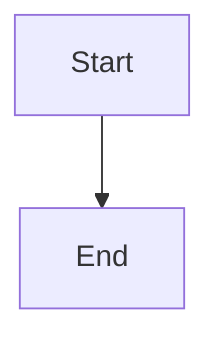

# Disposable synthetic lifecycle readiness probe

## Parent Epic

epic_012

## Scope

## Outcome

Provide an operator/developer-invoked synthetic Epic → Feature → Task lifecycle probe in a disposable workspace that validates readiness transitions, watchdog/reconciliation activity, convergence detection, and recovery without reading from or writing to the live board.

## Required acceptance

- The probe creates and cleans up its own temporary git repository and Cascade board; live board paths are never accepted as mutation targets.
- It exercises a successful lifecycle path and at least one intentionally stalled path that produces the expected durable diagnostic.
- Results clearly identify pass/fail and the failing phase; execution is bounded and safe to rerun.
- Coverage proves isolation and cleanup, with retained artifacts only through an explicit debug option.
- No always-on canary, hosted service, or production board mutation is introduced.

## Data structures

TBD.

## API contracts

TBD.

## Logic flow

## Task breakdown
- task_012_003_003
- task_012_003_002
- task_012_003_001

_(empty — Feature Team mints tasks after dispatch)_

## Risks & upward questions

None.

## Decision log

None yet.

## Closeout

Completed child work: `task_012_003_001` (Build the disposable probe workspace harness), `task_012_003_002` (Exercise lifecycle success and intentional-stall scenarios), `task_012_003_003` (Verify isolation, cleanup, and operator workflow).
