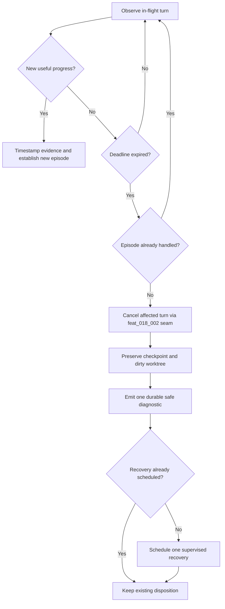

# Bounded in-flight turn progress watchdog and single recovery

## Parent Epic

epic_012

## Scope

### Outcome

Detect an in-flight SWE turn whose provider transport remains connected but produces no useful progress, cancel only that turn's provider/bridge process tree through the graceful turn-cancellation seam supplied by `feat_018_002`, preserve the task checkpoint and dirty worktree, emit one actionable durable diagnostic, and schedule at most one supervised recovery for the unchanged stall episode.

### Required acceptance

- Track transport/process liveness separately from progress liveness. Lease renewal or a pending provider await is not progress.
- Useful progress is limited to provider events, completed tool calls, checkpoint advancement, or task-worktree file/content advancement; evidence is timestamped and reduced to a stable episode signature.
- A configurable bounded no-progress deadline uses monotonic time and an injected clock in tests.
- On expiry, cancellation targets only the affected turn's provider/bridge process tree and does not terminate the supervisor, War Room, watchdog, or unrelated turns. Escalation from graceful termination to targeted force-kill is bounded.
- Cancellation and recovery preserve the dirty task worktree and last checkpoint/result evidence.
- Emit one durable diagnostic with task/turn/provider identity, last-progress kind/time, elapsed duration, cancellation outcome, preserved-work state, and recovery disposition; exclude prompts, credentials, and model output.
- Schedule no more than one supervised recovery for an unchanged episode. New useful progress establishes a new episode; repeated polls/callbacks remain idempotent.
- Regression coverage includes a fake provider call that stays connected forever, emits no events or tool completions, and never advances checkpoint/files. The test proves bounded detection, targeted cancellation, War Room survival, dirty-work preservation, one diagnostic, and at most one recovery.
- Do not begin cancellation integration until `feat_018_002` has landed and its cancellation/draining seam is available; reuse that seam rather than introducing a competing swe_turn/execution cancellation path.

### Scope cuts

- No whole-supervisor or War Room restart.
- No cancellation of unrelated turns and no broad process-name kill.
- No repeated retry loop, provider quality scoring, arbitrary turn-duration limit, or guarantee of task completion.
- No cleanup/reset of a dirty task worktree.

## Data structures

- `ProgressEvidence`: turn identity, progress kind, monotonic observation time, and a stable digest/version for the observed provider event, completed tool call, checkpoint, or task-worktree content state.
- `StallEpisode`: stable signature derived from the turn identity and latest useful-progress evidence, plus deadline state. Unchanged evidence retains the same signature; useful progress creates a new signature.
- `CancellationOutcome`: graceful/forced/not-required result, affected process-tree identity, bounded escalation result, and preserved checkpoint/worktree state.
- `RecoveryDisposition`: episode signature plus diagnostic-recorded and recovery-scheduled markers used for idempotency.

Persist or place episode markers in the existing durable execution/checkpoint state; do not create a second lifecycle store unless the current seam cannot represent them.

## API contracts

- The watchdog observes a turn snapshot and an injected monotonic clock, classifies only allow-listed evidence as useful progress, and returns either healthy/unchanged state or one expired `StallEpisode`.
- Expiry handling passes the affected turn identity to the `feat_018_002` graceful cancellation/draining seam. It must not identify targets by broad process name.
- Cancellation returns structured `CancellationOutcome` data without cleaning or resetting task state.
- Post-cancellation handling performs episode-keyed durable diagnostic emission and supervised recovery scheduling atomically or with independently idempotent writes.
- The diagnostic contains only the safe required fields; prompts, credentials, and model output are prohibited.

## Logic flow

## Task breakdown

1. `task_012_004_001` — Implement monotonic useful-progress and stall episode tracking.
2. `task_012_004_002` — Cancel only the stalled turn and preserve recoverable state. Depends on task 001 and is gated on the `feat_018_002` seam.
3. `task_012_004_003` — Emit one durable stall diagnostic and schedule one recovery. Depends on task 002.
4. `task_012_004_004` — Prove bounded watchdog recovery with a forever-connected fake provider. Depends on task 003.

The dependency chain is intentionally linear so the end-to-end regression lands after each production seam is available. Tasks 001–003 are completed; task 004 is active.

## Risks & upward questions

- The exact integration types and storage location depend on the landed `feat_018_002` seam. If that seam cannot return targeted cancellation outcome data or preserve draining state, propose an epic amendment rather than introducing a parallel cancellation path.
- Worktree advancement detection must reuse an existing cheap content/version signal where available; avoid repeated full-tree hashing on each watchdog poll.

## Decision log

- Track stalls by stable useful-progress episode signature, not transport liveness or elapsed total turn duration.
- Reuse the `feat_018_002` targeted graceful cancellation/draining seam and bound any escalation to the affected process tree.
- Deduplicate both diagnostic emission and recovery scheduling by episode, allowing a new attempt only after new useful progress.
- Use one high-signal end-to-end regression plus focused clock/idempotency tests; avoid redundant mock-heavy coverage.

- `dec_001` · 2026-10-23 · Feature Lead · **Progress and episode identity**
  Chose Track stalls by a stable useful-progress episode signature rather than transport liveness or total turn duration..
  Rationale: Connected transport, lease renewal, and pending awaits can coexist with a wedged turn; episode identity must change only when allow-listed useful evidence advances.
  Honors: Feature acceptance for separate liveness dimensions, bounded no-progress detection, and new-episode behavior..

- `dec_002` · 2026-10-23 · Feature Lead · **Cancellation integration**
  Chose Reuse the feat_018_002 targeted graceful cancellation/draining seam, with bounded force escalation limited to the affected turn process tree..
  Rationale: A single cancellation authority prevents competing lifecycle paths and protects the supervisor, War Room, watchdog, and unrelated turns.
  Honors: Feature dependency, targeted cancellation acceptance, and explicit scope cuts..

- `dec_003` · 2026-10-23 · Feature Lead · **Idempotent recovery**
  Chose Deduplicate durable diagnostics and supervised recovery scheduling by stable stall episode, permitting another recovery only after new useful progress..
  Rationale: Episode-keyed disposition prevents repeated polls or callbacks from creating retry loops while allowing genuinely changed work to form a new episode.
  Honors: Exactly-one diagnostic and at-most-one recovery acceptance..

- `dec_004` · 2026-10-23 · Feature Lead · **Test strategy**
  Chose Use one high-signal forever-connected provider regression plus focused clock and idempotency tests; omit redundant mock-heavy coverage..
  Rationale: The end-to-end failure mode crosses observation, cancellation, preservation, diagnostics, and recovery, while narrow deterministic tests cover boundary logic economically.
  Honors: Required regression coverage and frugal-engineering test guidance..

## Closeout

Completed child work: `task_012_004_001` (Implement monotonic useful-progress and stall episode tracking), `task_012_004_002` (Cancel only the stalled turn and preserve recoverable state), `task_012_004_003` (Emit one durable stall diagnostic and schedule one recovery), `task_012_004_004` (Prove bounded watchdog recovery with a forever-connected fake provider).
