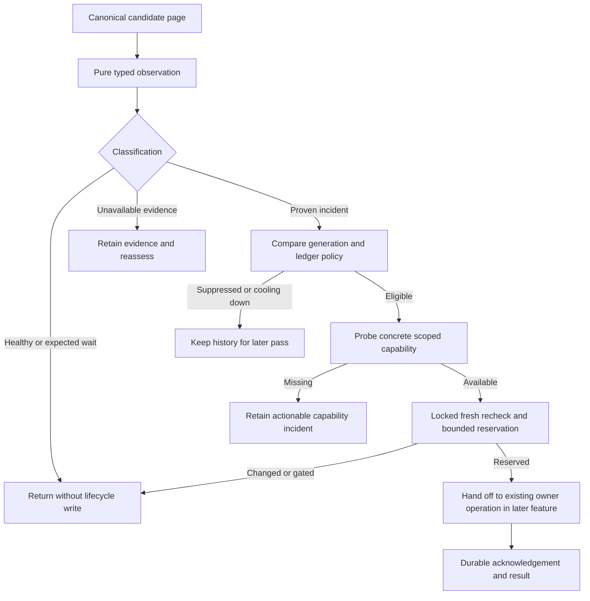

# Define canonical audit observations, incidents, and recovery authority

## Parent Epic

epic_013

## Scope

## Outcome
Define the shared Task/Feature/Epic health contract and generation-aware incident lifecycle on existing supervisor projections and durable recovery storage. This is the prerequisite for scheduling, repair adapters, and UI.

## Acceptance criteria
1. Read canonical board/lifecycle projections across tracking and product repositories; cover every field in epic criteria 3–6 and 21. Distinguish healthy, expected waiting, proven incident, and unavailable evidence. Human approval/comment/dependency waits are gates, not permission to advance.
2. Inspect all nonterminal work, completed work updated within seven days, and unresolved action/review/publication/cleanup references regardless of age. Use a bounded fair continuation cursor; no full completed-history rescan on every pass.
3. Extend existing recovery ledgers with typed work ID, tier, concrete accountable owner, failure class, authoritative generation, evidence, selected capability, request/acknowledgement/result, attempts, cooldown, and outcome. Do not create another lifecycle status database.
4. Fingerprints change with relevant lease, branch head, queue membership, validation/checkpoint, document revision, parent blockage, or capability changes. Only terminal success for an unchanged authoritative generation suppresses permanently. Claimed/error/refused/deferred/unsafe/no-op outcomes expire or re-evaluate; preserve history.
5. Define a named health_auditor role with an incident-scoped allowlist. Startup and per-incident checks prove registered operation, concrete owner authorization, required worktree/action reachability, and durable result path. Missing capability is an actionable incident retained for later retry.
6. Establish observation-versus-mutation interfaces: locked fresh preconditions, typed identity checks (Feature ID must never be parent_rev), bounded reservations, canonical lock ordering, and safe rollback/replay of interrupted claims.
7. Healthy observation is read-only; no agent turn, event, notification, Git commit, document/timestamp rewrite, or success-only external API call.

## Implementation boundaries
Reuse cascade/watchdog/health.py, workspace supervisor projections, task/action_recovery.py, task/orphan_delivery.py, task/supervisor_recovery.py, review_health.py, and canonical repository resolution. Pure projections must not call mutating sweeps. Keep all existing human authority and worktree protections.

## Validation
High-signal projection/ledger integration cases for all tiers, split repositories, healthy byte-for-byte silence, generation changes, expiry after crash, distinct typed identities, missing capability, repeated observations, and old unresolved completed work. Reuse existing recovery fixtures. No model or forge access is needed to validate observations.

## Out of scope
Scheduling, new generic status storage, repair execution, UI redesign, or external software installation. Epic criteria 3–8, 10–13, 19–21, 23–24 define the shared contract.

## Data structures

- **Typed identity.** A work reference is `(tier, work_id)`, validated against the canonical ID prefix and board metadata. Keep `parent_work_id`, document revision, action ID, branch name, commit SHA, and incident generation in separate fields/types; none substitutes for another. In particular, a Task's `parent_rev` is never a Feature ID.
- **Observation.** A value-only record carries the typed work reference, canonical status and owner, classification (`healthy`, `expected_wait`, `incident`, or `unavailable`), stable reason/failure class, evidence references with their source and revision, and the relevant generation fingerprint. Missing or contradictory evidence yields `unavailable` or a specific incident; human approval, comment, and dependency waits remain explicit gates. Repeated no-progress evidence or an expired canonical deadline is required before a stall becomes an incident.
- **Candidate continuation.** Inventory returns a bounded page and an opaque continuation cursor across all tiers. The eligible set is every nonterminal item, completed items updated in the last seven days, and any item named by unresolved action, review, publication, reconciliation, or cleanup state regardless of age. The cursor is stable across restarts and admits newly eligible items without a completed-history rescan on each pass. This feature defines the selection contract; the scheduler persists the compact cursor in its untracked supervisor receipt.
- **Incident record.** Extend the existing action, orphan-delivery, and remediation/recovery ledgers with typed work reference, concrete accountable owner, failure class, authoritative generation, evidence, selected capability, request/acknowledgement/result, attempt history, finite retry policy, next reassessment, and outcome. Preserve prior rows. Identity is derived from work ID, failure class, and relevant generation; a changed authoritative input produces a new generation. Only terminal success for the same generation suppresses permanently.
- **Capability descriptor.** Registry entries specify operation name, allowed failure classes and tier, concrete owner authorization, required worktree/action/evidence, lock and recheck protocol, finite attempt policy, and durable result path. Availability is checked at startup and again for the selected incident. A failed probe creates or retains a precise capability incident with a later reassessment.

## API contracts

1. `observe(work_ref, canonical_sources) -> Observation` reads board, execution, queue, action, review, and registered product-worktree projections without mutation. It must never call the current mutating supervisor sweep. Tracking repository resolution supplies lifecycle truth; registered product worktrees supply Git facts. Healthy observation emits no event, model turn, notification, Git write, document rewrite, or success-only external call.
2. `select_candidates(cursor, budget) -> (work_refs, next_cursor)` yields fair pages without changing board state. The coordinator in `feat_013_002` applies the epic's 100-item/60-second pass limits and persists the returned cursor; this feature does not start a scheduler.
3. `project_incident(observation, ledger) -> eligibility` compares the authoritative generation and retry policy. Claimed, error, refused, deferred, unsafe, and no-op rows have bounded expiry or reassessment. Capability or relevant lifecycle-input changes invalidate prior suppression. Old unresolved references remain eligible.
4. `probe_capability(incident, concrete_owner) -> available | missing(reason, resume_action)` verifies registration, scoped authorization, action/worktree reachability, and a durable request/acknowledgement/result path. The named `health_auditor` role receives an incident-scoped allowlist; ownership and human gates remain enforced by the existing lifecycle operation.
5. `reserve_after_recheck(incident, capability) -> reservation | stale | gated | unavailable` acquires the owning lifecycle lock in canonical order, rereads authority and evidence, compares the generation, and atomically records a bounded claim in the existing recovery store. A stale or gated recheck causes no repair. Release broad locks before Git, provider, network, or validation work; the owning adapter repeats relevant head/evidence checks before publication. Claim leases expire so interrupted work can be safely reassessed without duplicate effects.
6. `record_result(reservation, acknowledgement, result)` appends the durable outcome and next retry time against the same incident/generation. This is an interface for later repair adapters, not repair execution in this feature. Never clear unrelated blockers or erase earlier attempts.

## Logic flow

## Task breakdown

| Task | Result | Depends on |
| --- | --- | --- |
| `task_013_001_001` | Typed identities and pure all-tier observation contract | None |
| `task_013_001_002` | Bounded candidate inventory and fair continuation | `task_013_001_001` |
| `task_013_001_003` | Generation-aware existing recovery ledgers | `task_013_001_001` |
| `task_013_001_004` | Scoped auditor role and executable capability probes | `task_013_001_001`, `task_013_001_003` |
| `task_013_001_005` | Locked fresh recheck and crash-safe reservations | `task_013_001_003`, `task_013_001_004` |
| `task_013_001_006` | Cross-tier integration proof and handoff contract | `task_013_001_002`–`task_013_001_005` |

## Risks & upward questions

None.

## Decision log

None yet.

- `dec_001` · 2026-11-08 · Feature Lead · **Shared observation and incident contract**
  Chose Use pure typed all-tier observations and a returned fair continuation cursor; extend existing recovery ledgers for generation-aware incidents and bounded claims..
  Rationale: This keeps lifecycle truth in canonical board and recovery stores, makes healthy inspection silent, and allows the later scheduler and repair adapters to share one explicit handoff without adding a parallel status database.
  Honors: Feature acceptance criteria 1–7; epic_013 criteria 3–8, 10–13, 19–21, 23–24 and the approved cross-module constraints..

## Closeout

Completed child work: `task_013_001_001` (Define typed audit identities and pure observation contract), `task_013_001_002` (Select audit candidates with bounded fair continuation), `task_013_001_003` (Make existing recovery ledgers generation-aware), `task_013_001_004` (Register scoped health auditor authority and executable capability checks), `task_013_001_005` (Define locked fresh-recheck and crash-safe reservation interfaces), `task_013_001_006` (Verify all-tier audit foundations through integration fixtures).
