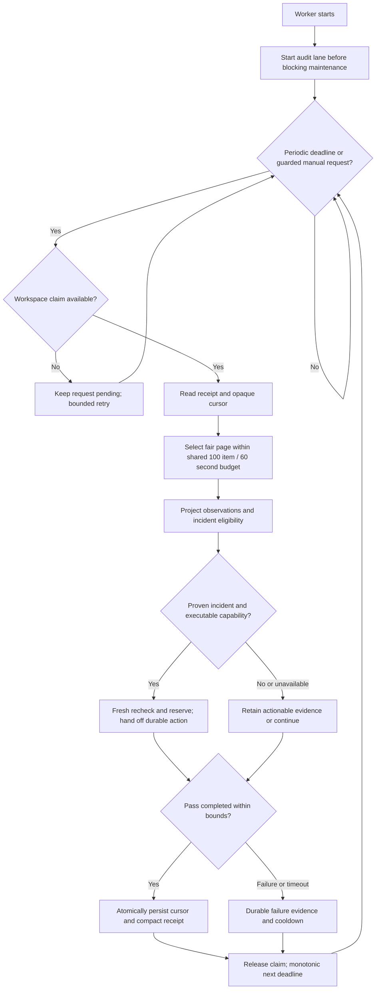

# Run bounded health audits in an independent supervisor lane

## Parent Epic

epic_013

## Outcome

Schedule the shared audit independently of watchdog advancement and review polling, with one audit per canonical workspace and restart-safe, coalesced execution.

## Acceptance criteria
1. Parse [automation.health_audit] enabled (boolean, default true) and interval (default "30m"). Accept positive integer duration strings with s/m/h/d units; bounds are 1m through 24h inclusive. Reject malformed, fractional, zero, negative, and out-of-range values explicitly without bringing down unrelated delivery.
2. Missing new config preserves existing configuration behavior and supplies the specified audit defaults. The new enabled flag controls health audits independently of automation.enabled and the legacy supervisor-health cadence; document how legacy maintenance and audits converge through the same repair claims.
3. Supervisor-owned lane starts before blocking maintenance and is independent of fetch/review/model execution. Monotonic deadlines, nonnegative jitter capped at min(5% of interval, 60s), and a cross-process workspace claim prevent overlap. Restart restores last-run scheduling and coalesces overdue periods into one pass; backward/forward wall-clock jumps do not produce storms.
4. Bound a pass to 100 work items and 60 seconds of observer/coordinator work, with fair continuation so no tier starves. Bound every subprocess/network operation on this path with explicit timeout and cancellation. Long repair/model work uses existing supervised workers and durable actions outside the scheduler and global locks.
5. Scheduled, manual, and concurrent-parent recovery paths share incident claims and lifecycle preconditions. Manual requests coalesce with an in-flight audit and leave the periodic deadline unchanged. Disabled scheduled audits create no periodic work; an explicit guarded manual run remains available.
6. Persist only a small untracked supervisor audit receipt/cursor per completed pass (last/next time, duration, counts and schedule recovery data). This is the documented low-cost observability exception: it cannot trigger board watchers, dispatch, notifications, Git, or provider work.
7. Failures/timeouts produce durable actionable auditor evidence and retry/cooldown without blocking unrelated delivery. A skipped overdue pass is not reported as completed.

## Validation
Use controllable clocks and real isolated workspace coordination for restart, clock jumps, jitter bounds, duplicate/manual requests, slow and timed-out I/O, disabled/invalid configuration, and cross-process overlap. Prove audit progress while the ordinary maintenance chain is deliberately blocked and no catch-up storm after restart. Assert bounded continuation covers more than one pass.

## Scope
Epic criteria 1–3, 7–8, 12, 14–15, 18. Production default activation is released only with the final acceptance feature; this feature supplies the implementation and integration seam without waiving required repair coverage.

## Data structures

- `HealthAuditConfig` is independent of `AutomationConfig.enabled`: `enabled: bool = true`, `interval_seconds: int = 1800`. Accept only a whole positive integer immediately followed by `s`, `m`, `h`, or `d`, yielding 60–86,400 seconds. Invalid audit settings produce an explicit audit configuration error while unrelated supervisor delivery remains available.
- One supervisor coordinator per canonical workspace holds a monotonic periodic deadline, an in-flight/manual coalescing signal, a cancellation signal, and a bounded retry deadline. A nonblocking cross-process workspace claim serializes the entire pass; its key is the canonical workspace identity, never a child worktree.
- One compact untracked receipt stores the opaque `CandidatePage.next_cursor`, last completed and next scheduled UTC times, interval used for restart recovery, pass duration, and counts. It lives outside watched board/queue inputs. A partial but successfully bounded page is a completed pass; an exception, timeout, or busy claim is not. Persist cursor and receipt atomically after completion. Active failures use existing durable incident/action evidence.
- Reuse `CandidateBudget`, `AuditCandidate`, `AuditObservation`, generation-aware incident eligibility, `CapabilityDescriptor`, and `IncidentReservation` from the completed audit foundation. Do not create a parallel work identity, lifecycle status, or repair ledger.

## API contracts

1. Read audit settings separately from ordinary automation parsing. Missing `[automation]` retains existing ordinary automation behavior while audit settings take their own defaults. `automation.health_audit.enabled = false` disables periodic admission; a guarded manual request remains available. Legacy `[supervisor_health].sweep_seconds` remains independent.
2. Start the lane before `repair_registered_worktrees`, startup reconciliation, or another potentially blocking maintenance chain. The lane uses the worker's existing shutdown signal and is drained on stop. Its exceptions cannot stop HTTP, watchdog delivery, or review polling. No external daemon or dispatch queue is introduced.
3. Scheduled and guarded manual requests enter the same coordinator. A manual request can claim an idle lane while scheduling is disabled. Concurrent requests coalesce with the active pass and never rewrite the periodic deadline. A busy workspace claim leaves overdue work pending for bounded retry and records no completed receipt.
4. A pass calls `select_audit_candidates(cursor, CandidateBudget(max_items<=100, max_seconds<=remaining), root=canonical_workspace)` and `project_audit_observation(work_id, root=...)`. Selection, observation, and coordination share one monotonic 60-second budget and at most 100 work items. Keep the selector's cursor opaque for fair tier rotation. Every subprocess/network operation has a timeout no greater than the remaining budget and a cancellation path.
5. Proven incidents flow through `project_incident`, `probe_capability`, and `reserve_after_recheck`. Existing supervised owner workers perform long repair after broad locks are released; `record_result` closes the exact claim token. Scheduled, manual, legacy maintenance, and parent recovery converge on the same incident generation and reservation preconditions. Missing capability and timed-out evidence remain actionable with finite retry/cooldown.
6. The coordinator returns counts and explicit failure/skip reasons for operator projection. Healthy passes have no board, queue, event, notification, Git, provider, or model side effect beyond the compact untracked receipt. A skipped or failed pass is never displayed as completed.

## Logic flow

Restart reconstructs one deadline from the receipt's next UTC time and current wall clock, clamps the reconstructed wait to [0, interval], then uses only monotonic time. An overdue interval admits one pass. Forward or backward wall-clock jumps cannot create a catch-up loop or indefinite postponement. Nonnegative jitter is at most `min(interval * 0.05, 60 seconds)`. Manual runs do not change the saved or in-memory periodic deadline.

## Task breakdown
1. task_013_002_001 — parse the independent audit configuration and document defaults.
2. task_013_002_002 — start the independent, restart-safe supervisor lane and persist its receipt.
3. task_013_002_003 — run fair, bounded observation passes with finite I/O and durable failure evidence.
4. task_013_002_004 — coalesce manual requests and share incident claims with other recovery paths.
5. task_013_002_005 — validate timing, overlap, continuation, and isolation in an integration workspace.

## Risks & upward questions

None.

## Decision log

- `dec_001` · 2026-11-08 · Feature Architect · **Independent audit lane and handoff contract**
  Chose Start a supervisor-owned lane before blocking workspace recovery and reconciliation; serialize passes with a canonical-workspace claim, persist only an atomic compact receipt after a completed bounded pass, and route incidents through the existing generation-aware reservation contract.
  Rationale: The current worker runs workspace recovery before watchdog startup, and watchdog startup reconciles completion before polling. The audit candidate selector already provides an opaque fair cursor, while reservation already provides locked fresh rechecks. This arrangement gives the audit its own scheduling progress without creating another lifecycle owner or dispatch database.
  Honors: Feature criteria 2–7 and epic criteria 1–3, 7–8, 12, 14–15, 18; preserves the 100-item/60-second bound, finite I/O, manual coalescing, restart safety, and existing repair authority.

- `dec_002` · 2026-11-08 · Feature Lead · **Candidate timeout continuation and evidence**
  Chose Treat an individual observation Git timeout as unavailable evidence, advance that candidate's opaque selector continuation, and retain its work ID in the existing untracked auditor failure evidence while the completed bounded pass writes its compact receipt..
  Rationale: A repeatedly slow first candidate otherwise pins the cursor and starves later tiers. Advancing the exact candidate position preserves fair rotation and retries the candidate on a later cycle without classifying it healthy or recovered. Whole-pass discovery, cancellation, and observer failures remain distinct and do not commit a completed receipt.
  Honors: Feature criteria 4, 6, and 7; bounded 100-item/60-second passes, fair continuation, actionable timeout evidence, and healthy read-only semantics..

## Closeout

Completed child work: `task_013_002_001` (Parse health-audit configuration independently of automation), `task_013_002_002` (Start a restart-safe independent supervisor audit lane), `task_013_002_003` (Execute fair bounded audit passes with finite I/O), `task_013_002_004` (Unify manual and scheduled audit recovery through incident claims), `task_013_002_005` (Validate audit lane behavior in an isolated workspace).

## Integrated validation

- Integrated the published Epic base `6f6b77948b12e1e5ba1329fba4f776ca9f3d56cd` at Feature commit `74e50350` after all five Tasks merged. The worktree was clean before and after validation.
- On that committed product revision, `python -m pytest -q tests/watchdog/test_audit.py tests/watchdog/test_audit_candidates.py tests/watchdog/test_audit_lane.py tests/watchdog/test_audit_protected_waits.py tests/watchdog/test_audit_recovery.py tests/watchdog/test_audit_admission_cleanup.py tests/watchdog/test_reservations.py tests/war_room/test_health_audit_routes.py tests/workspace/test_worker_startup_recovery.py tests/feature/test_delivery_yield_guidance.py tests/task/test_delivery_blocker_validation.py tests/task/test_post_validation_edits.py` passed: 124 tests in 215.66 seconds.
- Ruff passed for the changed audit, reservation, route, worker, and imported framework files. The integrated regression suite covers the late Task 004 admission and manual-route findings, including claim handoff, split tracking authority, Git descendant cleanup, and stopped-lane rejection.
- Production periodic default activation remains gated to `feat_013_005` after its all-tier recovery acceptance.
