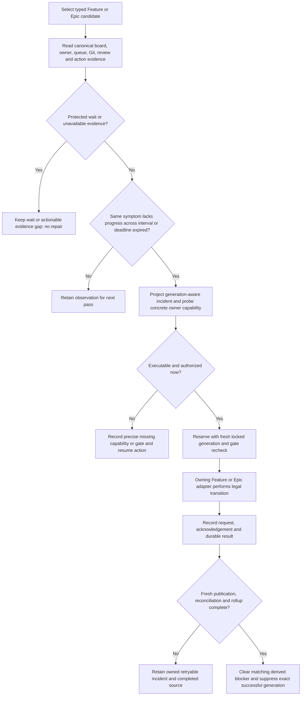

# Recover stalled Feature and Epic owners and publication lifecycles

## Parent Epic

epic_013

## Scope

Epic criteria 5–6, 8–13, 17, 19–24. Extend the existing audit and owning lifecycle paths to Feature and Epic recovery. Task recovery supplies the shared executable-adapter pattern. The War Room and default-on release gate belong to Feature 005.

## Outcome

A proven stalled Feature or Epic is resumed by its concrete owning team, and its owned integration work reaches review publication, reconciliation, and terminal rollup exactly once. Protected waits remain intact.

## Acceptance criteria

1. Detect active Features/Epics without a live planning owner or pending input; dispatchable children with no progress; completed local integration work lacking review publication; stale parent inputs, graph inconsistencies, approval/comment/dependency gates, and return/cancellation or trunk/integration discrepancies. Pending review or expected human wait alone is not a stalled-work incident.
2. Prove lack of progress from repeated authoritative observations across at least one configured interval or an existing canonical expired lease/action deadline. Do not reclaim a live owner or use document age alone as proof.
3. Supply concrete Feature-parent and Epic-parent adapters for safe owner resume/wakeup, authorized dispatch restoration, durable review/publication retry, idempotent reconciliation and completion rollup. Reuse team supervision, review_health, team_review_recovery, team_branch_recovery, stacked-review recovery, completion reconciliation and existing authorization.
4. Each capability is checked at startup and per incident for registration, concrete owner/worktree/action reachability and request/acknowledgement/result. A sent event without an executable mutation/result path cannot count as recovered.
5. Preserve plan and feature approval, sign-offs, comment gates, stale revision admission, dependency readiness, cancellation intent, dirty worktrees and ambiguous conflicts. Retry only safe existing transitions. No inferred human decision.
6. Route Task incidents first to Feature, Feature to Epic, and Epic/system to human/Boss as appropriate, recording evidence, responsible work ID and exact resume action. Dedupe unchanged incidents/notifications, re-evaluate changed generations, and clear only matching derived blockers.
7. Unknown mergeability, missing worktrees, fetch/admission/validation/publication failures remain owned and retryable or actionable. Retain completed work until pending review/cleanup/rollup is reconciled, regardless of the seven-day completion window.

## Validation

Real isolated-repository Feature and Epic recovery flows must reach owned-branch publication and terminal reconciliation exactly once, crossing registered adapters rather than mocked callbacks. Cover absent/completed owners, pending input/review, live slow planning, approval/comment gates, split repository roots, restart after acknowledgement, sibling blockers, concurrent manual recovery, cancellation/return state, and stale generation recovery. Reuse Epic 042 review and completion tests.

## Data structures

- Extend the existing typed `AuditObservation`/`AuditEvidence` and `AuditIncidentIdentity`. Keep `FeatureId`/`EpicId`, document revision, Git head, branch and audit generation distinct. Parent evidence records canonical tracking and product roots, owner/queue or lease state, direct-child status and execution, approval/comment/dependency gates, registered worktree and dirty state, review/publication and unresolved action identities. Missing or contradictory evidence is explicit `unavailable_evidence`, never healthy.
- A no-progress proof binds the same actionable symptom and authoritative generation to two observations separated by at least one configured interval, unless a canonical owner lease or durable action deadline has expired. Changes to queue input, owner/lease, child state, document revision, branch head, review/action state, gate or capability invalidate the prior proof. A live owner and an open human or review wait remain protected.
- Reuse the existing generation-aware incident contract and action/orphan/remediation ledgers: typed responsible work ID, accountable owner, failure class, exact action or review identity, request, acknowledgement, result, attempt/cooldown, and resume action. An acknowledgement is pending until a durable result and fresh reconciliation prove the effect. No second incident database or publication queue.

## API contracts

- Read-only admission uses `select_audit_candidates` and `project_audit_observation`; `project_incident` applies same-generation cooldown. `probe_capability` checks registered callable, concrete owner, worktree/action and result-store reachability at startup and per incident. `reserve_after_recheck` locks and rechecks the current generation before an adapter runs; `record_result` finishes the exact claim. Never pass a parent revision or Git ref as a work ID.
- Feature adapter: target `feature_team:<feature_id>` for Feature-owned planning, Task dispatch, publication and rollup. Reuse legal graph wakeup, `supervise_child`/`recover_task` for direct Tasks, owned `retry_integration_branch_update`, `publish_review_resolution`, `review_health`, and existing completion reconciliation. The adapter must return a durable action/result identity and the state reached; a queued message alone is pending. Execute Git/review actions only in the registered product worktree while board gates come from the tracking root.
- Epic adapter: target `epic_team:<epic_id>` for Epic-owned planning, Feature dispatch, publication and closeout. Reuse legal graph wakeup, direct-child supervision, owned branch/review retry, stacked-review recovery and completion reconciliation. Retain the original action ID and admission/approval provenance. A Feature symptom routes upward to its Epic only when the Feature team cannot complete its owned transition; Epic/system gaps name a precise Boss/human resume action.
- On every retry, reread gates and original action preconditions under the existing lifecycle/claim protocol, then release broad locks before slow work. Respect owner liveness, worktree cleanliness, cancellation/return intent, review state and concurrent manual recovery. Record an owned retryable failure for unknown mergeability, missing worktree, fetch, admission, validation or publication error; clear only a matching derived blocker after the exact result reconciles.

## Logic flow

## Task breakdown

1. `task_013_004_001` — Project parent-tier owner/queue, child, review and Git evidence; prove unchanged no-progress or expired canonical deadline while protecting live owners and gates. Deliver failure class, responsible ID, generation and candidate action.
2. `task_013_004_002` — Bind Feature symptoms to real Feature-team wake/dispatch, Task supervision, owned review/branch retry and completion rollup; preserve authorization and result identity. Depends on 001.
3. `task_013_004_003` — Bind Epic symptoms to real Epic-team wake/Feature dispatch, owned review/branch/stacked-review retry and closeout; preserve authorization and result identity. Depends on 001.
4. `task_013_004_004` — Register/probe both parent adapters; route escalation, dedupe incident receipts and notifications, re-evaluate changed generations and reconcile only matching blockers. Depends on 001–003.
5. `task_013_004_005` — Exercise the registered path in isolated repositories through owned publication and terminal reconciliation exactly once, including restart/manual races and protected waits. Depends on 002–004.

## Risks & upward questions

The current registry exposes only Task delivery/retry and integration-branch actions; parent owner wake, publication and rollup must be registered as concrete operations by Tasks 002–004. Missing authority or unreachable worktree remains an explicit incident with an exact owner/resume action. No epic contract change is requested.

## Decision log

See the canonical decision ledger for this Feature.

- `dec_001` · 2026-11-08 · Feature Architect · **Feature 004 recovery contract**
  Chose Use the existing typed audit observation, generation-aware incident receipts, and owning Feature/Epic lifecycle operations for parent recovery; require repeat no-progress proof or an expired canonical deadline before owner repair, and treat acknowledgement as pending until durable publication and reconciliation results exist..
  Rationale: This preserves Epic 013's approved authority and safety gates, avoids a second dispatch/review subsystem, and makes executable end-to-end recovery testable through concrete owner paths.
  Honors: Epic 013 criteria 5–6, 8–13, 17, 19–24; Feature 004 acceptance criteria 1–7.

## Closeout

Completed child work: `task_013_004_001` (Prove stalled Feature and Epic work from authoritative observations), `task_013_004_002` (Recover Feature owners, dispatch, publication, and rollup through concrete adapters), `task_013_004_003` (Recover Epic owners, Feature dispatch, publication, and rollup through concrete adapters), `task_013_004_004` (Wire parent recovery capabilities, escalation, and incident lifecycle), `task_013_004_005` (Validate end-to-end Feature and Epic recovery in isolated repositories).
