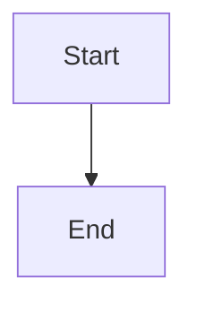

# Self-relaunching supervisor: launcher owns lock and listener, worker restarts on source change

## Parent Epic

epic_018

## Scope

## Intent

Split `cascade up` into a small long-lived **launcher** and a replaceable **worker**. The launcher acquires `.cascade/supervisor.lock`, binds the War Room listening socket once, and spawns the worker (`python -m cascade.workspace.worker`) with the socket fd inherited. When the worker detects a Cascade source change it exits with the update exit code (75); the launcher sweeps the worker's process group and any stale git locks, then spawns a fresh worker on the same socket. Clients queue in the socket backlog during the gap instead of getting connection refused.

## Acceptance

- Editing a `cascade/**/*.py` file while `cascade up` runs results in a new worker PID serving on the same host:port with no manual action; the launcher PID and lock holder are unchanged.
- A connection attempted during the restart gap succeeds (queued in backlog) rather than being refused.
- Worker runs in its own process group; after any worker exit, the launcher kills the group so no agent CLI subprocess (or its stdio MCP tool server) survives its worker.
- **Stale git-lock sweep (epic dec_007):** after the group is gone, the launcher removes any `.git/index.lock` under Cascade-managed worktrees (`.cascade/worktrees/*`) and logs one line per removal; these are stale by construction because the launcher holds the supervisor lock. A leftover `index.lock` in the product trunk is never removed, only logged as a warning (a human may be running git there); feature 3 surfaces it in status diagnostics.
- Worker reports readiness to the launcher over an inherited pipe after the server is constructed and resume is scheduled.
- SIGINT/SIGTERM to the launcher forwards an operator stop to the worker, waits, and exits 0 without relaunching. Worker exit 0 = stop; 75 = update restart; other = crash (restarted; bounded backoff is owned by the failure-containment feature, a fixed 1s delay is fine here).
- The worker refuses to start without the launcher handshake (inherited fd + lock token env), preserving the single-supervisor invariant; `prepare_up` trunk validation still runs in the launcher before binding.
- The launcher loop is stdlib-only and does not import changing Cascade modules after start.
- One integration test: start `cascade up` in a subprocess against a temp workspace, touch a source file in a copied package, assert the listener stays connectable and a new worker PID answers. The same test plants a `.git/index.lock` in a Cascade worktree before the touch and asserts it is gone after relaunch. No separate unit-test matrix for the sweep.

## Out of scope

Draining in-flight work (feature 2), preflight/backoff/degraded mode/health UI (feature 3).

## Data structures

TBD.

## API contracts

TBD.

## Logic flow

## Task breakdown

In dependency order:

1. `task_018_001_001` — Worker entrypoint, launcher handshake, readiness pipe, exit code 75. Depends on: none. (completed; includes the worker-side `listen_socket` parameter on `WarRoomHTTPServer`/`serve` in `cascade/war_room/server.py`.)
2. `task_018_001_002` — Launcher: supervisor lock, single listener, worker in own process group, group kill, relaunch policy, empty post-exit hook. Depends on: 001. (completed; title still mentions the git lock sweep.)
3. `task_018_001_003` — Single integration test (same-listener relaunch + planted worktree `index.lock` removed). Depends on: 002. (completed, merge `f3f488b`. It also shipped `sweep_stale_git_locks` in `cascade/workspace/launcher.py`, wired into `post_worker_exit` on every exit path; accepted per dec_009. Test passes on `feat/feat_018_001`.)
4. `task_018_001_004` — Stale git lock sweep. Depends on: 002. (active; per dec_009 reduced to: rebase onto `feat/feat_018_001`, confirm the merged sweep against epic dec_007, then close with no code change or fix only a concrete gap. Must not add a second sweep. Architect review of the merged code found no behavioural gap: all three `post_worker_exit` call sites (stop during readiness, readiness failure, normal exit) run after `_kill_worker_group`, and the module imports only stdlib. The only acceptable edit is cosmetic, e.g. the `post_worker_exit` docstring that still says the sweep lives in task_018_001_004.)

## Risks & upward questions

- **Duplicate sweep from task_018_001_004:** it was started before the sweep landed via 003 and its body still asks it to write the sweep. Active tasks cannot be revised. Reviewers of 004 must reject any change that adds a second sweep function or a second call site; an empty or near-empty diff is the expected outcome. If 004 stalls or blocks, revise it to the dec_009 scope rather than retrying it as written.
- **Merge gate bypassed:** dec_008's rule that 003 merges only after 004 was not enforced by the board. The outcome is acceptable (dec_009), but the board has no merge-ordering gate between sibling tasks; worth raising if it recurs.
- **Resolved — task 1's `server.py` edit:** the ~30 lines are worker-side (accept on the inherited `listen_socket`, loopback check on the bound address) and belong with the worker handshake. No later task touched `cascade/war_room/server.py`, so the launcher builds on it without duplication.

## Decision log

- `dec_001` · 2026-10-23 · Feature Lead · **Task breakdown**
  Chose Split the stale git lock sweep out of task_018_001_002 into task_018_001_004, which depends on the launcher and fills a post-exit hook stub. The launcher keeps the lock, listener, process-group kill and relaunch policy. task_018_001_003 must also wait for task_018_001_004..
  Rationale: task_018_001_002 failed twice with stalled provider turns. Splitting the separable sweep shrinks the turn without changing feature scope or acceptance criteria.
  Honors: epic dec_007 (worktree index.lock removed, trunk lock warn-only); feature acceptance criteria unchanged.

- `dec_008` · 2026-10-23 · Feature Lead · **Task breakdown**
  Chose task_018_001_003 and task_018_001_004 run in parallel now that the board activated both. task_018_001_003 writes the integration test with an unconditional planted index.lock assertion and must not implement the sweep itself. task_018_001_003 does not merge until task_018_001_004 has merged and the test passes on feat/feat_018_001 with both changes..
  Rationale: The board activated task_018_001_003 when the launcher merged, and active tasks cannot be revised or paused. Running both in parallel costs nothing, because the test only fails on the index.lock check until the sweep lands. Gating the merge rather than the start keeps the test honest and stops the two tasks from writing the sweep twice.
  Honors: dec_001 (sweep lives only in task_018_001_004); epic dec_007; feature acceptance criterion for one integration test covering relaunch and index.lock removal..

- `dec_009` · 2026-10-23 · Feature Architect · **Task breakdown**
  Chose Accept the stale git lock sweep that merged with task_018_001_003 (merge f3f488b, sweep_stale_git_locks in cascade/workspace/launcher.py, called from post_worker_exit on every exit path including shutdown) as the feature's sweep. Do not revert it. task_018_001_004 must not add a second sweep: its remaining work is to rebase onto feat/feat_018_001, confirm the merged sweep against epic dec_007, and either close with no code change or fix only a concrete gap it finds..
  Rationale: task_018_001_003 merged before task_018_001_004, against dec_008, and implemented the sweep itself. The merged code removes worktree index.lock files (both .git directories and gitdir files), logs one line per removal, only warns on the trunk lock, and the integration test passes on the feature branch (1 passed, 12s). Reverting and rewriting identical behaviour in 004 costs a task turn and risks merge conflicts for no user value. This supersedes the 003-must-not-sweep rule in dec_008.
  Honors: epic dec_007 (worktree index.lock removed, trunk lock warn-only); feature acceptance criteria unchanged; replaces the sweep-ownership part of dec_001 and dec_008..

## Closeout

Completed child work: `task_018_001_001` (Worker entrypoint: cascade.workspace.worker with launcher handshake, readiness pipe, and update exit code), `task_018_001_002` (Launcher: cascade up owns lock and listener, spawns worker in own process group, sweeps group and stale git locks, relaunches), `task_018_001_003` (Integration test: source edit relaunches worker on same listener and sweeps stale worktree index.lock), `task_018_001_004` (Stale git lock sweep after worker exit: remove worktree index.lock, warn-only on trunk).
