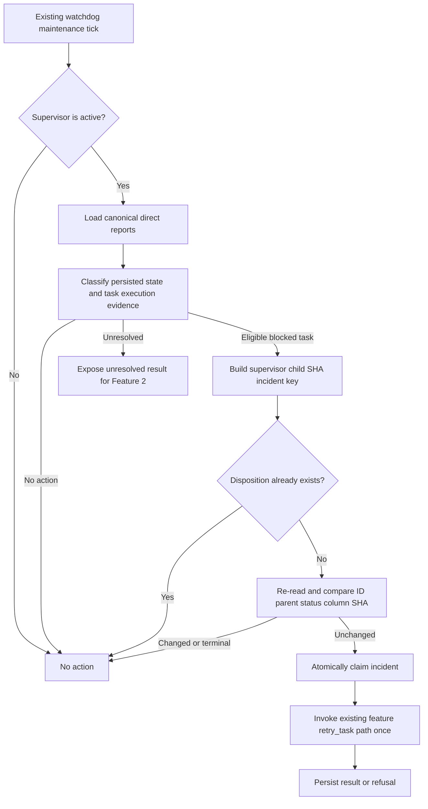

# Supervisor health observation and bounded remediation

## Parent Epic

epic_022

## Scope

## Objective

Integrate periodic direct-report health inspection into the existing supervisor lifecycle and make one bounded, role-authorized recovery attempt per unchanged child incident.

## Required outcomes

- Use the canonical work hierarchy and persisted status model.
- Classify reports into no-action, remediation-eligible, or unresolved outcomes using existing status names and transition rules.
- Exclude terminal reports and supervisors.
- Make cadence configurable through the existing runtime configuration pattern.
- Prevent duplicate recovery actions across repeated or concurrent sweeps by keying attempts to child identity and observed state/version.
- Resolve the epic’s implementation-discovery questions about canonical states, legal transitions, and safe recovery primitives before coding mutations.

## Discovered implementation contract

### Canonical hierarchy and states

Direct reports come from the persisted `WorkMeta.children` relationship, resolved through the merged canonical board view. The only work statuses are:

- Open: `backlog`, `ready_to_plan`
- In progress: `active`, `blocked`, `cancelling`
- Terminal: `completed`, `cancelled`

The monitor must inspect direct children only. A supervisor is eligible to sweep only while `active`; `completed`, `cancelled`, and `cancelling` supervisors must never initiate remediation. Terminal children (`completed`, `cancelled`) are always no-action and must never be reopened.

Task operational health is already projected by `cascade.task.execution.execution_view(s)` from the durable execution sidecar. Its health values are `queued`, `healthy`, `stale`, `awaiting_merge`, `merge_blocked`, `succeeded`, and `failed`. This is supporting operational evidence; board status remains lifecycle truth.

### Classification

| Persisted child state | Operational evidence | Classification | Feature 1 action |
|---|---|---|---|
| `completed`, `cancelled` | any | no-action | none |
| `cancelling` | any | no-action | allow canonical cancellation cleanup to finish |
| `backlog`, `ready_to_plan` | any | no-action | normal approval/dependency dispatch remains authoritative |
| `active` | absent, queued, healthy, awaiting merge | no-action | none |
| `active` task | stale | no-action here | existing stale-lease and in-flight-turn watchdogs own recovery |
| `active` task | merge blocked | unresolved | no automatic retry; merge recovery requires its existing path/operator context |
| `blocked` task owned by an active feature | terminal failed or compatible failure evidence | remediation-eligible | one `retry_task` attempt |
| `blocked` feature owned by an active epic | any | unresolved | no automatic action exists for this role/state |
| Any inconsistent, unreadable, newer, or unrecognized snapshot | any | unresolved | report through existing error/observability path; do not mutate |

Feature 1 observes unresolved cases but does not block the supervisor; propagation and provenance-aware reconciliation belong to dependent Feature 2.

### Legal transitions and recovery authority

The existing dispatch law allows tasks in `backlog` or `ready_to_plan`, and a `blocked` task located in `2_active`, to transition to `active` through `dispatch_task`. The feature-scoped `retry_task` wrapper verifies that the child is an owned task and currently `blocked`, then delegates to `dispatch_task(..., by="boss")`, preserving dependency, capacity, comment, ownership, worktree, event, and kickoff gates. This is the sole automatic remediation primitive for Feature 1.

There is no corresponding epic-scoped retry for a blocked feature, and `dispatch_feature` accepts only `backlog` or `ready_to_plan`. Therefore blocked features are unresolved, not remediation-eligible. The monitor must not call raw persistence, rewrite statuses, bypass dispatch gates, synthesize messages, reassign work, or duplicate existing stale-turn recovery.

A dispatch refusal such as `unmet_deps`, `cap`, `parent_cancellation_pending`, a comment gate, `bad_state`, or any exception is a completed bounded attempt for that unchanged incident, not permission to loop immediately. A successful call means the canonical dispatch accepted the transition; later sweeps re-read persisted state.

### Incident identity and race safety

Use `(supervisor_id, child_id, observed_child_sha)` as the minimum incident key. The document SHA is the canonical optimistic version for lifecycle status and plan content. For task failures, include the execution `attempt`, `phase`, and `outcome` in the stored observation/diagnostic when present, but do not substitute heartbeat age as incident identity.

Claim/check the incident and invoke the recovery while holding the existing process-level synchronization boundary, or provide an equivalent atomic compare-and-record operation. Re-read the child immediately before acting and require the same ID, parent, status, path column, and SHA. If the child changed or became terminal, classify the attempt as superseded/no-action. Persist one compact remediation disposition per incident key so repeated or concurrent sweeps cannot invoke recovery twice. A changed SHA establishes a new incident and may receive one new attempt.

The disposition is coordination metadata, not a second lifecycle model. It records only incident key, observation time, action, and result/reason; status remains authoritative in the work document and task operational health remains authoritative in the existing execution sidecar.

### Cadence and lifecycle integration

Add the sweep to the existing watchdog maintenance cycle, not a new scheduler or thread. Follow the existing `cascade.toml` typed-reader pattern with a positive numeric setting and conservative default. The implementation task should choose and document the final key/default alongside its tests; invalid values must fall back safely or raise consistently with the neighboring configuration contract, and the sweep must never become a busy loop.

## Data structures

- `ChildHealthObservation`: supervisor ID/status, child ID/tier/status/SHA, optional task execution attempt/phase/outcome, and classification.
- `RemediationIncidentKey`: supervisor ID, child ID, and observed child SHA.
- `RemediationDisposition`: incident key, observed time, action (`retry_task`), and result/reason.

Keep these structures small and internal. Do not add statuses or make the disposition ledger authoritative for lifecycle state.

## API contracts

- A pure classifier accepts a canonical child snapshot plus optional task execution view and returns `no_action`, `remediation_eligible`, or `unresolved` with a stable reason.
- A sweep accepts an active supervisor, enumerates only its direct reports, and revalidates every actionable snapshot before mutation.
- Remediation delegates only to the existing role-authorized `retry_task`/canonical task dispatch path and performs at most one call per incident key.
- Read, classification, persistence, and dispatch failures are surfaced through existing logging/health channels and retried only on a later scheduled sweep; they are never reported as successful recovery.
- Feature 1 exposes unresolved classifications for Feature 2 but does not mutate supervisor blocked state.

## Logic flow

## Acceptance coverage

Integration tests demonstrate healthy no-op behavior, one eligible blocked-task recovery attempt through the canonical dispatch gates, successful transition to active/queued, terminal child and terminal supervisor exclusion, blocked-feature unresolved classification, repeat/concurrent-sweep idempotency, stale active-task delegation to existing watchdog recovery, and transient failure handling. Prefer one supervisor-loop/state-store integration suite plus narrow deterministic classifier/config tests; do not duplicate lower-level dispatch coverage.

## Non-goals

No new scheduler, state taxonomy, dashboards, notification integrations, unlimited retries, raw status rewrites, automatic blocked-feature retry, or competing stale-turn recovery.

## Task breakdown

- `task_022_001_001` — Discover canonical supervisor states and safe recovery primitives.
- `task_022_001_002` — Implement periodic health observation and bounded remediation. Depends on task 001.
- `task_022_001_003` — Verify supervisor health and remediation acceptance scenarios. Depends on task 002.

## Risks & upward questions

- The repository has no safe automatic primitive for an epic supervisor to retry a blocked feature. Feature 1 must classify it unresolved; Feature 2 owns propagation. Adding such a primitive requires an explicit later scope decision.
- Attempt disposition needs durable, atomic coordination without becoming another state model. Reuse an existing durable coordination store if it cleanly supports both task and feature incidents; otherwise add only a minimal incident ledger guarded by the existing process lock.
- `WorkDoc.sha` is the canonical available lifecycle version. Implementers must ensure it is re-read from the owning merged/worktree view immediately before recovery so stale copies cannot authorize action.

## Decision log

- Use persisted work status as lifecycle truth and task execution views only as supporting operational evidence.
- Classify only owned blocked tasks as remediation-eligible; blocked features and merge-blocked tasks are unresolved because no equivalent safe automatic primitive exists.
- Delegate remediation exclusively to feature-scoped `retry_task`, which preserves canonical dispatch gates.
- Key the one-attempt guarantee by supervisor ID, child ID, and observed child document SHA, with atomic claim and compare-before-act.
- Integrate with the existing watchdog maintenance cycle and typed `cascade.toml` configuration pattern; do not add a scheduler.

- `dec_001` · 2026-10-25 · Feature Architect · **Canonical state classification**
  Chose Use persisted WorkStatus as lifecycle truth; use task execution health only as supporting operational evidence, and exclude completed, cancelled, and cancelling work from remediation..
  Rationale: The board model is the canonical persisted lifecycle, while the execution sidecar already owns task-process health. Keeping those responsibilities separate avoids a second state taxonomy and prevents terminal resurrection.
  Honors: Required canonical hierarchy/status use, terminal exclusions, and the epic constraint against a parallel health model..

- `dec_002` · 2026-10-25 · Feature Architect · **Safe recovery boundary**
  Chose Automatically remediate only an owned blocked task by invoking the existing feature-scoped retry_task path; classify blocked features, merge-blocked tasks, and stale active tasks as unresolved or delegated to their existing owners..
  Rationale: retry_task validates ownership and blocked state before using canonical dispatch gates. No equivalent blocked-feature primitive exists, and stale/merge recovery already has dedicated paths.
  Honors: Role authorization, bounded remediation, legal transitions, and the non-goal against new recovery mechanisms..

- `dec_003` · 2026-10-25 · Feature Architect · **Incident identity and concurrency**
  Chose Key remediation by supervisor ID, child ID, and observed child WorkDoc SHA; atomically claim the incident and re-read ID, parent, state, column, and SHA before acting..
  Rationale: The document SHA is the existing optimistic lifecycle version. Compare-before-act plus a durable claim prevents duplicate concurrent or repeated recovery while permitting one new attempt after a real child change.
  Honors: One attempt per unchanged incident and safety under concurrent sweeps or manual intervention..

- `dec_004` · 2026-10-25 · Feature Architect · **Lifecycle integration**
  Chose Run health observation from the existing watchdog maintenance cycle and configure cadence through the typed cascade.toml reader pattern..
  Rationale: The watchdog already owns periodic lifecycle maintenance. Reusing it avoids a scheduler/thread and keeps configuration consistent with convergence and turn-progress monitors.
  Honors: Configurable conservative cadence and the explicit no-new-scheduler constraint..

- `dec_005` · 2026-10-25 · Feature Architect · **Test strategy**
  Chose Use supervisor-loop/state-store integration coverage for core scenarios, with focused classifier/config boundary tests only where integration coverage is insufficient..
  Rationale: The risk lies at the hierarchy, persistence, locking, and dispatch boundary; one high-signal integration suite provides more confidence with less maintenance than redundant mocked units.
  Honors: Feature acceptance coverage and frugal-engineering guidance..

## Closeout

Completed child work: `task_022_001_001` (Discover canonical supervisor states and safe recovery primitives), `task_022_001_002` (Implement periodic health observation and bounded remediation), `task_022_001_003` (Verify supervisor health and remediation acceptance scenarios).
