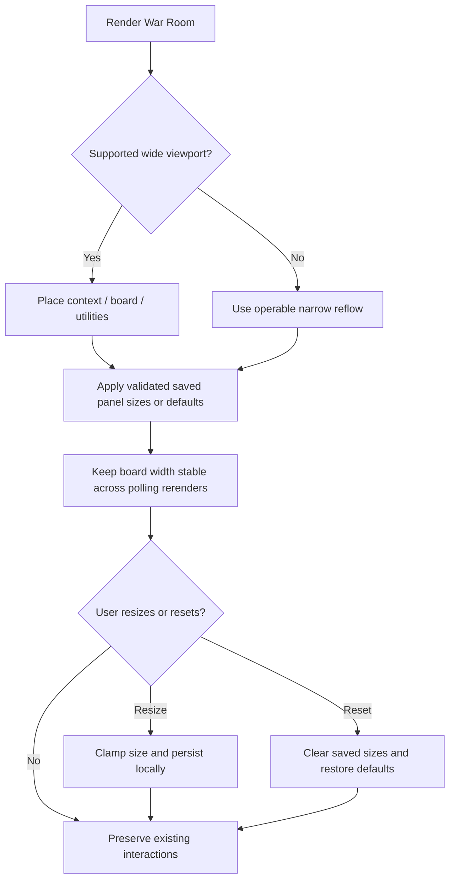

# Centered responsive War Room layout and resizable panels

## Parent Epic

epic_023

## Scope

Deliver the epic's layout success criteria: context left, board center, utilities right on wide screens; stable board width across polls; full viewport use; clamped panel resizing saved in this browser with reset; usable narrow layouts and keyboard-accessible controls. Preserve existing board actions, lens, chat, and sidebar behavior.

## Data structures

- Responsive shell state: viewport-derived layout mode plus bounded left and right panel sizes.
- Persisted preferences: browser-local panel sizes only; missing, stale, or invalid values fall back to defaults.
- No new server-side domain data or cross-device preference model.

## API contracts

- No backend API changes.
- Browser storage accepts only validated, clamped panel-size values and is cleared by reset.
- Resize controls support pointer and keyboard input and expose appropriate accessible semantics.
- Existing War Room board, lens, chat, sidebar, polling, and action contracts remain unchanged.

## Logic flow

## Task breakdown

1. **task_023_001_001 — Build the centered responsive War Room shell** (completed)
   - Establish the wide and narrow responsive layout.
   - Preserve existing behavior and verify board width stability across polling.
2. **task_023_001_002 — Add accessible panel resizing, persistence, and reset** (active; depends on completed task_023_001_001)
   - Add bounded pointer and keyboard resizing.
   - Validate browser-local persistence and provide reset-to-default behavior.

## Risks & upward questions

- Resizing must not allow side panels to make the board or controls unusable; enforced bounds and narrow-layout behavior mitigate this.
- Persisted values can outlive layout changes; validation and default fallback prevent stale data from breaking the shell.
- No upward contract change is required.

## Decision log

- `dec_001` · 2026-11-05 · Feature Lead · **Task breakdown**
  Chose to deliver the responsive shell first, then add accessible resizing, browser-local persistence, and reset in a dependent second task.
  Rationale: The shell establishes the layout and width-stability contract that resizing depends on. Keeping the interaction layer separate limits implementation risk while preserving the smallest complete feature slice.
  Honors: Feature scope, existing task dependency order, and the epic requirement to preserve current War Room behavior.

## Closeout

Completed child work: `task_023_001_001` (Build the centered responsive War Room shell), `task_023_001_002` (Add accessible panel resizing, persistence, and reset).
