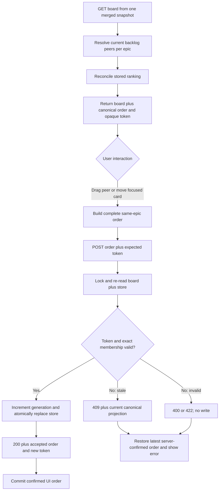

# Durable backlog feature priority

## Parent Epic

epic_023

## Scope

Deliver shared, durable ordering for backlog features within one epic. The order is presentation and queue-priority state only: it must not change dependencies, readiness, plan approval, execution caps, dispatch eligibility, or trigger dispatch.

The feature includes:

- a canonical per-epic priority store that survives supervisor restart and is shared by every client;
- reconciliation when backlog membership changes;
- a guarded War Room reorder command and projection in the existing board response;
- canonical ordering in the feature lens and any display-only backlog/dispatchable queue;
- same-epic drag/drop plus labelled focused move-up/move-down controls;
- clear recovery from stale or invalid writes without losing the last server-confirmed order.

## Acceptance criteria

- Reordering a backlog feature is limited to peers currently in the same epic's `1_backlog` feature set.
- The accepted order survives page reload and supervisor restart and is visible to a second client.
- A newly created backlog feature appears after already ranked peers. Features that leave backlog, are removed, or change epic are omitted without corrupting remaining order.
- A stale token, duplicate ID, missing peer, unknown ID, cross-epic ID, or non-backlog ID is refused atomically and leaves persisted state unchanged.
- `GET /api/board` supplies canonical order and its concurrency token without an additional request; backlog feature rendering does not re-sort by ID.
- Drag/drop, focused move controls, row actions, selection, collapsed columns, return-to-backlog, chat/sidebar behavior, and narrow-screen use remain functional.
- Reordering never changes or invokes dispatch/readiness behavior.

## Data structures

Persist one schema-versioned sidecar at `.cascade/backlog_feature_priority.json` in the product trunk:

```json
{
  "version": 1,
  "epics": {
    "epic_023": {
      "generation": 4,
      "feature_ids": ["feat_023_004", "feat_023_002"]
    }
  }
}
```

- `feature_ids` stores only ranked feature IDs for that epic; feature documents are not edited to represent priority.
- Missing state means no explicit ranking. An existing malformed state file is an error and must not be silently replaced.
- Reads reconcile the stored list against the current merged board snapshot: retain still-valid ranked peers in stored order, drop departed peers, then append unranked current peers in their stable snapshot order.
- The client token is opaque and derived from the schema version, per-epic generation, epic ID, and reconciled complete order. Membership changes therefore invalidate an older token even before compaction is persisted.
- Accepted writes increment the epic generation and atomically replace the JSON file. Use the existing `process_lock`, validated load, temporary-file write, and `Path.replace` convention so validation, stale checking, and persistence are one critical section.
- Store and service APIs use immutable result shapes containing `epic_id`, complete reconciled `feature_ids`, and `token`.

## API contracts

### Board projection

Extend `GET /api/board` with one top-level map built from the same merged `BoardIndex` used for feature membership:

```json
{
  "backlog_feature_priorities": {
    "epic_023": {
      "feature_ids": ["feat_023_004", "feat_023_002"],
      "token": "opaque-token"
    }
  }
}
```

Only epics with current backlog features need an entry. The feature lens orders each epic's backlog rows by this projection. Any boss/backlog queue may reuse the same display ordering, but its eligibility set and dispatch command remain unchanged.

### Reorder command

Add `POST /api/reorder_backlog_features`:

```json
{
  "epic_id": "epic_023",
  "feature_ids": ["feat_023_002", "feat_023_004"],
  "expected_token": "opaque-token"
}
```

The command re-reads the current merged board and priority state inside the mutation guard, then requires:

- a known epic ID;
- a non-empty string token matching the current reconciled token;
- a duplicate-free list containing exactly every current backlog feature peer for that epic;
- no unknown, cross-epic, active, completed, cancelling, or otherwise non-backlog feature.

Success returns HTTP 200 with `ok: true`, `epic_id`, the accepted canonical `feature_ids`, and a new `token`. A malformed payload returns HTTP 400. Semantic membership violations return HTTP 422 with a stable `code` and safe message. A stale token returns HTTP 409 with `code: "stale_priority"` plus the current canonical order/token so the browser can resynchronize. Every non-success path preserves the prior stored state.

The route is loopback human UI surface only; no agent-facing reorder tool is added.

## Logic flow



The browser keeps, per epic, the last server-confirmed projection and at most one pending reorder. It may render the intended order immediately, but polling must not overwrite that pending display. On success it replaces confirmed state from the command response. On failure it restores the newest server projection available from the response/current poll, shows a clear message, and allows subsequent polling to converge normally.

Drag initiation is ignored from links, buttons, and other row action controls. Drop targets are restricted to backlog cards with the same parent epic. Move-up/move-down buttons have explicit accessible labels, disable at list boundaries, and restore focus by feature ID and control after rerender.

## Verification strategy

Use the fewest existing seams that prove the contract:

- Service-level priority-store tests: reload durability, deterministic append/compaction, accepted atomic reorder, stale-token refusal, and invalid exact-membership refusal.
- War Room API/integration tests: `GET /api/board` projection, successful POST, second-client visibility, restart/reload, creation/removal reconciliation, stale concurrent writers, and unchanged readiness/dispatch results.
- Existing browser/DOM seam: same-epic drag order, focused up/down movement and focus retention, row-action isolation, refresh persistence, pending-poll behavior, and visible stale/error recovery.

Do not add redundant unit coverage for validation already exercised through the service/API, and do not introduce a new browser harness.

## Task breakdown

1. `task_023_002_001` — Durable priority store and guarded reorder service. Active; no dependencies.
2. `task_023_002_002` — Board API projection and reorder command. Backlog; depends on `task_023_002_001`.
3. `task_023_002_003` — Accessible drag/drop and focused move controls. Backlog; depends on `task_023_002_002`.

## Risks & upward questions

- Feature `feat_023_001` also changes War Room layout. Keep priority UI edits localized to backlog-card rendering and rebase normally if both touch the same JavaScript/CSS; no dependency is required.
- Corrupt priority storage must remain visible and fail closed for writes rather than silently discarding operator ordering.
- No upward question is blocking. The persistence format and concurrency contract are resolved here within the epic's delegated choice.

## Decision log

None yet.

- `dec_001` · 2026-11-05 · Feature Architect · **Data structures**
  Chose Persist schema-versioned per-epic generations and ranked feature IDs in `.cascade/backlog_feature_priority.json`; reconcile against the current merged board, derive an opaque token from generation plus reconciled order, and write under `process_lock` by atomic replace..
  Rationale: A small trunk-local JSON sidecar follows existing Cascade state-store conventions, survives restart, is shared by clients, avoids mutating feature documents, and makes membership changes invalidate stale clients without adding a database or service.
  Honors: Epic macro-architecture and cross-module constraints for shared durable state, same-snapshot membership, guarded writes, lifecycle reconciliation, and no feature-doc edits..

- `dec_002` · 2026-11-05 · Feature Architect · **API contracts**
  Chose Project per-epic canonical order and token in `GET /api/board` and accept only a complete same-epic order plus expected token at `POST /api/reorder_backlog_features`; return current canonical state on stale conflict and never mutate on invalid input..
  Rationale: One read projection avoids extra polling requests, while a complete-list compare-and-swap command makes concurrent changes and membership drift explicit and easy to validate atomically.
  Honors: Success criteria for second-client visibility, reload durability, stale/invalid refusal, and unchanged dispatch eligibility..

- `dec_003` · 2026-11-05 · Feature Architect · **Logic flow**
  Chose Keep one last-confirmed projection and at most one pending reorder per epic; isolate row actions from drag, restrict drops to same-epic backlog peers, and provide labelled move controls with focus restoration..
  Rationale: Per-epic pending state stays coherent with the existing three-second full-board poll, gives deterministic rollback/resynchronization on conflicts, and provides an accessible non-drag path without redesigning the board.
  Honors: Epic constraints for accessible focused movement, row-action safety, clear failure feedback, polling compatibility, responsive usability, and preservation of existing War Room behavior..

## Closeout

Completed child work: `task_023_002_001` (Add durable per-epic backlog priority and guarded reorder service), `task_023_002_002` (Project canonical priority through the board API and reorder command), `task_023_002_003` (Add accessible backlog drag/drop and focused move controls).
