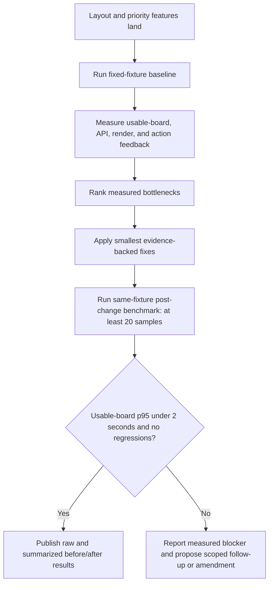

# War Room latency review and targeted fixes

## Parent Epic

epic_023

## Scope

Measure a reproducible local baseline for navigation-to-usable-board, board API time, render cost, and action feedback; fix only bottlenecks demonstrated by that baseline; publish before/after timings on the same fixture. After the layout and priority features land, meet the epic's p95 under-2-second initial usable-board target across at least 20 post-change runs while preserving lifecycle freshness and current polling/error behavior.

## Data structures

The benchmark artifact must retain enough information to reproduce and audit the comparison:

- fixture identity and pre-change revision;
- local environment or machine class;
- metric start/end boundaries;
- raw per-run measurements;
- run count and summarized p95/results.

No new product-domain data structure is required unless baseline evidence identifies one as necessary for a measured fix.

## API contracts

No API change is assumed up front. Existing War Room board and action contracts, lifecycle freshness, polling behavior, and visible errors must remain compatible. If a measured bottleneck requires a broader data-path or API contract change, escalate with baseline evidence before expanding scope.

## Logic flow

## Baseline handoff

Task `task_023_003_001` established the pre-optimization comparison at merge revision `26532dc0c3c4bd0a8a14380110d75a8006b9ff99`. The fixed 3-epic, 30-feature, 60-task fixture and 20 raw samples are retained in `tests/war_room/baselines/task_023_003_001.json`; reproduction and metric boundaries are documented in `docs/task_artifacts/task_023_003_001_war_room_latency_baseline.md`.

Baseline p95 results on Linux 6.8 / Python 3.12.12 / headless Chromium 141 at 1440×1000 were:

- navigation to usable board: 182.7 ms;
- initial board API: 151.4 ms;
- synchronous render: 8.3 ms;
- action feedback: 32.4 ms.

The board API accounts for roughly 85% of navigation p95. Task `task_023_003_002` should therefore profile and reduce repeated canonical board projection work—`merged_board`, sidecar/review/readiness projection, and priority loading—before considering DOM micro-optimizations. Retain only changes with focused measurement evidence, and do not weaken fresh board reads, polling, lifecycle semantics, or visible errors. Task `task_023_003_003` must compare against the same baseline file, fixture, metric boundaries, browser family, viewport, and machine class.

## Optimization handoff

Task `task_023_003_002` retained two measured reductions to canonical board projection and merged them at revision `d9f65fb7ee4b35d4a4b1c584a11cb3a906014eea`: active-Epic plan readiness now reuses the already-selected canonical Epic metadata instead of rescanning the board, and review-thread readiness batches feature and shared-Epic comment-gate projection instead of repeatedly loading the same sidecars.

On the task 001 fixed 93-card fixture, 20 fresh server-side projections improved from 91.392 ms to 63.418 ms median (-30.6%) and from 114.238 ms to 73.583 ms p95 (-35.6%). Raw samples, environment, and boundaries are retained in `docs/task_artifacts/task_023_003_002_war_room_targeted_fixes.md`.

The optimization preserves the fresh `merged_board` read, single-item command and lifecycle evaluators, priority projection, and existing board, priority, and I/O error propagation. No browser, DOM, polling, or action-feedback code changed. The task sandbox could not bind the browser benchmark's loopback socket, so task `task_023_003_003` remains responsible for the required same-browser, same-fixture 20-run comparison across navigation-to-usable-board, board API, render, and action feedback, plus explicit freshness/error verification. No additional optimization scope is justified before that final result.

## Task breakdown

1. **task_023_003_001 — Build reproducible War Room latency benchmark and capture baseline.** Define the fixed fixture and metric boundaries, retain raw baseline measurements, and identify ranked bottlenecks.
2. **task_023_003_002 — Implement targeted fixes for measured War Room bottlenecks.** Make only evidence-backed changes and retain high-signal regression coverage.
3. **task_023_003_003 — Verify p95 target and publish same-fixture before/after timings.** Record at least 20 comparable post-change runs, verify the under-2-second p95 gate and non-regression constraints, and publish the evidence.

Dependencies are strictly ordered `001 → 002 → 003`.

## Risks & upward questions

- Results can be misleading if the fixture, revision, environment, or metric boundaries drift between baseline and verification; record them with the raw measurements.
- Optimizing one stage may regress another; compare all four required metrics before retaining a fix.
- If the documented local benchmark still misses the target after measured fixes, report the blocker with evidence. Do not weaken the target or silently broaden the data-path contract.

No blocking upward question exists at planning time.

## Decision log

- `dec_001` · 2026-11-05 · Feature Lead · **Task breakdown**
  Chose to retain the existing three-task dependency chain: reproducible baseline, evidence-backed fixes, then same-fixture verification; mint no additional tasks.
  Rationale: The chain fully covers the feature and epic acceptance contract. Additional tasks would add coordination overhead without creating a distinct shippable outcome, while the ordered gates prevent speculative optimization and make the final p95 result auditable.
  Honors: Epic feature breakdown and success criteria for a reproducible before/after review, p95 navigation-to-usable-board under 2 seconds across at least 20 runs, and no regression in action feedback or lifecycle freshness.

- `dec_002` · 2026-11-05 · Feature Lead · **Baseline handoff**
  Chose Use the measured initial board API path as task_023_003_002's optimization target; profile canonical board projection before any DOM micro-optimization..
  Rationale: The 20-run baseline records board API p95 at 151.4 ms versus render p95 at 8.3 ms, so server-side projection dominates application work and is the only evidence-backed target. Binding the baseline to merge revision 26532dc0c3c4bd0a8a14380110d75a8006b9ff99 also makes the later comparison auditable.
  Honors: The epic requirement to identify and fix material bottlenecks without speculative caching, preserve lifecycle freshness and polling/error behavior, and verify p95 navigation-to-usable-board under 2 seconds on the same documented fixture..

- `dec_003` · 2026-11-05 · Feature Lead · **Optimization handoff**
  Chose Accept task_023_003_002's measured canonical board-projection changes and advance directly to task_023_003_003 verification; do not add further optimization work before the final same-fixture result..
  Rationale: The retained changes address the baseline-dominant board API path and improved 20-run server-side projection p95 from 114.238 ms to 73.583 ms (-35.6%) while preserving fresh merged-board reads, lifecycle evaluators, polling boundaries, priority projection, and error propagation. The remaining acceptance evidence is the full browser comparison, not another speculative fix.
  Honors: The epic contract to fix only demonstrated bottlenecks, preserve lifecycle freshness and visible errors, and publish at least 20 same-fixture before/after samples proving navigation-to-usable-board p95 under 2 seconds without regressions..

## Closeout

Completed child work: `task_023_003_001` (Build reproducible War Room latency benchmark and capture baseline), `task_023_003_002` (Implement targeted fixes for measured War Room bottlenecks), `task_023_003_003` (Verify p95 target and publish same-fixture before/after timings).
