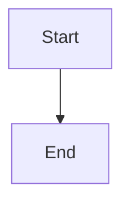

# Edit backlog briefs through PRs and refresh approved content

## Parent Epic

epic_024

## Scope

# Edit backlog briefs through PRs and refresh approved content

## Intent

Let a human edit an existing backlog epic brief, submit the change as a new review PR/MR, and see the approved revision on the existing board item after merge.

## Scope and acceptance criteria

- Expose Edit on eligible backlog epic briefs. Load the selected brief's persisted values, not create-form defaults.
- Edit every brief-authoring field: title, intent, success criteria, constraints, provider, and model/reasoning assignments for epic_manager, epic_architect, feature_lead, feature_architect, and swe. Preserve and allow editing any other human-authored Markdown sections. Identity, lifecycle, generated approval/runtime metadata, and graph bookkeeping are system-managed.
- Reuse existing provider/model inventory and validation. Keep saved values visible; never silently replace unsupported or unavailable saved assignments with defaults. Validation errors preserve entered work; reasoning overrides can be explicitly cleared.
- A changed valid submission creates a new isolated branch and PR/MR against configured product trunk, modifying only the selected brief. Preserve ID, original path even when title changes, creation metadata, and untouched content/metadata. Do not regenerate an existing brief from the new-brief template.
- Read and submit against explicit source provenance. Fetch and compare the target brief revision before writing; reject stale, deleted, or no-longer-backlog targets with a reload message. Unrelated trunk commits do not invalidate an unchanged brief. Disable duplicate in-flight submit; no-op/cancel creates no PR.
- Return a real PR/MR link only after creation succeeds. Failures preserve form input and make retry/recovery understandable. Creation does not activate or locally overwrite the approved brief.
- After merge, existing scheduled sync or forced refresh updates the same board row and plan view with the approved content/assignments. Cover both snapshot-only briefs and stale local backlog copies. Activation uses the same approved source revision shown on the board. Existing active/completed/live integration state stays authoritative and is never overwritten by a late edit merge.
- Refresh failure retains the last valid board; operator checkout and active worktrees remain untouched. Reuse current remote selection, polling, Git/forge infrastructure and human activation gate.

## Implementation boundaries

Reuse cascade/briefs.py, cascade/brief_stack.py, War Room brief dialog and selectors, existing HTTP route conventions, and cascade/tracking.py. Inspect cascade/workspace/backlog_snapshot.py, cascade/workspace/integration_worktree.py, document routing/reads, and activation provenance together: current snapshot import omits every local epic ID and local HEAD wins activation source selection. Narrowly extend precedence for eligible backlog briefs; do not implement general branch reconciliation.

## Validation

Prefer real local Git repositories and a fake forge boundary: edit a brief with all authoring fields plus extra Markdown, inspect the one-file PR diff, merge upstream, sync and verify board, plan detail, saved assignments and activation provenance. Include a stale local backlog copy and diverged operator checkout. Add focused API/UI checks for prefill, clear reasoning, stale revision, non-backlog target, validation/no-op, and failure recovery. Preserve create-brief regression coverage; avoid duplicate mock-heavy unit suites.

## Non-goals

Editing active/completed plans through this flow, automatic PR merging, activation, a generic YAML/lifecycle editor, new agents/providers, a new sync service, and general merge-conflict or pending-PR management.

## Data structures

TBD.

## API contracts

TBD.

## Logic flow

## Task breakdown
- task_024_001_005
- task_024_001_004
- task_024_001_003
- task_024_001_002
- task_024_001_001

_(empty — Feature Team mints tasks after dispatch)_

## Risks & upward questions

None.

## Decision log

None yet.

## Closeout

Completed child work: `task_024_001_001` (Add lossless backlog brief edit model and validation), `task_024_001_002` (Implement stale-safe brief edit PR API), `task_024_001_003` (Add War Room backlog brief edit experience), `task_024_001_004` (Refresh merged backlog edits with approved provenance), `task_024_001_005` (Validate end-to-end backlog brief edit lifecycle).
