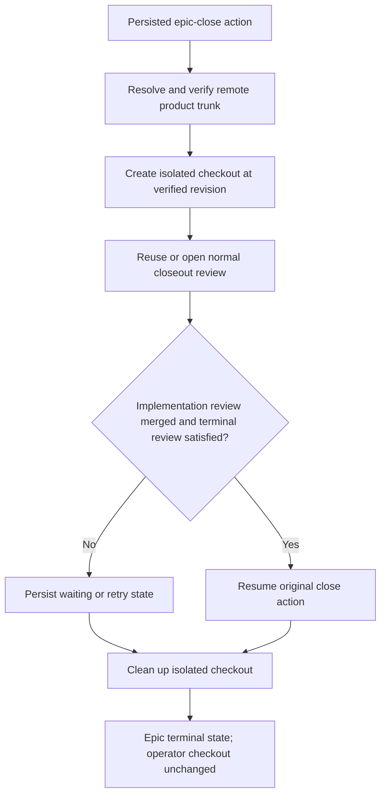

# Dirty-trunk-safe epic close

## Parent Epic

epic_026

## Objective

Complete epic close without touching unrelated changes in the operator's product-trunk checkout.

## Scope

- Resolve and verify the remote product-trunk revision used for closeout.
- Create a disposable isolated checkout pinned to that revision.
- Run trunk-dependent review and closeout operations only from the isolated checkout.
- Reuse or open the normal closeout review.
- Verify the implementation review is merged and the terminal closeout review is satisfied.
- Resume the original persisted close action with existing retry semantics.
- Clean up only the isolated checkout resources created by closeout.

## Acceptance

An epic closes while the operator product-trunk checkout contains unrelated tracked edits, staged/index changes, and untracked files. After close, the checkout's file bytes, index entries, HEAD, and current branch are unchanged, and the disposable closeout checkout has been cleaned up.

## Out of scope

- Stashing, cleaning, resetting, committing, merging, or otherwise modifying operator changes.
- Changing review policy or redesigning persisted-action semantics.
- Broad workspace-framework refactoring or exhaustive filesystem-permutation testing.

## Data structures

No new durable product data is required. Reuse the existing persisted close action and represent the isolated workspace with the repository's existing temporary checkout/worktree abstraction where available. The workspace must carry the verified trunk revision and cleanup ownership needed to remove only resources it created.

## API contracts

The epic-close orchestration boundary must obtain a verified isolated product-trunk workspace before trunk-dependent work, pass that workspace to review/closeout operations, and always scope cleanup to it. Existing external close, retry, and review contracts remain unchanged.

## Logic flow

## Task breakdown

1. `task_026_004_001` — Create isolated verified-trunk closeout workspace.
2. `task_026_004_002` — Run and resume epic closeout from the isolated workspace. Depends on task 001.
3. `task_026_004_003` — Add dirty-trunk epic-close regression coverage. Depends on task 002.

## Risks & upward questions

- Remote trunk verification must fail closed; using the dirty local checkout as a fallback would violate the feature contract.
- Cleanup after partial failure must retain enough ownership information to avoid deleting operator-managed resources.
- No upward contract change is currently required.

## Decision log

Board decision entries are recorded through Cascade.

- `dec_001` · 2026-10-27 · Feature Lead · **Workspace isolation**
  Chose Run every trunk-dependent epic-close operation from a disposable checkout pinned to a verified remote product-trunk revision..
  Rationale: The operator checkout may contain unrelated tracked, staged, and untracked work and cannot safely serve as closeout input.
  Honors: Feature objective and acceptance contract; tasks task_026_004_001 and task_026_004_002..

- `dec_002` · 2026-10-27 · Feature Lead · **Verification strategy**
  Chose Use one high-signal integration/system regression that snapshots operator file bytes, index entries, HEAD, and branch before and after epic close..
  Rationale: This directly proves the user-visible safety property while avoiding redundant mock-heavy coverage.
  Honors: Frugal-engineering guidance and task_026_004_003 acceptance criteria..

## Closeout

Completed child work: `task_026_004_001` (Create isolated verified-trunk closeout workspace), `task_026_004_002` (Run and resume epic closeout from the isolated workspace), `task_026_004_003` (Add dirty-trunk epic-close regression coverage).
