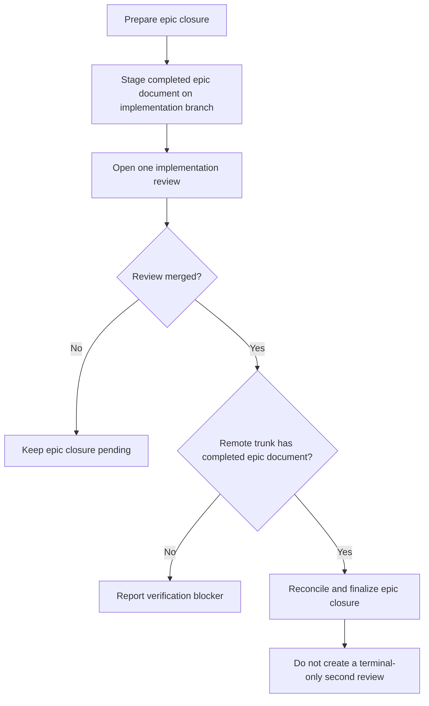

# Prepare and reconcile epic closure through one implementation review

## Parent Epic

epic_028

## Scope

Implement the single-review epic lifecycle: stage the epic plan's completed-state move on the implementation branch before opening the review; keep closure pending while it is open; after merge, verify both the merged review and completed epic document on remote trunk; finalize without creating a terminal-only closeout PR. Preserve the human review policy and leave the operator product-trunk checkout untouched. Add high-signal coverage for idempotent preparation, verification blockers, reconciliation, and absence of a second PR.

## Data structures

No new durable product data model is required. Reuse the existing epic work document, implementation-review state, remote-trunk view, and closure/reconciliation state. Preparation and reconciliation must be idempotent so retries converge on the same state.

## API contracts

- Preparation stages the epic document's completed-state move on the implementation branch before the implementation review is opened.
- While that review remains open, epic closure remains pending.
- Reconciliation succeeds only after remote trunk proves both that the implementation review merged and that the epic document is in completed state.
- A failed verification is reported as a blocker and does not finalize closure.
- Successful reconciliation finalizes closure without creating a second, terminal-only review.
- All operations preserve the required human review gate and do not mutate the operator's product-trunk checkout.

## Logic flow

## Task breakdown

1. task_028_001_001 — Stage epic completion on the implementation branch.
2. task_028_001_002 — Verify the merged review and completed epic document on remote trunk, then reconcile closure.
3. task_028_001_003 — Prove the single-review lifecycle with high-signal coverage.

Dependency chain: `task_028_001_001` → `task_028_001_002` → `task_028_001_003`.

## Acceptance criteria

- First-run preparation stages the completed epic document before review creation; repeated preparation is a no-op or equivalent convergent success.
- Closure stays pending while the implementation review is open.
- Reconciliation blocks when either the merged-review check or completed-document-on-remote-trunk check fails.
- After both checks pass, closure finalizes idempotently.
- The lifecycle creates exactly one implementation review and no terminal-only closeout review.
- The operator product-trunk checkout remains untouched.
- Lifecycle-level tests cover these behaviors without duplicating lower-level tests that already provide equivalent confidence.

## Risks & upward questions

None. The implementation should reuse existing review, remote verification, and reconciliation mechanisms; introducing a parallel closure path is out of scope.

## Decision log

- 2026-11-03 — Use one human-reviewed implementation review for both implementation and the staged epic completed-state move. Post-merge reconciliation verifies remote-trunk evidence and finalizes state without a second review.

- `dec_001` · 2026-11-03 · Feature Lead · **Feature closure lifecycle**
  Chose Use one human-reviewed implementation review for both the implementation and the staged epic completed-state move; after merge, verify the merged review and completed epic document on remote trunk, then finalize without a terminal-only second review..
  Rationale: This is the smallest lifecycle that preserves the human review gate, makes closure evidence verifiable on remote trunk, supports idempotent retries, and avoids redundant review ceremony.
  Honors: Feature scope and epic_028's single-review closure intent..

## Closeout

Completed child work: `task_028_001_001` (Stage epic completion on the implementation branch), `task_028_001_002` (Verify merged review and reconcile epic closure), `task_028_001_003` (Prove the single-review closure lifecycle).
