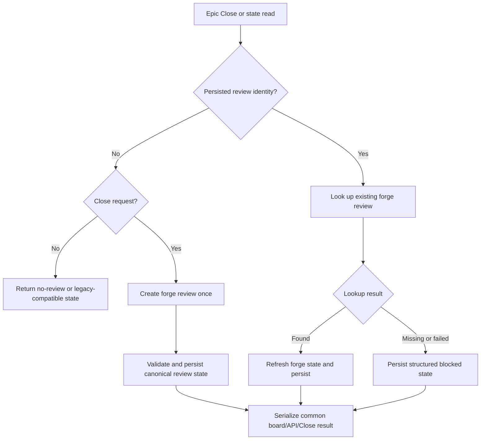

# Persist and expose epic implementation-review state

## Parent Epic

epic_028

## Scope

Extend the close result, durable forge review snapshot/lookup, and board/API serialization with an explicit epic close stage, validated review URL, source and target branches, forge state, and actionable blocker details. Reconstruct pending state after restart and make repeated Close requests return the existing review rather than create another. Cover pending, refresh/restart reconstruction, failed or missing lookup, and idempotency.

## Data structures

Use one canonical implementation-review state across persistence, Close results, board projection, and API serialization. The state contains:

- epic close stage
- stable forge review identity and validated review URL
- source and target branches
- current forge review state
- structured blocker details suitable for user action

Persist enough review identity and branch context to look up the existing forge review after restart. New fields must load safely when absent from older records; absence represents legacy or not-yet-created state rather than corrupt data. Validate externally supplied review URLs at the model boundary before persistence or exposure.

Blockers are data, not control-flow strings: retain a stable category/code, actionable message, and relevant lookup context so all read paths render the same failure.

## API contracts

- A successful initial epic Close that opens a review returns the canonical implementation-review state and persists it before the result is exposed.
- A repeated Close with an existing persisted or reconstructed review returns that same review identity and refreshed forge state; it never opens a replacement review.
- Board and API read paths serialize the same canonical fields and blocker structure. They must not independently infer close stage or forge state.
- Refresh/restart lookup updates forge-derived fields while preserving stable review identity, URL, and branch context.
- A missing review or failed forge lookup produces an explicit blocked state with actionable details. It does not silently clear the snapshot or trigger review creation.
- Legacy persisted records without the added fields remain readable and can be enriched through reconstruction where sufficient identity exists.

## Logic flow

## Task breakdown

1. `task_028_002_001` — Model and persist the canonical implementation-review state.
2. `task_028_002_002` — Reconstruct and refresh that state from the stored snapshot and forge lookup; depends on 001.
3. `task_028_002_003` — Make epic Close reuse an existing review; depends on 002.
4. `task_028_002_004` — Expose the canonical state through board and API serialization; depends on 001 and 002.
5. `task_028_002_005` — Add lifecycle-level coverage; depends on 003 and 004.

## Test strategy

Favor high-signal integration/API coverage over duplicate unit tests. Focused model/persistence tests should cover backward-compatible loading and URL validation. Lifecycle tests should cover initial pending state, refresh, restart reconstruction, failed and missing lookup, consistent board/API serialization, repeated Close returning the same review, and an assertion that forge creation occurs only once.

## Risks & upward questions

- Forge providers may distinguish missing, inaccessible, and transient lookup failures. Preserve those distinctions in blocker categories where the adapter exposes them; all remain non-creating paths.
- Concurrency can race two first Close requests before a snapshot exists. The implementation must use the repository's existing serialization or atomic persistence boundary so the idempotency promise holds under concurrent requests, not only sequential retries.
- Review URL validation must follow the existing forge/provider trust policy rather than introducing provider-specific rules in serializers.

No upward decision is currently required.

## Decision log

- 2026-11-03 — Adopt one persisted implementation-review state as the source of truth for Close, reconstruction, board, and API paths; failed or missing lookups become blocked state and never cause implicit replacement-review creation.

- `dec_001` · 2026-11-03 · Feature Architect · **Architecture / implementation-review source of truth**
  Chose Use one durable implementation-review state for epic Close results, restart reconstruction, board projection, and API serialization; represent failed or missing forge lookup as structured blocked state and never implicitly create a replacement review..
  Rationale: A single persisted model prevents drift between read paths, enables restart-safe idempotency, preserves review identity, and makes failures actionable without risking duplicate forge reviews.
  Honors: Feature scope for durable review state, restart reconstruction, actionable blockers, consistent serialization, and idempotent repeated Close; frugal-engineering guidance to keep one canonical model and concentrate tests at persistence and lifecycle boundaries..

## Closeout

Completed child work: `task_028_002_001` (Model and persist epic implementation-review state), `task_028_002_002` (Reconstruct and refresh implementation-review state), `task_028_002_003` (Make epic Close idempotent for an existing review), `task_028_002_004` (Expose implementation-review state through board and API serialization), `task_028_002_005` (Add end-to-end coverage for implementation-review lifecycle).
