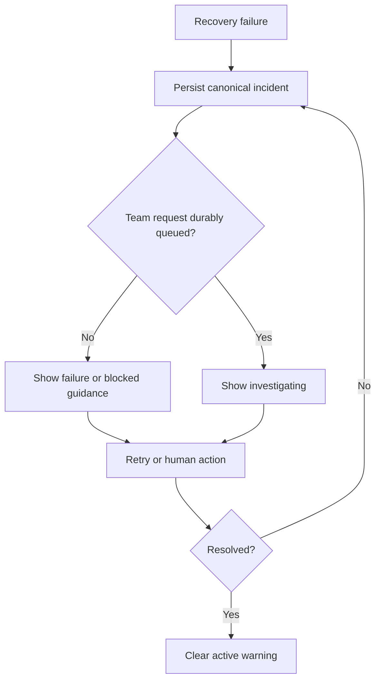

# War Room recovery status and operator guidance

## Parent Epic

epic_031

## Outcome

Expose one durable, actionable incident state on the affected War Room row from first failure through resolution or human blocker.

## Scope

- Project recovery state through the existing API and board model.
- Show failure-specific copy, owner, safe reason, affected branch or paths, last attempt, and action/review link.
- Only claim agents are investigating after the team request is durably queued.
- Suppress duplicate warnings and repeated toasts.

## Acceptance focus

Refreshes and restarts preserve status; transitions are exact; blocked incidents name the owner and next step; resolution clears the active warning.

## Data structures

The implementation will use one canonical persisted recovery-incident projection. Task `task_031_002_001` owns the minimal field and state definitions so they remain aligned with the existing board model.

## API contracts

The existing board/API read path exposes the canonical incident projection. The UI consumes that projection without introducing competing client-only recovery state.

## Logic flow

## Task breakdown

1. `task_031_002_001` — Persist and expose canonical War Room recovery incident state.
2. `task_031_002_002` — Render actionable recovery guidance on the affected War Room row. Depends on `task_031_002_001`.
3. `task_031_002_003` — Verify recovery status lifecycle across refresh and restart. Depends on `task_031_002_001` and `task_031_002_002`.

## Risks & upward questions

None.

## Decision log

See recorded Cascade decisions.

- `dec_001` · 2026-11-03 · Feature Lead · **Task decomposition**
  Chose Deliver the feature in three dependency-ordered slices: canonical persisted incident projection, row-level operator guidance, then end-to-end lifecycle verification..
  Rationale: This is the smallest shippable plan that separates the state contract from its presentation while reserving refresh/restart and duplicate-suppression proof for one economical integration-focused verification slice.
  Honors: Feature outcome and acceptance focus; frugal-engineering preference for high-signal system coverage; product-manager scope discipline..

## Closeout

Completed child work: `task_031_002_001` (Persist and expose canonical War Room recovery incident state), `task_031_002_002` (Render actionable recovery guidance on the affected War Room row), `task_031_002_003` (Verify recovery status lifecycle across refresh and restart).
