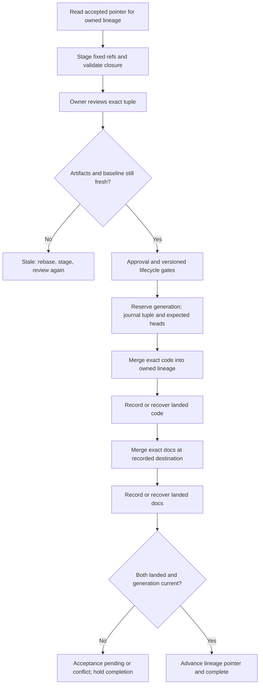

# Revision-bound architecture proposals and recoverable acceptance

## Parent Epic

epic_034

## Scope

Delivery slice C of epic_034; success criteria 4, 6, 10–11 and accepted-baseline portion of 15.

Deliver the review-unit contract from the epic: owner and repository identities, fixed documentation destination, exact plan/design/model revisions and pinned source closure, accepted baseline, requirement/decision/view citations, architecture impact, and explicit no-diagram-change or empty-baseline state. Stage proposals before approval/dispatch without advancing accepted architecture. Artifact edits invalidate affected review; stale baselines require rebase/re-review. Claimed diagram changes with missing/invalid models cannot pass.

Ship minimum authorized owner-scoped read/stage/review paths WITH these gates; do not wait for F to make required proposals authorable. Enable gates explicitly and by version: preserve recorded rollout for already executing work; new/materially revised proposals bind reviewed artifacts. No rollout exception permits a claimed missing model.

Accept code and documentation together where possible. For split repositories, journal the exact approved revision tuple and expected heads before merging implementation into its owned integration lineage, then exact reviewed docs; only both accepted sides advance the architecture pointer and completion. A partial merge remains acceptance_pending and holds affected downstream work. Retry only the missing operation; recognize landed ancestry after crashes. Scope pointers by integration lineage; use lifecycle reservation/generation checks before and after Git work so competing promotions cannot overwrite newer acceptance. No lock held across rendering/remote Git.

Acceptance: mutation of every reviewed artifact, stale baseline, minimum authoring under enabled gates, split failure/retry and conflicts, destination changes, competing promotion, and accepted child baseline without advancing trunk. Include integration checks and documentation closeout.

## Data structures

Persist versioned records in the owning feature/epic lifecycle store, keyed by work ID and stable integration-lineage identity. Repository identity is the recorded target key and destination repository key/role from Feature A, never the current path, checkout, or render cache. A lineage identifies the owned integration branch and repositories; child acceptance updates that lineage, not product trunk.

- **ReviewUnit v1**: unit ID, owning work ID and authorized owner, target repository key, code directory and design owner, code repository key, recorded destination repository key/role/path, proposed ancestor context, baseline pointer ID and generation, rollout version, and status. Its immutable reviewed tuple holds exact plan document path/commit/content digest, exact design `ArchitectureArtifactRef` and content digest, model contract and every source `ArchitectureArtifactRef` with their owning work and commit/content digests, validated `C4SourceClosure.digest`, renderer image digest/settings and semantic artifact digest, requirement/decision/view citations, affected work, and architecture impact. Record either a validated diagram change or an explicit justified `no_diagram_change`; the latter still binds the reviewed plan and design. A diagram claim requires a nonempty valid model closure and successful renderer/binding result. Store explicit `empty_baseline` separately from an unknown or missing baseline. Cache paths are display hints, never identity or approval evidence. The implementation commit is bound later, when code exists, in the promotion journal; that binding must pass the integration/merge gate against this approved architecture tuple.
- **AcceptedLineage v1**: lineage key, monotonic generation, accepted review-unit ID and exact tuple, accepted code/doc heads, accepted architecture artifact/model refs, and explicit `empty_baseline` for a lineage with no accepted model. The pointer advances only after complete acceptance. A proposal's ancestor is historical context; the current baseline is always read from this record, so an accepted child merge can be the next baseline without a trunk advance.
- **Review state**: `draft → staged → reviewed → approved`, with `stale` on a changed bound artifact, destination, baseline generation, or material proposal edit. Revalidation may produce a new staged unit but never restores human review or approval. `rejected` is terminal for that unit. Immutable reviewed tuple and reviewer identity/time are recorded when review completes; approval pins that exact tuple.
- **PromotionJournal v1**: operation ID, lineage key and reserved generation, approved review-unit ID/tuple digest, fixed code/doc repository identities and destination, expected code/doc heads, exact incoming implementation and documentation commits, per-side `pending|landed` state and observed resulting head, plus `reserved|acceptance_pending|accepted|conflict` outcome and stable error code. Persist before Git work. A one-repository merge can land both sides in one atomic commit; a split merge records code first and docs second. Journal and accepted pointer updates use durable compare-and-swap on lineage generation. A pending journal blocks affected completion and dependents.

## API contracts

- `read_architecture_state(work_id, lineage)` returns the authorized owner's staged unit, review status/reasons, current accepted pointer/generation, and pending promotion. It exposes pinned refs and semantic diff from Feature B. It never substitutes working-tree bytes or a different lineage's pointer.
- `stage_architecture_proposal(owner, work_id, refs, impact, citations, expected_generation)` checks owner scope, fixed Feature A destination, committed reviewed bytes, source closure/ownership, Feature B validation/render bindings, and expected lineage generation. It persists a new immutable unit and returns its ID, tuple digest, diff, and `staged`. Explicit no-diagram-change and empty-baseline states are legal; claimed change with absent/invalid model returns `model_required` or `model_invalid`. Mismatched refs/destination return `artifact_changed` or `destination_changed`; stale generation returns `stale_baseline`.
- `review_architecture_proposal(owner, unit_id, expected_tuple_digest, decision)` reads the exact pinned tuple, verifies current artifacts and baseline, then records reviewer, decision and revision. Only a fresh reviewed unit may become approved; a new stage after any edit requires another human review. Owner-scoped read/stage/review are available before the gate rollout is enabled.
- Lifecycle approval, dispatch, integration, merge and closeout call the same `validate_review_gate(work_id, boundary)`. It checks recorded rollout version, approved tuple, artifact bytes/commits, closure and tool bindings, fixed destination, baseline generation and blocking scope at each boundary. Enable a named/versioned gate only after minimum authoring works. Work already executing retains its recorded version; new or materially revised proposals bind the current version. Any version rejects a claimed missing or invalid model. Failures have stable `review_required`, `artifact_changed`, `destination_changed`, `stale_baseline`, `model_required`, `model_invalid`, or `acceptance_pending` outcomes and do not advance lifecycle state.
- `reserve_promotion(unit_id, expected_heads, expected_generation)` atomically checks approved tuple/freshness and no competing reservation, then persists the journal. `promote_or_resume(operation_id)` rechecks reservation, generation, tuple and expected heads before each Git operation, merges only a missing side, and records each resulting head. After Git it rechecks lineage reservation/generation before pointer update. If a crash occurs after merge but before journal update, inspect destination ancestry and exact incoming commit to mark that side landed; never replay it. If an expected head changed without the exact operation landed, return `head_conflict` and require reconciliation/re-review. If generation changed, return `reservation_lost`; no older operation may overwrite a newer pointer. Only both landed sides transition to `accepted`, advance AcceptedLineage, and release completion/affected dependents. Retries are idempotent for one operation ID.
- Rendering, remote Git and merge conflict handling run outside lifecycle locks. Short transactions guard reservation, journal transitions and accepted-pointer compare-and-swap. D consumes the pinned semantic artifacts for paired interaction/comments; E owns change-request routing; F extends authoring and closure beyond this minimum.

## Logic flow

## Task breakdown

1. `task_034_003_001` — Persist pinned architecture review units and accepted baselines by integration lineage.
2. `task_034_003_002` — Stage and inspect owner-scoped architecture proposals; depends on task 001.
3. `task_034_003_003` — Invalidate review when reviewed artifacts or baseline change; depends on tasks 001–002.
4. `task_034_003_004` — Enforce revision-bound approval, dispatch, integration, merge, and closeout gates with versioned rollout; depends on task 003.
5. `task_034_003_005` — Journal promotions and reserve lineage-scoped acceptance generations; depends on tasks 001 and 004.
6. `task_034_003_006` — Promote exact reviewed code and documentation with partial-merge recovery; depends on task 005.
7. `task_034_003_007` — Verify integration scenarios and close documentation; depends on tasks 002–004 and 006.

## Verification focus

Use integrated checks for mutation of plan, design, model contract or any closure file after review; fixed destination edits; stale/rebased proposal and accepted child baseline without trunk advancement; owner authoring with gates enabled; missing model claims; split code/doc failure and either-side crash/retry; conflicts and competing promotions. Reuse A/B artifact and renderer coverage. No broader UI/comment authoring belongs here.

## Verification and closeout

Task 007's owner reports `pytest -q tests/workspace/test_architecture_review.py` passing 32 checks in final validation (deliverable `f97f75a761863f33e933d87b6678ed0a446d2265`). The checks cover owner authoring after gate enablement; mutation of the plan, design, model contract, source closure and fixed destination; stale or rebased proposals; accepted child baseline without a trunk advance; and missing or invalid model refusal. Commit `6830a52678c7060a791e2dc21acad63f2c87fbcc` applies the claimed-model check to no-rollout, durable policy-0 and enabled-policy gates; the public-gate regression covers each rollout state. Promotion checks cover colocated and split repositories, unavailable documentation, crashes after either split merge, changed heads, and competing reservations. The task's canonical merge is tracked separately from this owner-reported evidence.

Feature C records pending or conflict state for reconciliation and re-review when remote Git transport or semantic merge conflicts cannot complete promotion. D owns paired interaction and comments, E owns change-request routing, and F owns extended tier-wide authoring and closure.

## Risks & upward questions

None. Cross-feature contract incompatibilities go through an epic amendment before changing sibling scope.

## Decision log

- `dec_001` · 2026-11-09 · Feature Lead · **Review unit and rollout**
  Chose Bind review and approval to one immutable versioned tuple of committed plan, design, model closure, renderer and lineage baseline; stage/read/review must be usable before enabling gates..
  Rationale: A/B already provide fixed repository refs and pinned validation/render artifacts. A single tuple prevents working-tree/cache drift, while a recorded rollout protects executing work and still rejects missing claimed models.
  Honors: epic_034 success criteria 4, 6, 10–11; Features A/B artifact contracts; feature C tasks 001–004.

- `dec_002` · 2026-11-09 · Feature Lead · **Acceptance and recovery**
  Chose Reserve a lineage generation and journal exact approved tuple plus expected code/doc heads before Git; advance accepted pointer only after both sides land, and retry only a missing side..
  Rationale: Split repositories can fail between merges or between merge and journal update. Durable ancestry recognition and generation checks prevent duplicate merges and older promotions overwriting accepted architecture.
  Honors: epic_034 success criterion 15 accepted-baseline contract; feature C tasks 005–007.

## Closeout

Completed child work: `task_034_003_001` (Persist pinned architecture review units and lineage baselines), `task_034_003_002` (Stage and inspect owner-scoped architecture proposals), `task_034_003_003` (Invalidate review when pinned artifacts or baseline change), `task_034_003_004` (Enforce revision-bound planning and lifecycle gates), `task_034_003_005` (Journal promotions with lineage-scoped reservations), `task_034_003_006` (Promote exact reviewed code and documentation recoverably), `task_034_003_007` (Verify proposal and promotion integration, close documentation).
