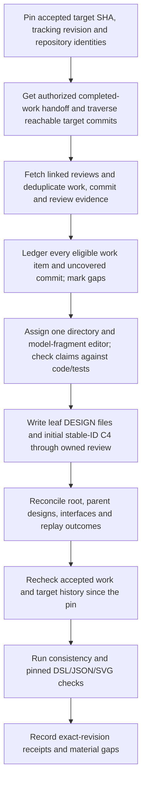

# Historical design reconstruction and final validation

## Parent Epic

epic_034

## Scope

Delivery slice G of epic_034; success criteria 13–14 and final end-to-end acceptance. Implements human cmt_001 / dec_001.

Pin an inventory of every completed, non-cancelled epic, feature, and task plus reachable target Git history at an agreed current baseline. Reconcile uncovered fixes/direct commits, merges, and available squash/rebase provenance; retrieve linked MR/PR descriptions through authorized forge access. Deduplicate overlapping work-item and commit evidence; do not assume one review per commit. Narratives are leads: validate every current design claim against code/tests. Explicitly ledger unavailable review descriptions, ambiguous provenance, unreachable/deleted history, and unresolved coverage.

Assign one editing owner per meaningful directory/shared fragment. Populate concise designs and initial C4 model in the configured destination; reconcile leaves to root, then downward/across interfaces. Preserve root design, one-home requirements and decisions, stable model IDs, and accepted proposal/closeout workflow. Cancelled plans are not requirements sources, while surviving code remains subject to actual-code/history checks. Every excluded target directory names its covering parent.

The replay ledger accounts for each completed work item and uncovered commit, review references, evidence revisions, affected requirement/decision IDs, and durable/superseded/no-impact/unresolved outcome. Before closeout reconcile accepted work since the inventory pin.

Validate parent-child consistency, cross-directory interfaces, references, view links, TOC headings, real pinned DSL/JSON/SVG processing, and claims against current code/tests. Surface unresolved material gaps. Exercise direct fix, MR-described non-Cascade change, overlap, superseded/cancelled work, and unavailable provenance, plus final paired-review/split-acceptance/living-epic scenarios. Prior slices own their own integration checks; G is final reconciliation, not a deferred test bucket.

## Data structures

- **Inventory manifest (version 1):** record the target repository's stable `target_repository_key`, target and tracking repository identities, `architecture_destination`, target accepted HEAD SHA, tracking/board revision, inventory timestamp, and traversal boundaries. The pin is a consistent accepted baseline, not a moving branch name. Store the exact completed, non-cancelled epic/feature/task IDs and document revisions visible at that board revision. Traverse the reachable target commit DAG through that accepted SHA, including merge parents. Record squash/rebase links only when independently supported; preserve unknown provenance.
- **Evidence index:** key commits by full target SHA, work by work ID plus document revision, and reviews by forge plus review ID/URL and fetched description/source revision. Keep many-to-many links between them. A work record and a direct Git traversal hit may cite the same commit; one review may cover multiple commits and one commit may have multiple reviews. Record the source of each link, unavailable descriptions or source revisions, truncated F replay, ambiguous links, and unreachable/deleted history without inventing a mapping.
- **Directory and model ownership:** `architecture/design-mappings.json` is the target-owned schema-v1 index with stable `target_repository_key`, `artifact_id`, `code_directory` and `design_owner_directory`. Root `.` retains `DESIGN.md`. Map every meaningful target-code directory to exactly one editing owner and every shared C4 fragment to one work owner; excluded directories name their covering parent. Keep stable C4 element/view IDs and one home for requirement and decision IDs. Use `ProjectContext.design_path` and `editable_architecture_root` for the configured target/tracking destination.
- **Replay ledger:** one row for each eligible completed work item and each reachable commit not covered by a work row. Store evidence keys and exact revisions, review references, affected design paths and requirement/decision IDs, owner, and one of durable, superseded, no-impact, or unresolved. Deduplicate links, not eligible rows; an eligible item with no reliable commit mapping still gets a row. Cancelled plans are excluded as requirements sources; any surviving code still enters via Git evidence. Material unresolved rows block clean closure.
- **Validation and delta report:** store the baseline manifest digest, accepted work and target commits added after the pin, reconciliation disposition for each delta, inspected code/test/design/model revisions, pinned Structurizr image digest and DSL/JSON/SVG artifact revisions, check outcomes, and explicit material gaps. Closeout uses a refreshed accepted baseline after all deltas are reconciled.

## API contracts

- Read owned and pinned ancestor architecture through F's `build_tier_planning_context(project, work_id)`. F's `read_historical_replay(project, requester_work_id, work_id, evidence_scope)` accepts only `work_record`, `git`, and `review` scopes for a completed non-cancelled record in the requester's permitted lineage. Its current implementation caps review units and receipt-bound commits at 100 and reports truncation/unavailability. It does not give Feature G direct access to sibling Feature A–F board content. The Epic owner must provide an authorized, revision-pinned inventory/evidence handoff for those sibling records; Task 001 records any missing handoff as a coverage gap. Neither repository file access nor a status projection is used to bypass board-content authorization.
- Independently enumerate commits reachable from the pinned target accepted SHA, and use only authorized forge access for linked MR/PR descriptions. F's target Git evidence is receipt-bound and can omit direct fixes; `.cascade/reviews.json` and the configured forge snapshot are leads, not proof that a review maps to a commit. Keep explicit `linked_review_missing`, `review_description_unavailable`, `review_source_revision_unavailable`, receipt-missing/truncated, and ambiguous outcomes.
- Resolve each design home through `ProjectContext` and the target-owned mapping index. Stage owned exact-revision proposals with F's `stage_owned_architecture_change`, which delegates to C's `stage_architecture_proposal`; route Feature-to-Epic and other ancestor/shared edits to their owners. Bind the reviewed plan, design/model bytes, destination, accepted baseline generation, impact and citations. Do not treat an unreviewed proposal as an accepted design.
- Validate the initial stable-ID C4 DSL with the existing pinned `structurizr/structurizr@sha256:c89b54231c42da90484e6bf4e398f36a40123cb4b12c9d5f09c27eef3dc9644c` distribution; export JSON and SVG from those same bytes. Record `ReconciliationReceipt` with exact implementation revisions/head, affected directories, leaf/ancestor design refs, accepted review unit or justified no-change, model digest and affected views. Use F's `record_reconciliation_receipt` and `validate_reconciliation_closeout` at the relevant Task/Feature/Epic gates; pending promotion, stale evidence or material mismatch prevents clean closeout.

## Logic flow

## Task breakdown

1. `task_034_007_001` — Pin completed-work and Git/review evidence inventory.
2. `task_034_007_002` — Assign design ownership and reconstruct leaf designs and C4 model; depends on 001.
3. `task_034_007_003` — Reconcile parent designs, interfaces, and replay ledger; depends on 002.
4. `task_034_007_004` — Validate historical reconstruction and final acceptance; depends on 003.

## Authorized A–F evidence handoff (Epic dec_013, 2026-11-10)

The Epic owner read the six completed, non-cancelled feature specs and closeouts under its own scope and sent this revision-pinned handoff. These are historical contract and closeout leads; Task 001 must check claimed current behavior against accepted code and tests. The Epic owner's representative direct task read returned `content_access_denied`. Child revisions and content remain unavailable pending direct owner handoffs; the parent revision must not stand in for any child revision.

| Feature | Canonical feature revision | Completed child IDs listed by closeout | Historical lead |
| --- | --- | --- | --- |
| `feat_034_001` | `2843c8f87ff6ab8f215ae03a3349c301671781e7` | `task_034_001_001`, `task_034_001_002`, `task_034_001_003`, `task_034_001_004` | Design guidance, fixed destination, target mapping and ownership, committed-byte references. |
| `feat_034_002` | `3ceda65501172a864b5db88fd3470208eba0ad11` | `task_034_002_001`, `task_034_002_002`, `task_034_002_003`, `task_034_002_004`, `task_034_002_005`, `task_034_002_006`, `task_034_002_007` | Local source closure, semantic identity, pinned offline rendering, trusted SVG binding, semantic diff and error states. |
| `feat_034_003` | `78d2feaaeebb94c4c672da5a1d5efcb3f92cae68` | `task_034_003_001`, `task_034_003_002`, `task_034_003_003`, `task_034_003_004`, `task_034_003_005`, `task_034_003_006`, `task_034_003_007` | Scoped exact-revision review, accepted lineage, promotion reservations and recoverable split acceptance. |
| `feat_034_004` | `1f6a3c2c8626bc86e8f2daf676c7c4a8bc12d369` | `task_034_004_001`, `task_034_004_002`, `task_034_004_003`, `task_034_004_004`, `task_034_004_005`, `task_034_004_006` | Paired C4 review, changed-view inventory, semantic anchors, outdated targets and scoped blocking. |
| `feat_034_005` | `ede9292c67c67e4558b23ec3fa5fd99d3c4ecbc6` | `task_034_005_001`, `task_034_005_002`, `task_034_005_003`, `task_034_005_004`, `task_034_005_005`, `task_034_005_006` | Accountable comment routing, impact triage, holds, sibling preservation and approved corrective work. |
| `feat_034_006` | `7d078a396a6b79f098da6b9e9e8e3db6b2b3d4b7` | `task_034_006_001`, `task_034_006_002`, `task_034_006_003`, `task_034_006_004` | Pinned context, bounded replay, owned staging, shared amendments and reconciliation receipts. |

Each of the 34 child IDs needs its own ledger row with `revision=null`, `completion_evidence.kind=parent_closeout_lists_completed_child`, the relevant feature ID and revision above, and `unavailable_reason=task_record_not_read_under_epic_scope` until an authorized owner supplies its exact task evidence. This subset does not replace the project-wide eligible work inventory or independent reachable Git/review traversal. At the Epic owner's latest check, Feature F PR #218 was open and mergeable; that is not accepted target reachability. Task 001 must pin the accepted target baseline, verify F API reachability there, and reconcile later accepted integration as a delta.

## Risks & upward questions

The Epic has supplied a revision-pinned A–F feature closeout handoff. Exact child revisions and content remain open pending authorized owner handoffs. Unavailable review descriptions, ambiguous provenance and unreachable history remain explicit coverage limits. Material design/code mismatches block clean closeout and are reported with exact evidence. No epic contract change is proposed.

## Decision log

- `dec_001` · 2026-11-10 · Feature Lead · **Inventory and replay access**
  Chose Pin the accepted target and tracking revisions, index all eligible completed work and reachable target commits with many-to-many evidence links, and obtain sibling A–F work evidence through an authorized Epic-owner handoff. Treat missing, truncated, ambiguous, or unreachable evidence as explicit coverage gaps.
  Rationale: F's read_historical_replay permits only completed records in the requester's lineage and caps some evidence at 100 rows; Feature G cannot directly read sibling plans. Direct target Git traversal is also needed to find fixes without reconciliation receipts. This keeps reconstruction complete without widening board-content access.
  Honors: Epic 034 criteria 13–14 and cmt_001; Feature F scoped replay and Feature C exact-revision review contracts.

## Closeout

Completed child work: `task_034_007_001` (Pin completed-work and Git/review evidence inventory), `task_034_007_002` (Assign design ownership and reconstruct leaf designs and C4 model), `task_034_007_003` (Reconcile parent designs, interfaces, and replay ledger), `task_034_007_004` (Validate historical reconstruction and final acceptance).
