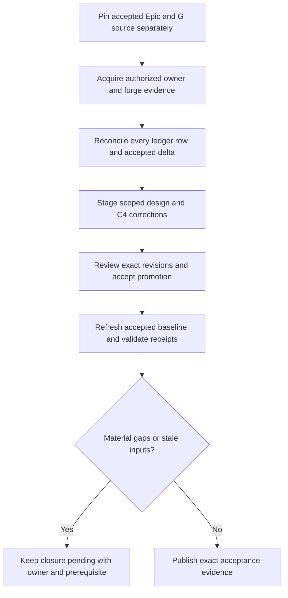

# Reconcile historical evidence and accepted architecture gaps

## Parent Epic

epic_034

## Scope

Corrective slice for epic criteria 12–14 after Feature G's canonical completion. Preserve all completed work and reuse G's inventory, reconstruction, ledger, tests and honest gap report; do not repeat A–G implementation. Requires its own reviewed plan and human approval under criterion 17; the original epic approval does not authorize execution.

Acceptance:
1. Pin separately the accepted Epic target/tracking revisions and G source artifacts. Reconcile all later accepted deltas, including F PR #218 merge d2ed1aca (present in epic f83f536a) and eventual G integration. No feature-source reachability may stand in for accepted Epic reachability.
2. Obtain the 34 A–F child-record revisions and relevant intent/verification evidence through the authorized owning Feature Teams and Epic handoff. Never use parent revisions as child revisions or filesystem access to bypass board authorization. Preserve exact unavailable reasons where retrieval fails.
3. Retrieve linked MR/PR descriptions and source revisions through existing authorized forge access, verifying linkage to reachable commits. Review URLs and merge messages are leads, not fabricated descriptions. Include non-Cascade fixes and deduplicate many-to-many work/commit/review evidence.
4. Individually reconcile the 2023 existing replay rows and accepted deltas to durable, superseded, no-impact, or unresolved dispositions with exact evidence and current-code/test references. Group work only when each row remains accounted for; do not blanket relabel missing evidence no-impact. Explain remaining evidence limitations and their materiality. Material unresolved rows prevent clean closure.
5. Reconcile affected leaf/root DESIGN files and stable-ID C4 fragments through existing owner-scoped staging/amendment paths. Complete exact-revision architecture review and accepted promotion; record current Task/Feature/Epic reconciliation receipts where required. Historical missing receipts remain honest gaps and must not be fabricated retroactively.
6. Refresh final reports and validate parent/child consistency, ownership, links, current code claims, and the pinned offline DSL/JSON/SVG pipeline. Exercise meaningful direct-fix and MR-described-change evidence plus unavailable provenance and acceptance rejection; reuse passing existing checks. Clean closeout requires no unresolved material mismatches and valid exact-revision acceptance evidence.

Planning constraints: provide concrete pinned handoff/ledger/delta/receipt contracts before task implementation. Use a small sequence of evidence acquisition, ledger/design reconciliation, and final accepted-state verification. Any proven lifecycle defect needs explicit scoped repair work, not raw state mutation. If authorized evidence remains unobtainable, report the exact prerequisite and request a human scope decision rather than silently relaxing the epic. G final-validation-report.json at 0bfcaca1 is the starting gap evidence (50 reported passing tests; clean_closeout=false).

## Data structures

These version-1 contracts extend G's existing inventory and replay artifacts; they do not create a second evidence store. Preserve existing row IDs and add explicit schema versions for new fields.

- **BaselinePair**: target/tracking repository identities and exact accepted Epic SHAs, separately pinned G artifact revision/path/content hash, observed F/G review state, and merge/reachability evidence. A source branch SHA never establishes accepted Epic integration. Refresh accepted deltas before final validation.
- **OwnerEvidenceHandoff**: work ID, owning feature, exact record revision, authorized source, relevant intent/verification excerpts with source references, and availability. Unavailable records carry a null revision plus a reason and responsible owner. Preserve the 34 existing child IDs; parent metadata never supplies a child revision.
- **ReviewEvidence**: forge/repository/review identity, linked reachable commit SHAs, source/head/base/merge revisions when available, captured description and content hash, retrieval time, and explicit unavailable fields/reasons. A description snapshot is mutable external evidence; its hash identifies captured bytes, not an invented historical Git revision. Distinguish current description from a description proven to exist at merge time.
- **ReplayDisposition**: original row ID and source identity, many-to-many work/commit/review evidence references, disposition (durable, superseded, no-impact, unresolved), rationale, current-code/test references at exact revisions, affected requirement/design/model IDs, and material-gap reason when unresolved. Every original row and newly accepted delta must appear exactly once in coverage accounting; shared evidence may be referenced by multiple rows.
- **AcceptanceSummary**: baseline pair, covered/unresolved/material counts, exact artifact revisions, architecture review-unit and accepted-revision IDs, current reconciliation receipt references and validator outcomes per applicable tier. Historical missing receipts remain separately reported. Clean closeout is false whenever a material gap, stale baseline, pending promotion, or required missing/stale receipt remains.

## Ownership and evidence boundary

Feature owners obtain their child records through their existing scoped tools and send revision-pinned handoffs through the Epic owner. H consumes those handoffs; it does not enumerate sibling task files or widen board access. Forge evidence uses existing authorized read access. Missing evidence is retained with an explicit reason and materiality assessment, never synthesized from a URL, merge title, or parent record. Architecture edits use existing owned-fragment staging and amendment paths.

## API contracts

These are required operation contracts, not new public endpoint names. Reuse G's HistoricalEvidenceInventory, AuthorizedWorkHandoff and AuthorizedReviewHandoff adapters and F's scoped replay/reconciliation services where their schemas fit.

1. Evidence acquisition takes BaselinePair and authorized owner/forge handoffs and returns a pinned inventory plus per-source availability. Validate repository identity, exact revisions and commit linkage; reject mismatched handoffs and preserve unavailable evidence without discarding ledger rows.
2. Reconciliation takes that inventory and existing ledger at pinned revisions and returns revised dispositions, design/C4 proposal references, and an accepted-delta coverage report. Reject duplicate/missing row IDs, unsupported claims and blanket no-impact classifications. A disposition needs row-specific rationale even when evidence is shared.
3. Acceptance verification takes the proposed artifacts, current accepted Epic pair and revision-bound approval/promotion evidence. Recheck F/G accepted reachability and every accepted delta. Invoke existing record_reconciliation_receipt and validate_reconciliation_closeout through authorized owner paths for current work; do not manufacture historical receipts or bypass policy by raw state writes.
4. A changed accepted baseline, evidence set or reviewed artifact invalidates the affected verification/approval result. Return explicit missing_evidence, material_mismatch, stale_baseline or acceptance_pending outcomes with owner and next prerequisite, rather than a successful empty result. Persist final reports only with the exact inputs they verified.

Verification reuses G's focused checks and adds high-signal coverage for a non-Cascade direct fix, an MR-described change, overlapping evidence, unavailable provenance, and rejection of stale/pending acceptance. Record test and renderer commands/results at the tested revision; historical passing counts are not new validation.

## Logic flow

## Task breakdown
- task_034_008_003
- task_034_008_002
- task_034_008_001

_(empty — Feature Team mints tasks after dispatch)_

## Risks & upward questions

- A–F child evidence may remain unavailable after authorized owner requests. Keep precise gaps and obtain a human scope decision if material evidence cannot be recovered.
- PR descriptions are mutable; retrieval today cannot prove their historical text without archived evidence. Preserve capture provenance and qualify inferred claims.
- G's remote review integration and later Epic commits can change the accepted baseline. Final verification must refresh it without treating feature-source ancestry as Epic acceptance.
- Planning edits do not authorize implementation. Independent review and fresh human approval of this corrective feature remain required by epic criteria 17–18; no task execution or acceptance is claimed by this document.

## Decision log

None yet.

## Closeout

Completed child work: `task_034_008_001` (Pin accepted baselines and acquire authorized historical evidence), `task_034_008_002` (Reconcile replay rows and accepted deltas into scoped design proposals), `task_034_008_003` (Verify exact architecture acceptance, receipts and final closeout).
