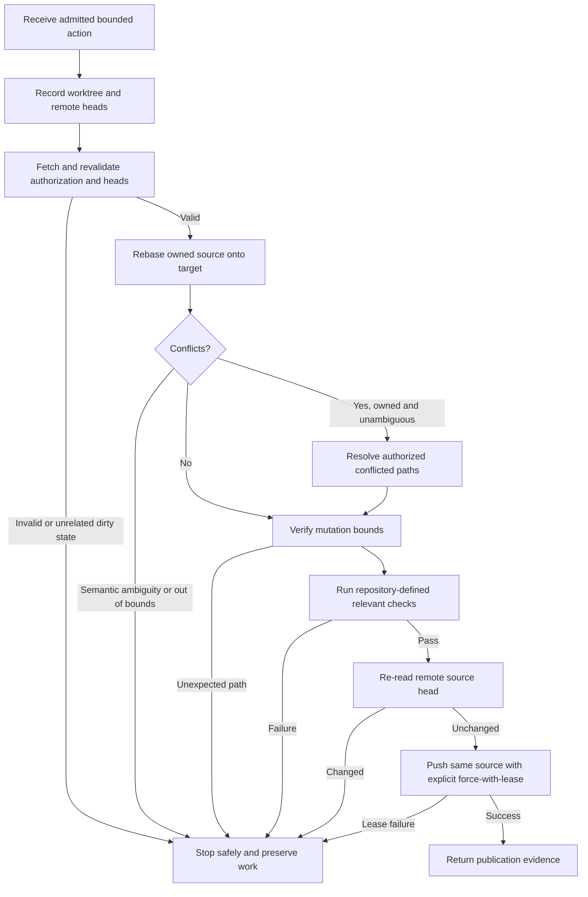

# Execute and publish an owned review rebase

## Parent Epic

epic_035

## Scope

### Objective

Run an already-admitted resolution action in a dedicated repository-backed team turn and safely update the same open review source branch.

### Required outcomes

- The turn receives only the authorized review/worktree, linked Git metadata, minimal edit/test operations, and push credentials.
- It records initial worktree state and source/target remote SHAs, fetches, and revalidates authorization and both heads before mutation.
- It rebases the owned source onto the target, permits edits only to conflicted paths that are also owned/authorized, and stops on unresolved semantic ambiguity.
- It runs repository-defined checks relevant to the rebased change and captures their results.
- It re-reads the remote source immediately before publication and pushes only the same review source branch with an explicit `--force-with-lease=<source-ref>:<observed-sha>`.
- Lease races, failed checks, dirty unrelated paths, remote-head changes, or changed authorization stop safely without discarding user work.
- Repository-backed end-to-end fixtures exercise one clean rebase and one semantic conflict.

### Non-goals

No target/trunk rewrite, new review creation, review replacement, unrestricted shell, automatic product decisions, broad cleanup, or bypass of existing lifecycle/review gates.

## Data structures

The turn contract must carry only:

- authorized review identity and source/target refs;
- dedicated worktree/repository identity;
- admitted ownership/path bounds and authorization evidence;
- minimal permitted Git, edit, and repository-check operations;
- scoped publication credentials.

Execution evidence must retain:

- initial worktree status;
- observed source and target remote SHAs before mutation;
- authorization/head revalidation results;
- conflicted and modified paths;
- check commands and outcomes;
- the source SHA observed immediately before publication;
- publication or safe-stop outcome with actionable reason.

Concrete type names belong to implementation; these fields and invariants are the feature contract.

## API contracts

### Preflight

Given the bounded turn input, fetch current refs and return validated execution context only when the review is still authorized, source and target heads match the admitted action, and no unrelated dirty state would be endangered. Otherwise stop without mutation.

### Rebase and conflict handling

Rebase the validated owned source onto the validated target. Mutations are limited to conflicted paths within the authorized ownership set. Unresolved product or semantic choices produce a preserved-state stop, not an automatic decision.

### Checks and publication

Run repository-defined relevant checks and retain evidence. Immediately before publication, re-read the remote source head. Update only the same open review source branch using an explicit `--force-with-lease=<source-ref>:<observed-sha>`. Any failed check, unexpected mutation, remote-head change, or lease failure stops publication and preserves local work.

### Result

Return structured evidence for success or safe stop. A successful result identifies the unchanged target, updated source, check evidence, and lease-protected push. A stopped result identifies the failed invariant and leaves recovery to the existing lifecycle rather than discarding work.

## Logic flow

## Task breakdown

1. `task_035_002_001` — define bounded inputs and fail-closed preflight validation.
2. `task_035_002_002` — execute guarded rebase and bounded conflict resolution.
3. `task_035_002_003` — run relevant checks and publish with explicit lease protection.
4. `task_035_002_004` — add deterministic clean-rebase and semantic-conflict end-to-end fixtures.

Dependencies are linear: `001 → 002 → 003 → 004`.

## Acceptance criteria

- Invalid authorization, changed admitted heads, or dirty unrelated paths prevent mutation.
- The target ref is never rewritten and the review identity is unchanged.
- Conflict edits cannot escape the intersection of conflicted and authorized paths.
- Semantic ambiguity stops with preserved state and actionable evidence.
- Publication cannot occur unless relevant checks pass and the remote source still equals the observed lease SHA.
- The push uses an explicit ref-and-SHA force-with-lease argument.
- End-to-end fixtures prove the clean success path and semantic-conflict safe-stop or explicitly authorized resolution path.
- Failure paths do not discard unrelated user work.

## Risks & upward questions

None. The epic contract is sufficient; implementation-specific type and module names remain delegated to the tasks.

## Decision log

See recorded board decisions.

- `dec_001` · 2026-11-04 · Feature Lead · **Execution staging and verification**
  Chose Deliver the feature as a linear fail-closed pipeline: bounded preflight, guarded rebase/conflict handling, checks plus lease-safe publication, then two repository-backed end-to-end fixtures..
  Rationale: Each stage depends on evidence from the prior stage, so a linear chain keeps authorization and lease invariants explicit. Two end-to-end scenarios provide the highest-signal coverage required by the epic without adding redundant test scope.
  Honors: Epic required outcomes and non-goals; frugal-engineering preference for the smallest high-signal test set..

## Closeout

Completed child work: `task_035_002_001` (Define bounded review-rebase turn inputs and preflight validation), `task_035_002_002` (Execute guarded owned-source rebase and conflict resolution), `task_035_002_003` (Run repository checks and publish with an explicit force-with-lease), `task_035_002_004` (Add end-to-end owned review rebase fixtures).
