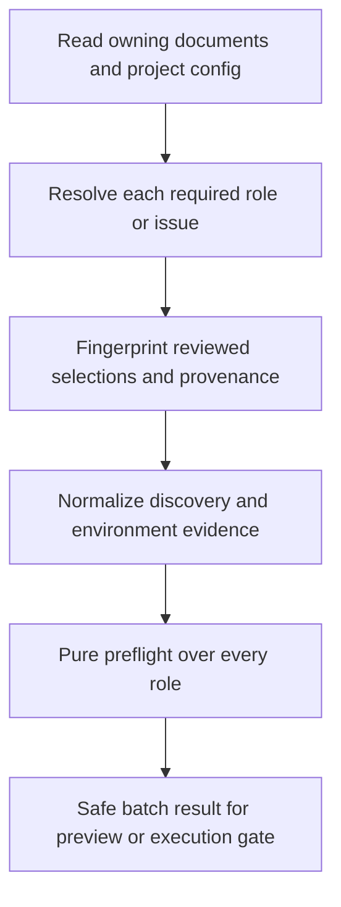

# Unify effective role configuration and capability diagnostics

## Parent Epic

epic_037

## Scope

Deliver the shared contract required by epic_037 success criteria 1–3, 7, and 9. Extend existing provider discovery/inventory, model resolution and pure preflight; do not create a second evaluator or status store.

Acceptance:
- Resolve all five Epic roles, the Feature planning roles plus effective SWE selection, and Task SWE with the same precedence/stamping rules used by actual work. Include work item, role, provider, model, reasoning (including provider default), reviewed/effective Flex, document path/revision and source for each selection. Explicit malformed values and incomplete legacy selections become blockers with an explicit migration/default remedy, never successful empty batches or exception fall-through.
- Produce one safe batch/role contract including supported/blocked/transient outcome, deterministic/transient classification, stable reason code and safe message, eligible remedies, provenance, and inventory age/freshness. Preserve useful existing response fields while migrating consumers.
- Distinguish missing/malformed configuration, unsupported adapter, unavailable/empty discovery, missing installation/authentication, temporary unavailability, absent/retired model, unsupported reasoning, provider/model Flex rejection, and incompatible CLI/SDK or required tool-host capability. Normalize environmental observations outside the pure evaluator; no probe may start a model turn or persist credentials/raw errors.
- Aggregate every affected role. A deterministic rejection takes precedence in the batch while transient role details remain visible. Missing capability evidence cannot be reported as verified support.
- Specify the shared selection fingerprint and revision semantics used by child override checks, execution snapshots, readiness and Flex authorization. Inventory age shown after restart must not interpret process-relative monotonic timestamps as wall-clock dates.

Validation: extend focused existing preflight/discovery/stack tests with a table-driven failure matrix, precedence/provenance cases and safe serialization checks. One representative integration test must demonstrate that preview and execution receive identical effective selections. Do not duplicate the full matrix at every boundary.
Implementation anchors: cascade/agent/preflight.py, cascade/agent/discovery/, cascade/watchdog/model_resolve.py, cascade/brief_stack.py, cascade/work_backend.py.
Before dependent work starts, document the concrete result schema and reason/remedy mapping in this feature's API contracts.

## Data structures

- `EffectiveSelection`: `work_id`, `tier`, `role`, `provider`, `model_id`, `reasoning_level` (nullable override), `reasoning_effective` (the explicit override when set, otherwise the discovered provider default when known), `reviewed_flex_mode`, `effective_flex_mode`, `field_sources`, `document_path`, `document_revision`, `selection_fingerprint`. A field source names the owning document and its revision or the relevant project configuration revision; source kinds retain existing `document-role`, `document`, `project-role`, `project-tier`, `project-default`, and `provider-default` meanings. An unmaterialized inherited value also names the ancestor and the stamping rule. A stamped child value is owned by the child document, with its `parent_rev` retained as lineage. A runtime Flex waiver changes only `effective_flex_mode`; it is never a reviewed field source.
- `SelectionIssue`: `work_id`, `tier`, `role`, safe `reason_code`, `message`, and available provenance for a selection that cannot be constructed. The resolver returns one selection or issue for each required role; it does not drop a role after a parse/resolution error. An issue carries nullable safe provider/model/reasoning/Flex fields and the attempted field source/revision when available; it never carries a raw parser exception.
- `CapabilityEvidence`: normalized provider availability, discovery failure kind, model catalog (including per-model reasoning/Flex), provider Flex support, and explicit compatibility evidence for CLI/SDK and required tool host. Unknown capability is distinct from supported. Adapters/probes create this outside the pure evaluator and expose only fixed safe labels, never raw errors or credentials.
- `InventoryFreshness`: retain `from_cache`, `fetched_at`, `expires_at`, and `ttl_seconds` for existing consumers, with `fetched_at` and `expires_at` serialized as UTC epoch seconds. Add `age_seconds` and `stale` at projection time; compute age with a wall clock and clamp clock skew to zero. The in-process TTL may use monotonic time privately. After restart, absent/invalid wall-clock evidence means unknown age and stale, not a fabricated date.

## API contracts

**Scopes and precedence.** Epic evaluates `epic_manager`, `epic_architect`, `feature_lead`, `feature_architect`, `swe` in that order. Feature evaluates `feature_lead`, `feature_architect`, and effective `swe`; Task evaluates `swe`. The owning worktree is authoritative. For each role, explicit document role model wins, then document legacy model, then configured provider role, then configured tier model. An explicitly present malformed or blank value is a configuration issue; fallback applies only to an absent value. Feature planning roles follow `feature_backend_from_epic` mapping at mint and then their own overrides. Feature SWE follows Feature SWE, then Epic SWE, then the project default when not yet stamped. Task SWE follows `task_backend_from_feature` at mint and then Task override. Provider follows the selected document, then the project default; reasoning follows an explicit role override, otherwise the discovered provider default. Reviewed Flex follows the selected document/stamp; an absent value is false. Validate legacy documents that lack required pins and report migration/default guidance rather than treating an empty role set as success.

**Fingerprint and revision.** Canonical fingerprint is SHA-256 of a versioned, sorted-key UTF-8 JSON object (`schema: selection-v1`) containing `work_id`, `tier`, ordered roles, each role's provider, model, explicit reasoning override, reviewed Flex, per-field source kind and source document/config revision, and owning document path/revision. Encode the scope as an ordered array and encode each role as either a complete selection or an issue with its stable issue code and available source revisions. Normalize absent reasoning to null and absent Flex to false. A batch with any issue still has a fingerprint for diagnostics and stale comparisons, but cannot authorize execution or a Flex waiver. Exclude inventory, timestamps, diagnostic text, and runtime waiver. A change to selected values or any contributing document/config revision invalidates the fingerprint. Store the same fingerprint with preview, child override check, execution snapshot, readiness projection, and Flex authorization. Compare it to freshly resolved selections before using a snapshot or waiver; a mismatch is `stale_selection` and requires revalidation. An unrelated inventory refresh changes capability results, not the selection fingerprint. A waiver is separately bound to the fingerprint, original action, and scope; its effective Flex value is evaluated afresh.

**Pure result.** `ProviderCapabilityBatchPreflight` retains `outcome` (`supported|blocked|transient`), `checks`, and `supported`; add `work_id`, `action`, `selection_fingerprint`, `inventory_freshness`, `classification` (`deterministic|transient|null`), `reason_code`, `message`, and eligible `remedies`. Each `RoleCapabilityPreflight` retains its Python `role` and nested `result` object. Its serialized `checks[]` entry remains flat, with the existing `outcome: supported|unsupported|unavailable`, `reason`, `provider`, `model_id`, `tier`, `message`, and `retryable` keys, and adds selection/provenance, `reason_code` alias, classification, remedies, and inventory freshness. Safe unknown selection fields serialize as null. `reason` remains a stable code. Successful roles use `available`, classification null, and no remedies. The evaluator accepts selections/issues and normalized evidence only; it performs no discovery, filesystem mutation, credential write, or provider turn. Every required role has exactly one check. An empty required scope or missing evidence cannot yield `supported`. If any role is unsupported, batch is blocked/deterministic; otherwise any unavailable role makes it transient; retain every role result even when batch precedence differs. For a blocked batch, summarize the first unsupported role in scope order; for a transient batch, summarize the first unavailable role. Successful batches use `reason_code: available`, classification null, message `Selected agent configuration is supported`, and no remedies. The batch remedy list is the ordered deduplicated union of failed-role remedies, plus `continue_without_flex` only after the specified fresh whole-batch check. The UI should render all checks.

**Stable reason and remedy vocabulary.** `choose_configuration` opens supported provider/model/reasoning selection; `open_provider_setup` opens installation/auth/tool-host guidance; `refresh_and_retry` refreshes evidence; `migrate_or_default` applies or guides an explicit supported default/migration. `continue_without_flex` is a batch-level candidate only when every deterministic failure is `flex_mode_not_supported` and a fresh whole-batch evaluation with Flex off succeeds. It is not a per-role authorization.

| Reason code | Classification | Eligible remedies |
| --- | --- | --- |
| `missing_configuration`, `malformed_configuration`, `invalid_model`, `invalid_tier` | deterministic | migrate_or_default, choose_configuration |
| `unsupported_adapter` | deterministic | choose_configuration |
| `provider_not_installed`, `provider_not_authenticated` | transient | open_provider_setup, refresh_and_retry |
| `discovery_unavailable`, `discovery_empty`, `provider_unavailable`, `provider_temporarily_unavailable`, `capability_unknown` | transient | refresh_and_retry; open_provider_setup when setup evidence exists |
| `model_not_offered` (includes absent/retired model) | deterministic | choose_configuration |
| `reasoning_not_supported` | deterministic | choose_configuration |
| `flex_mode_not_supported` (include `capability_scope: provider|model`) | deterministic | choose_configuration; batch may offer continue_without_flex |
| `cli_incompatible`, `sdk_incompatible`, `tool_host_incompatible` | deterministic | open_provider_setup |
| `stale_selection` | deterministic | refresh_and_retry after selection reconciliation |

Unknown per-model reasoning or Flex metadata is `capability_unknown` when that metadata is needed to verify the selected value; explicit rejection yields `reasoning_not_supported` or `flex_mode_not_supported`. A complete verified catalog absence yields `model_not_offered`; an unavailable or empty catalog does not. Messages are fixed, operator-safe text keyed by reason and optional safe labels; provider exception text and raw discovery payloads never enter results or persistence. Serialize only JSON-safe primitives, deterministic role order, stable reason codes, non-secret paths/revisions and wall-clock freshness. Keep current dispatch `ok`, `reason`, `event` and nested `preflight.outcome/checks` keys while adding fields. Later features may persist/project the same safe result but must not create another evaluator or status store.

## Logic flow

## Task breakdown

1. task_037_001_001 — define this contract.
2. task_037_001_002 — resolve and fingerprint selections.
3. task_037_001_003 — normalize evidence and inventory freshness.
4. task_037_001_004 — extend the pure evaluator and safe result.
5. task_037_001_005 — migrate consumers and verify parity.

## Risks & upward questions

None.

## Decision log

None yet.

- `dec_001` · 2026-11-07 · Feature Architect · **API contracts**
  Chose Use one versioned selection fingerprint over ordered effective roles, reviewed values and contributing source revisions; keep inventory and runtime Flex waivers outside it..
  Rationale: Preview, child override checks, execution snapshots, readiness and Flex authorization need a stable identity for the reviewed selection. Inventory refreshes should trigger capability reevaluation without changing that identity.
  Honors: Epic 037 success criteria 1, 2, 5, 7 and 9; shared selection/provenance contract..

- `dec_002` · 2026-11-07 · Feature Architect · **API contracts**
  Chose Preserve existing preflight outcome and response keys while adding per-role classification, provenance, safe reason/remedy codes and whole-batch deterministic precedence..
  Rationale: Existing dispatch and War Room consumers already use the current keys. Additive fields let them migrate while every affected role remains visible and no missing evidence counts as support.
  Honors: Epic 037 success criteria 3, 7 and 9; one pure evaluator and no parallel status store..

- `dec_003` · 2026-11-07 · Feature Architect · **Data structures**
  Chose Use UTC wall-clock inventory timestamps for portable freshness and retain monotonic time only for the in-process cache TTL..
  Rationale: Current monotonic timestamps are meaningful only within one process; using them after restart can display a false inventory age or date.
  Honors: Epic 037 success criteria 2 and 6; accurate restart-safe readiness..

- `dec_004` · 2026-11-07 · Feature Architect · **API contracts**
  Chose Keep the Python role result nested and the serialized role check flat; summarize the first failure matching batch precedence, fingerprint incomplete scopes for stale diagnostics, and treat unknown required capability metadata as unavailable..
  Rationale: Existing dispatch serialization already exposes flat checks from nested Python results. Deterministic batch precedence needs a matching summary, and unresolved selections need stable identity without being allowed to authorize work. Unknown metadata cannot prove support or a specific rejection.
  Honors: Epic 037 success criteria 1–3, 7 and 9; existing preflight and dispatch response compatibility..

- `dec_005` · 2026-11-07 · Feature Lead · **Task breakdown**
  Chose Task 001 delivers the approved shared contract as importable source declarations and a focused contract test; the Feature team retains the prose API contract and decision log..
  Rationale: The prose contract is already saved in the feature spec. Task sandbox policy denies docs/features reads and writes, so another documentation-only Task dispatch cannot produce an authorized commit. Source declarations give dependent Tasks 002–004 an executable interface within the Task sandbox.
  Honors: feat_037_001 API contracts and Tasks 001–004 dependency intent; Task path ownership..

## Closeout

Completed child work: `task_037_001_001` (Define effective-selection and diagnostic API contracts), `task_037_001_002` (Resolve and fingerprint complete effective role selections), `task_037_001_003` (Normalize capability evidence and portable inventory freshness), `task_037_001_004` (Extend the pure preflight evaluator and safe batch result), `task_037_001_005` (Migrate selection consumers and verify preview/execution parity).
