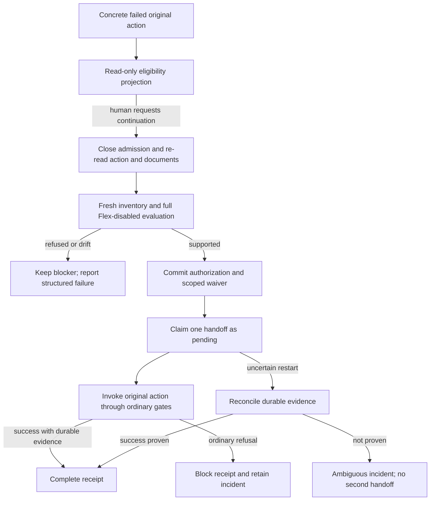

# Add human-authorized idempotent continuation without Flex

## Parent Epic

epic_037

## Scope

Deliver epic_037 success criterion 5 with the durable recovery and lifecycle constraints of 2, 3, 7 and 8. Extend the existing provider recovery command, lifecycle gate and recovery ledger.

Acceptance:
- Offer Continue without Flex only for a concrete failed original action when at least one failure is Flex rejection, all deterministic failures are flex_mode_not_supported, and fresh evaluation of the entire same selection with Flex disabled passes. Any remaining transient, configuration, provenance, capability, lifecycle or approval blocker prevents continuation.
- Require an explicit human action. Agents, schedulers, ordinary refresh and automatic retries cannot authorize a waiver. Persist only non-secret authorization/audit data: action identity/type, work item and original revision/selection fingerprint, affected scope, human authorization, requested/effective Flex, freshness evidence and retry outcome.
- Store the Flex waiver as a runtime service-tier override tied to the selected configuration, leaving reviewed plan text, provider/model/reasoning pins and approval/sign-off revisions intact. Apply it only to the original action's validated role scope and its normal stamped descendants; it does not overwrite independent child overrides or change existing sibling work. Carry its provenance into minted/executed selections. Configuration/revision changes require fresh eligibility and authorization; unrelated changes cannot silently broaden the waiver.
- Re-read current documents/lifecycle under the existing gate, refresh inventory, validate the full Flex-disabled selection, persist authorization, and replay the original activation, Feature dispatch, approval-driven dispatch or Task retry through ordinary gates once. Do not bypass dependency/review/approval constraints, reconstruct arbitrary opaque checkpoints or discard worktrees.
- Bind idempotency to original action plus selection/revision (not work ID or provider alone); concurrent/repeated requests and restart use one durable action receipt and one retry handoff. Record pending/completed outcomes so crash recovery cannot blindly issue a duplicate. An ambiguous handoff remains an actionable incident rather than risking a second turn.
- Fresh drift during replay retains the blocker and reports the new structured failure. Existing reviewed work and successful prior lifecycle steps are preserved.

Validation: command/API integration tests for human-only authorization, Flex-only versus mixed failures, fresh inventory and revision races, preserved plan hashes and dirty worktrees, duplicate clicks/concurrent requests, restart before/after retry handoff, and exactly one successful retry event/turn in the normal path. Exercise each original action adapter without duplicating the evaluator matrix.
Before implementation of mutation/replay, document waiver scope, invalidation and action receipt state transitions in this feature's API contracts.
Implementation anchors: cascade/provider_recovery_command.py, cascade/provider_recovery.py, cascade/provider_recovery_state.py, cascade/epic/lifecycle_gate.py, existing dispatch/kickoff and provider route adapters.

## Data structures

- **Failed action reference:** durable, opaque attempt ID assigned when a canonical activation or dispatch attempt fails preflight; action kind (`epic_activation`, `feature_dispatch`, `approval_dispatch`, or `task_retry`), target work ID, original actor/path and permitted replay arguments, owning document path/revision, complete reviewed selection fingerprint, ordered role scope, and blocker/incident reference. The attempt ID distinguishes separate failed actions on the same work item. Assign and persist it at the canonical failed preflight boundary with the original actor, replay arguments and full role-check evidence. The existing mutable per-work provider blocker and its `first_attempt` timestamp are only a presentation projection, never an action identity; a fresh preview cannot manufacture a failed action. A UI hint is not an authorization.
- **Runtime Flex waiver:** versioned row in the existing provider recovery ledger, keyed to one authorization receipt. It records the selected source configuration and exact validated roles, requested Flex=true and effective Flex=false, ancestor/stamp lineage, authorizing human identity/time, and fresh inventory evidence (observation time, age/staleness and safe provider capability revision where available). It stores no credentials, provider error body or raw secrets. Provider, model and reasoning pins remain in the reviewed document.
- **Action receipt:** key = original failed-action ID + action kind/target + original document revision + complete reviewed selection fingerprint. Store authorization, waiver ID, handoff state, canonical replay result/event or structured refusal, first/last timestamps and safe audit evidence in the same durable ledger. A unique receipt key is claimed atomically under the existing process/transition locks. Do not key by work ID or provider alone.

## API contracts

### Eligibility and authorization

A read-only recovery projection may return `continue_without_flex` only for the specific failed action reference. The server, not the browser, computes eligibility. Require at least one failed role with `flex_mode_not_supported`; every deterministic failure must have that code. Refresh provider inventory, resolve the entire original role scope from current owning documents, and evaluate the *same* provider/model/reasoning selections with effective Flex false. Every role must be supported, inventory must be fresh, and the original document revision, selection fingerprint, action identity and lifecycle/dependency/approval state must still match. Transient, configuration, provenance, capability and other lifecycle refusals fail closed. The existing pure batch evaluator remains the sole capability decision. A preview or refresh does not create a waiver or receipt.

The mutation command accepts an explicit server-authenticated human principal and the failed-action reference/expected revision and fingerprint. Agent, scheduler, ordinary refresh and automatic retry paths cannot call it as human. Re-read the incident, documents and lifecycle state after closing admission with `LifecycleGate.transition`; refresh inventory and repeat the complete Flex-disabled check under the command's serialized boundary. Reject stale or missing evidence with a safe structured refusal. Persist the authorization and waiver before any replay. The command response reports eligibility/receipt state, safe reason, action key and any ordinary replay result; it never exposes raw provider output or credentials.

### Waiver scope and invalidation

The override changes only runtime service tier. Apply effective Flex=false to the exact roles validated for the original action and to descendants created by the normal pin/stamp flow from those roles. Propagate a waiver/lineage reference with stamped selections so execution preflight can distinguish this authorized effective Flex from the reviewed Flex request. An independently configured child role, a previously existing sibling, or an unrelated action has no inherited waiver. Explicit child configuration always wins; if it requests Flex, validate it normally. A new or changed provider/model/reasoning/Flex pin, source/configuration revision, role set, or ancestor stamp breaks the lineage and needs fresh eligibility and human authorization. Normal status movement and stamping caused by the authorized action may carry the recorded pre-action source revision forward; they must not turn an unrelated later edit into a valid waiver. The reviewed selection fingerprint and approved/sign-off plan revisions are never rewritten to implement the override.

Carry-forward across a canonical status relocation or Task parent-pin refresh must be an explicit, durable lineage entry tied to the same authorization receipt and handoff claim. Record the exact before/after document paths, revisions and selection fingerprints at that transition boundary, and verify that the selected provider, model, reasoning, requested Flex and role scope are unchanged. A Task parent-pin refresh may carry only when the pin update is the canonical dispatch preparation and its selected configuration remains the same. The later execution gate accepts the post-transition identity only through this recorded chain; ordinary edits, a matching value from an independent child override, or an unrecorded relocation cannot inherit it. Descendant stamps continue to name the original authorized source and the verified chain. Persist the lineage before kickoff so a restart can distinguish an authorized status move from drift.

At every actual process launch, resolve the current selection and refresh inventory again through the existing execution gate. If the waiver lineage or capability check fails, retain the durable blocker and return the new structured failure. Do not silently fall back to a different provider/model/reasoning level or write a new waiver.

### Receipt transitions and replay

`eligible` is a computed state only. Durable transitions are:

| State | Meaning and next step |
| --- | --- |
| `authorized` | Human authorization and scoped waiver are committed. No retry has been claimed. After restart, this state can be rechecked and claimed once if the original selection/lifecycle still matches. |
| `handoff_pending` | One caller durably claimed the canonical action before invoking it. Repeated/concurrent clicks return this receipt without invoking again. |
| `completed` | Canonical action returned a successful event/turn handoff with durable evidence; repeats return the stored outcome. |
| `blocked` | A fresh ordinary gate or preflight refused before a successful handoff; retain its structured blocker. A changed selection or new failed attempt needs a new human authorization. |
| `ambiguous` | The process stopped or returned without decisive evidence after the handoff claim. Reconcile against durable dispatch/event/queue/turn evidence; if it proves success, mark completed. Otherwise expose an actionable incident and never blindly issue a second handoff. |

Persist `authorized` before `handoff_pending`; persist the pending claim before calling the ordinary action. State writes must be atomic and restart-safe. A request with the same action key returns or advances only its existing receipt. Once pending, no scheduler, duplicate click or restart may launch it again. A normal success yields at most one lifecycle event and one model turn. An emitted dispatch event alone does not prove kickoff or turn admission: the current deferred kickoff queue is process-local. Mark `completed` only when the canonical action's lifecycle effect and its turn handoff have decisive durable evidence; if an event exists but handoff is unproven, keep the receipt `ambiguous` and reconcile without invoking the action again. An exception after the pending claim is also ambiguous unless the ordinary gate proves no lifecycle effect occurred. A refusal caused by fresh drift records `blocked` with the new structured failure while preserving prior plan hashes, approvals, successful lifecycle steps and dirty worktrees.

Supported replay adapters are deliberately narrow:

| Original failed action | Ordinary gate and replay entry |
| --- | --- |
| Epic activation | `watchdog.dispatch.activate_epic(work_id, "human")`, including brief, dependency, worktree and fresh provider gates. |
| Feature dispatch | `watchdog.dispatch.dispatch_feature(work_id, original authorized actor)`, including readiness, dependency, review and stacked-dispatch gates. |
| Approval-driven dispatch | Re-run the canonical `dispatch_feature` or `dispatch_task` for the specific target released by an existing approval through the same approval/automation dispatch path; do not redo an approval already committed or dispatch unrelated children. |
| Task retry | `feature.recovery.retry_task(task_id, feature_id=parent)`, which claims through normal task dispatch and retry gates. |

The adapter must preserve the original action arguments and never reconstruct an opaque graph checkpoint, delete a worktree, skip an approval/review gate or directly invoke a model turn. If the ordinary action rejects, return that structured result and leave the existing incident actionable.

## Logic flow

## Task breakdown

1. `task_037_003_001` — Define continuation contract, waiver scope, and receipt states.
2. `task_037_003_002` — Evaluate and expose eligibility.
3. `task_037_003_003` — Persist the scoped runtime Flex waiver.
4. `task_037_003_004` — Implement human authorization and durable action receipt.
5. `task_037_003_005` — Replay each original action once through ordinary gates.
6. `task_037_003_006` — Validate command and replay integration.

## Risks & upward questions

- The current recovery ledger keys provider replacement by work item plus requested selection and records completion before kickoff. Continuation needs a separate action receipt and pending handoff claim within that ledger; reusing the old key would coalesce distinct failed actions.
- The current lifecycle gate is process-local. Restart safety depends on the durable receipt and existing event/queue evidence, not on that volatile lock alone.
- An ambiguous handoff may need operator investigation; automatic replay is unsafe without decisive durable evidence. The current dispatch path emits the lifecycle event before `_boot_after` invokes kickoff, and deferred kickoff uses an in-memory queue, so an event alone is insufficient evidence that a turn was handed off.

## Decision log

None yet.

- `dec_001` · 2026-11-07 · Feature Lead · **API contracts — waiver scope and invalidation**
  Chose Bind the runtime Flex waiver to the exact validated role scope and source revision, carrying it only through normal stamped descendants; explicit child overrides and existing siblings remain independent..
  Rationale: This preserves reviewed configuration and approvals while allowing the authorized action to complete without silently widening the service-tier waiver.
  Honors: Epic success criterion 5; fresh execution checks and provenance constraints in criteria 2, 3, 7 and 8..

- `dec_002` · 2026-11-07 · Feature Lead · **API contracts — action receipt**
  Chose Key a durable receipt by concrete failed-action identity, kind/target, original revision and reviewed selection fingerprint; commit authorized, handoff_pending, completed, blocked or ambiguous transitions around one canonical retry..
  Rationale: The existing work-item/selection recovery key cannot distinguish failed actions, and a pending claim plus evidence reconciliation avoids duplicate lifecycle effects after concurrent clicks or restart.
  Honors: Epic success criterion 5; restart-safe one-handoff requirement and preservation of existing work..

- `dec_003` · 2026-11-07 · Feature Lead · **API contracts — replay adapters**
  Chose Replay only Epic activation, Feature dispatch, the specific approval-released dispatch target, or Task retry through their existing ordinary gates, without redoing committed approvals or reconstructing graph checkpoints..
  Rationale: These are the four original action forms in scope; canonical gates retain dependency, review, approval and fresh preflight enforcement.
  Honors: Feature acceptance and Epic criteria 2 and 5; no bypass of lifecycle constraints..

- `dec_004` · 2026-11-07 · Feature Architect · **API contracts — failed action identity**
  Chose Persist an opaque attempt ID and original replay context at each canonical failed provider preflight; treat the mutable work-item blocker as a projection, not the continuation identity..
  Rationale: The existing blocker is overwritten per work ID and its first-attempt timestamp can survive multiple failures, so neither safely distinguishes original actions for authorization or idempotency.
  Honors: Concrete failed-action eligibility and action-scoped idempotency in the feature acceptance..

- `dec_005` · 2026-11-07 · Feature Architect · **API contracts — handoff evidence**
  Chose Require decisive durable evidence of both lifecycle effect and turn handoff before completing a receipt; keep event-only or post-claim uncertainty ambiguous without replay..
  Rationale: The canonical dispatch path emits its event before kickoff, and deferred kickoff is queued in memory. An event alone cannot prove that a turn was handed off or permit a safe second dispatch.
  Honors: One successful event and one model turn across concurrent requests and restart..

- `dec_006` · 2026-11-07 · Feature Architect · **API contracts — canonical waiver carry-forward**
  Chose Carry a Flex waiver through canonical status relocation or Task parent-pin refresh only with a durable before/after lineage record tied to the same receipt and pending handoff, after verifying unchanged selected configuration and role scope..
  Rationale: The merged waiver matcher binds to the pre-action document revision, while ordinary dispatch writes a new revision before kickoff; unrecorded carry would either lose the authorized waiver or let later edits inherit it.
  Honors: Feature acceptance for fresh execution checks, scoped waiver provenance, and one ordinary replay without changing reviewed plan or approvals..

## Closeout

Completed child work: `task_037_003_001` (Define continuation contract, waiver scope, and receipt states), `task_037_003_002` (Evaluate and expose Continue without Flex eligibility), `task_037_003_003` (Persist scoped runtime Flex waiver and selection provenance), `task_037_003_004` (Implement human authorization and durable action receipt), `task_037_003_005` (Replay each original action once through ordinary gates), `task_037_003_006` (Validate continuation command and replay integration).
