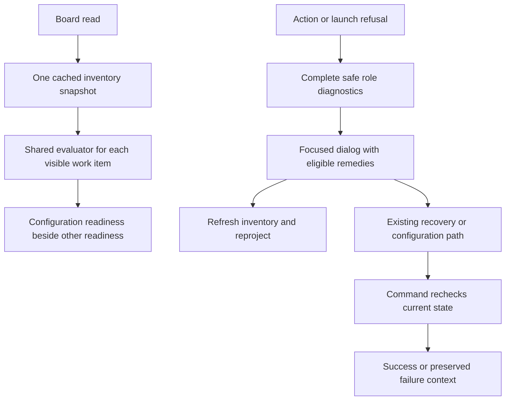

# Expose actionable War Room diagnostics and readiness

## Parent Epic

epic_037

## Scope

Complete epic_037 success criteria 3, 4, 6 and 10 using the shared evaluator, gates and recovery action. Extend the existing provider recovery dialog, API serialization and board rows.

Acceptance:
- Epic activation, Feature dispatch, approval-driven dispatch and Task retry display a focused accessible failure dialog/panel with every affected role, provider/model/reasoning/Flex selection, safe reason, configuration path/revision, inventory freshness and valid remedies. Lead with readable failure text; provider_preflight_blocked is never sole feedback. Make partial approval/dispatch outcomes explicit.
- Render server-computed action eligibility: refresh/retry for transient state, provider setup, a usable path to change configuration, and Continue without Flex only when eligible. Changes still flow through existing review/recovery paths. A stale view cannot grant authority; command-side checks decide.
- Backlog and active rows display configuration readiness separately from lifecycle/dependency/plan readiness. Derive all results from the same evaluator, sharing the bounded inventory cache across rows. Display stale/unknown state explicitly; no provider discovery on every row and no model turn for a readiness refresh.
- Refreshing inventory reprojects readiness and dialog diagnostics without lifecycle events, queue/checkpoint mutation or new incidents. A cached success cannot clear a durable blocker. Preserve visible failure/context on unsuccessful action; show completion once for idempotent success.
- Reuse keyboard/focus handling and labels in the existing dialog, including safe text rendering and focus restoration.

Validation: add economical browser/API flows using the repository's existing browser harness and fake provider inventory: invalid future Feature/SWE role at activation; all failed roles/remedies; one successful Continue without Flex retry with unchanged reviewed plan; transient/setup flow distinct from deterministic selection rejection; stale inventory refreshed; catalog drift after activation blocked at launch; approval-driven failures and Task retry. Assert lifecycle side-effect counts on the server and keyboard/focus behavior in the browser. Run targeted existing recovery/readiness/brief/approval regression suites; no dependency installation is authorized.
Implementation anchors: cascade/war_room/serialize.py, provider routes and dispatch/approval handlers, cascade/war_room/static/provider_recovery_dialog_ui.js, war_room.js and board row presentation; tests/war_room existing browser flow harness.

## Data structures

- Reuse `ProviderCapabilityBatchPreflight.to_dict()` and its ordered role `checks` as the safe diagnostic source. Each check carries effective provider/model/reasoning/Flex selection, source path/revision, stable reason, classification and remedies; the batch carries action, selection fingerprint and inventory freshness.
- Add a read-only configuration-readiness projection to backlog and active Epic, Feature and Task rows. It reports supported, deterministic blocker, transient blocker or unknown state and exposes freshness/staleness. It is distinct from plan, dependency and lifecycle readiness.
- Keep the durable provider blocker and `provider_recovery.actions` as the source for active recovery. A successful cached readiness evaluation does not clear that blocker; only the established fresh execution check does.
- Keep the failed action's complete safe per-role check snapshot in the active recovery view. Present it as the failure context, separately from the current configuration-readiness projection, so a reload or inventory refresh cannot erase what failed.

## API contracts

- `/api/board` returns configuration readiness for applicable backlog and active rows. One bounded cached inventory snapshot is shared across the board projection; row serialization does not trigger per-row discovery or a model turn. Existing `provider_recovery` remains available for active blockers and supplies server-computed action eligibility.
- For an active blocker, `provider_recovery` also exposes the persisted safe batch diagnostics (including ordered role checks and original action identity when recorded). The dialog retains that failed-action context across reloads while showing refreshed configuration readiness as a separate current observation.
- Failed Epic activation, Feature dispatch, approval-driven dispatch and Task retry responses include a readable safe summary and the complete ordered failed-role checks from the shared evaluator. Include action identity, document path/revision, selection fingerprint and inventory freshness where supplied by that contract. Keep internal error codes as details. For approval-driven dispatch, state which approval or dispatch step committed and which launch did not occur.
- Inventory refresh uses the existing provider inventory refresh path, followed by read-only board/dialog reprojection. It changes neither lifecycle state nor queue/checkpoint/incident state. A failed action retains its context while the fresh diagnostic view is shown.
- Recovery controls follow the server's `provider_recovery.actions` eligibility and existing review/recovery commands. Continue without Flex is shown only when its original-action eligibility is true; the command rechecks revision, selection fingerprint, freshness and all normal gates. Stale view state never authorizes a command.

## Logic flow

## Task breakdown

1. `task_037_004_001` — Server row readiness and recovery eligibility projection.
2. `task_037_004_002` — Complete safe action and approval/dispatch diagnostics. Runs in parallel with 001.
3. `task_037_004_003` — Accessible dialog and board presentation; depends on 001 and 002.
4. `task_037_004_004` — Browser/API validation and targeted regressions; depends on 003.

## Risks & upward questions

- Readiness can become stale between display and action. Commands retain fresh checks and report a conflict with useful diagnostics.
- Shared cache and board polling must stay bounded; test one inventory observation per projection and no lifecycle side effects on refresh.
- No upward contract change is currently needed.

## Decision log

None yet.

- `dec_001` · 2026-11-07 · Feature Lead · **Data structures and API contracts**
  Chose Project configuration readiness from the shared per-role evaluator and one bounded inventory snapshot, while keeping durable recovery actions and command-side authorization in the existing paths..
  Rationale: This gives operators current diagnostics without adding a competing status store, per-row provider discovery, or authority from stale browser state.
  Honors: epic_037 success criteria 3, 4, 6 and 10; existing recovery and Flex continuation contracts; no lifecycle effects from read-only refresh..

- `dec_002` · 2026-11-07 · Feature Architect · **Data structures and API contracts**
  Chose Expose the persisted safe failed-action batch, including ordered role checks and original action identity when available, in the active provider_recovery view; keep current configuration_readiness separate..
  Rationale: Action responses alone disappear after reload, while a refreshed inventory can change the current observation without resolving the durable blocker. The recovery dialog needs both the original failure and the current observation.
  Honors: epic_037 success criteria 3, 4, 6 and 10; existing durable blocker and recovery action contracts; read-only inventory refresh and fresh command-side checks..

## Closeout

Completed child work: `task_037_004_001` (Project provider configuration readiness and recovery eligibility on War Room rows), `task_037_004_002` (Return complete safe diagnostics for activation, dispatch, approval and Task retry), `task_037_004_003` (Show accessible provider diagnostics, remedies and configuration readiness in War Room), `task_037_004_004` (Validate provider readiness and recovery across War Room browser and API flows).
