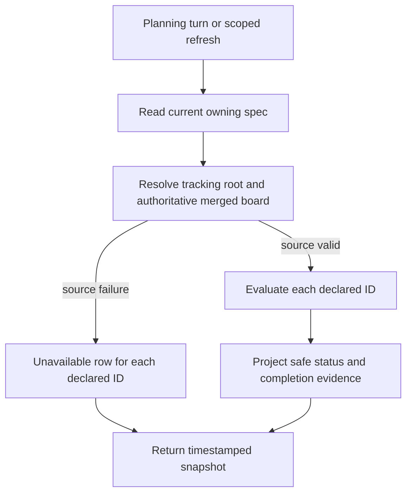

# Expose authoritative dependency status to planning

## Parent Epic

epic_038

## Scope

# Expose authoritative dependency status to planning

## Intent

Give epic and feature planners a minimal, read-only view of every declared dependency without granting access to its specification.

## Scope and contract

- Reuse the canonical tracking-root and merged-board resolution and lifecycle completion rules. Extract a shared evaluator where existing checks are duplicated; do not introduce a second status store.
- For each declared dependency return work ID, tier when known, canonical status and column when known, outcome (`satisfied`, `dependency_unmet`, or `dependency_status_unavailable`), safe completion evidence, and stable reason when unavailable. Carry observation time and an opaque authoritative revision/fingerprint so a snapshot is clearly identifiable, not an authorization token.
- Known incomplete, cancelled, or status/column mismatch is unmet. An absent ID in an otherwise valid authoritative board is unavailable with `dependency_not_found`; inability to establish the authoritative source is unavailable with a stable source-failure reason. Empty dependency lists are satisfied.
- Complete means canonical `completed` in `3_completed`; existing review/stacked-dispatch restrictions remain explicit action checks and are not silently removed or redefined.
- Inject the projection into every epic/feature planning turn. Expose a scope-bound read-only refresh through the existing planning tool registration/MCP transport; derive the allowed dependency IDs from the caller's current owning spec, not arbitrary IDs or paths.
- Keep scoped document authorization and sandbox allowlists unchanged. A denied content read is `content_access_denied`, independent of dependency outcome. Never include bodies, comments, prompts, raw paths, exception text, or secrets in the projection.

## Acceptance criteria

1. Completed but unreadable dependencies are satisfied for both planning tiers; readable incomplete dependencies are unmet.
2. Missing/source-unavailable cases are distinguishable and fail closed; tracking-repository ownership and completed trunk precedence are respected over stale worktree copies.
3. All declared IDs are represented; no-dependency work remains ready on this dimension.
4. Read-only refresh cannot enumerate arbitrary board items; existing cross-team content reads remain denied.
5. Completion evidence is derived from the authoritative state, never from read access or transcript text.

## Validation

Extend existing board/tracking, planning sandbox/tool, and dispatch tests with focused integration cases. Include small predicate tests only for distinctions not already exercised. Before implementation, document the existing review/stacked behavior and cache/snapshot semantics to preserve; pin them in focused compatibility tests.

## Exclusions

No new dependency database, dependency graph validation feature, permission broadening, or historical transcript rewrite.

## Data structures

- An observation has the owning work ID, UTC observation time, opaque authoritative snapshot fingerprint, aggregate outcome, and one row per declared dependency in spec order. An empty list has aggregate outcome `satisfied`.
- A row has work ID; tier, canonical status and column when known; outcome `satisfied`, `dependency_unmet`, or `dependency_status_unavailable`; safe completion evidence from canonical lifecycle state; and a stable unavailable reason. An absent ID on a valid board uses `dependency_not_found`. A source failure projects every declared ID as unavailable with a stable source-failure code.
- The fingerprint identifies observed state, grants no access, and contains no document text or repository path.

## API contracts

- Every epic and feature planning turn receives the projection for dependencies declared by its current owning spec. The read-only refresh uses existing planning tool registration and MCP transport and takes no arbitrary IDs or paths.
- Refresh reads the caller's current owning spec to select allowed IDs, then observes the canonical merged board. It returns only the safe projection. A denied content read remains `content_access_denied` independently of dependency outcome.
- Observed status does not authorize approval, minting, activation, review, or dispatch. Action-boundary rechecks belong to `feat_038_002`; operator reporting and end-to-end regressions belong to `feat_038_003`.

## Existing behavior to preserve

- Planning artifact routing uses the tracking checkout when invoked from a managed target worktree. The merged board combines trunk and registered worktrees; a completed product-trunk epic overrides stale worktree copies. Completion requires status `completed` in `3_completed`.
- `merged_board` has a two-second single-flight cache, invalidates after registered board/registry writes, and can pin a board view for one read-only response. Observation metadata describes that snapshot, not a transaction or mutation permission.
- Feature dependency readiness checks lifecycle completion. Other dispatch paths also block pending feature review; merge gating and sibling checks remain separate. Stacked dispatch retains opt-in, predecessor-base, and fan-in restrictions. Extracting the shared evaluator must preserve these explicit action checks.

## Logic flow

## Task breakdown

1. `task_038_001_001` — Pin existing behavior and compatibility tests.
2. `task_038_001_002` — Extract shared authoritative evaluation; depends on 001.
3. `task_038_001_003` — Build the safe status projection; depends on 002.
4. `task_038_001_004` — Inject projection into epic and feature turns; depends on 003.
5. `task_038_001_005` — Add scope-bound read-only refresh; depends on 003 and may proceed independently of 004.

## Risks & upward questions

None.

## Decision log

None yet.

## Closeout

Completed child work: `task_038_001_001` (Pin existing dependency, review, stacked dispatch, and snapshot behavior), `task_038_001_002` (Extract authoritative dependency evaluation shared by readiness and dispatch), `task_038_001_003` (Build safe dependency-status projection from authoritative evaluation), `task_038_001_004` (Inject dependency projection into epic and feature planning turns), `task_038_001_005` (Expose scope-bound read-only dependency refresh through planning tools).
