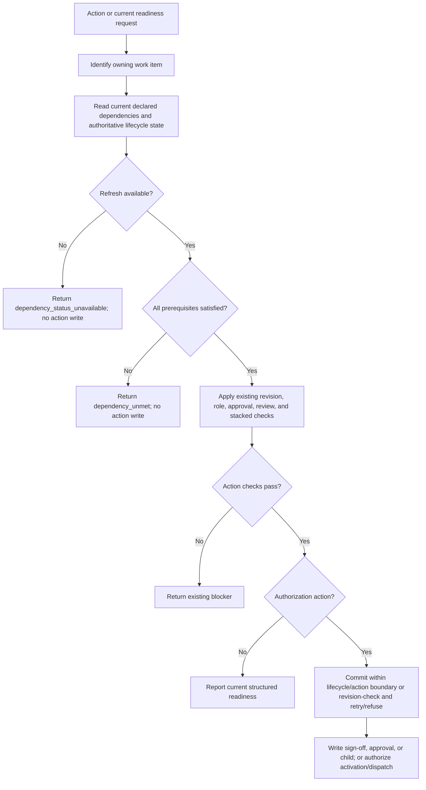

# Recheck dependency status at planning action boundaries

## Parent Epic

epic_038

## Scope

# Recheck dependency status at planning action boundaries

## Intent

Prevent a stale planning snapshot from approving or authorizing downstream work while allowing an active dependent plan to observe newly completed dependencies.

## Scope

Consume the shared evaluator and scope-bound status contract from feat_038_001 in plan readiness, role sign-off, plan/feature approval, activation/dispatch dependency checks, and feature minting guidance and mutation boundaries. Preserve all existing non-dependency authorization, plan revision, review, and stacked-dispatch checks.

## Acceptance criteria

1. Re-read the owning work item's current declared dependencies and authoritative lifecycle evidence immediately before sign-off, approval, or minting authorization. Do not reuse the turn-start snapshot or a request-scoped/cached board view as proof of freshness.
2. Use the existing action/lifecycle synchronization boundary (or a minimal revision-checked retry/refusal where required) so a concurrent dependency change cannot commit an action based on superseded evidence. A failed refresh returns `dependency_status_unavailable` and performs no authorization-dependent mutation.
3. Known unmet prerequisites return `dependency_unmet`; a denied plan-body read never becomes a dependency blocker. Dependency evidence is evaluated separately from plan revision sign-offs; unchanged plan text does not make old dependency evidence current.
4. An incomplete dependency that completes during the active epic's planning is recognized on the next refresh/action without restarting or reactivating the epic. The inverse transition or source loss before action fails closed.
5. Boundary checks concern the owning work item's execution prerequisites. Creating a backlog child may declare existing but incomplete predecessor features; do not require the new child's predecessors to be completed merely to describe and sequence future work. Preserve existing tier/existence validation for those declarations.
6. Epic-plan approval checks the owning epic's current prerequisites before its existing bulk approval of backlog children. Unfinished valid sibling predecessors do not block that bulk plan approval. Bulk child approval records do not certify execution readiness: each child's activation/dispatch rechecks its own prerequisites. Direct feature sign-off/approval checks that feature's prerequisites. Refuse an epic with unmet/unavailable prerequisites before writing any bulk child approval.
7. Approval/readiness and dispatch use the shared lifecycle result; existing review/stacked restrictions remain separately reported and enforced. Existing approval records, role-specific sign-off semantics, and ordinary no-dependency workflows remain compatible.

## Validation

Extend existing sign-off, plan-readiness, minting, approval/dispatch, and lifecycle integration tests. Drive incomplete-to-completed and satisfied-to-unmet/unavailable transitions between turn context creation and the action, including a preloaded board cache/request snapshot. Verify refusal leaves no new approval, sign-off, or child artifact. Include successful sequential minting and bulk epic-plan approval with unfinished sibling predecessors, then verify approved successors remain undispatchable until their own prerequisites complete. Verify an epic prerequisite failure leaves every child approval unchanged.

## Exclusions

No redesign of approval policy, scheduling, stacked PRs, dependency graph validation, or automatic activation of downstream work.

## Data structures

The feature reuses the feat_038_001 scope-bound dependency projection and lifecycle evaluator. No new persisted dependency state is introduced.

| Value | Purpose |
| --- | --- |
| Current owning work item and its declared `depends_on` IDs | Read from authoritative metadata for the action target, not from the turn context. |
| Dependency rows | Allowlisted work ID, tier, canonical status and column, outcome, safe completion evidence, observation time, and opaque source revision or fingerprint supplied by the shared evaluator. |
| Action-boundary result | Ephemeral aggregate of the current declaration and rows: satisfied, `dependency_unmet`, or `dependency_status_unavailable`, with stable reason codes. It is valid only for the guarded action. |

A missing declared ID in a successfully read board is unavailable with reason `dependency_not_found`; a known incomplete or cancelled item is unmet. Plan-body access is an independent authorization result and contributes no dependency evidence. A prior projection or unchanged plan SHA is never an authorization token.

## API contracts

Use the shared evaluator/status contract from feat_038_001 through a small action-boundary helper. Its input is the owning work ID and the action's synchronized board/lifecycle context; its output is the current declaration plus the shared structured dependency result. The helper rereads authoritative metadata and bypasses request-scoped snapshots and short-lived board caches for its authorization read. If the implementation cannot hold the existing lifecycle/action synchronization through commit, compare the declaration and authoritative source revision immediately before mutation and retry once or refuse. A refresh failure returns `dependency_status_unavailable` and leaves authorization-dependent state untouched.

| Consumer | Owner checked | Boundary and mutation rule |
| --- | --- | --- |
| Plan readiness and role sign-off | Epic or feature being evaluated or signed | Show current structured dependency result; sign-off refuses unmet/unavailable before writing a record. Retain role-specific and plan-revision checks. |
| Direct feature approval | Feature being approved | Recheck immediately before approval write; retain existing approval, review, and stacked checks. |
| Bulk epic-plan approval | Epic whose plan is approved | Recheck once within the guarded bulk action before any epic or child approval write. Valid unfinished sibling predecessors do not block plan approval. Child approval does not certify dispatch readiness. |
| Feature minting | Epic or feature authorizing creation | Refresh guidance through normal read paths; recheck at mutation before creating a child. Validate the new child's declared predecessor tier and existence, while allowing existing incomplete predecessors. |
| Activation and dispatch | Child being activated or dispatched | Recheck that child's current prerequisites at its execution boundary, regardless of an earlier approval record. Retain separate review and stacked restrictions. |

Every refusal exposes the shared stable dependency code separately from explanatory text. No-dependency owners pass the dependency dimension after the current declaration is read.

## Logic flow

## Task breakdown

1. `task_038_002_001` — refresh the owning item's prerequisites at action boundaries; shared foundation for the remaining tasks. Completed.
2. `task_038_002_002` — apply the fresh result to plan readiness and role sign-off. Depends on 001. Completed.
3. `task_038_002_003` — guard direct feature and bulk epic-plan approval with the owning item's prerequisites. Depends on 001. Completed.
4. `task_038_002_004` — refresh feature-minting authorization while allowing incomplete predecessors on backlog children. Depends on 001. Completed.
5. `task_038_002_005` — recheck each child's prerequisites at activation and dispatch. Depends on 001 and 003. Completed.
6. `task_038_002_006` — verify stale-snapshot transitions and sequential planning flows with integration coverage. Depends on 002, 003, 004, and 005. Active.

## Risks & upward questions

None.

## Decision log

- `dec_001` · 2026-11-06 · Feature Architect · **API contracts**
  Chose Use a guarded action-boundary helper that rereads the owner's current dependency declarations and shared lifecycle result; bypass request snapshots and board caches for authorization..
  Rationale: A turn-start projection or unchanged plan text cannot prove that prerequisite state is still current. Holding the existing action/lifecycle boundary, or verifying revisions before commit, prevents stale evidence from authorizing a write.
  Honors: Feature criteria 1–4 and 7; feat_038_001 shared evaluator and scope-bound status contract..

- `dec_002` · 2026-11-06 · Feature Architect · **API contracts**
  Chose Scope bulk epic-plan approval to the epic's prerequisites, while direct feature approval and each child's activation/dispatch check that feature's own prerequisites..
  Rationale: Approval records describe plan authorization, not execution readiness. This lets an epic approve sequenced backlog children without allowing an approved successor to run early.
  Honors: Feature criteria 5–7; parent epic decision dec_004 and existing tier/existence, review, and stacked restrictions..

## Closeout

Completed child work: `task_038_002_001` (Refresh prerequisite evidence at planning action boundaries), `task_038_002_002` (Apply fresh prerequisites to readiness and role sign-off), `task_038_002_003` (Guard direct and bulk plan approval with owning prerequisites), `task_038_002_004` (Refresh minting authorization while allowing future predecessor declarations), `task_038_002_005` (Recheck each child's prerequisites at activation and dispatch), `task_038_002_006` (Verify stale-snapshot and sequential planning flows).
