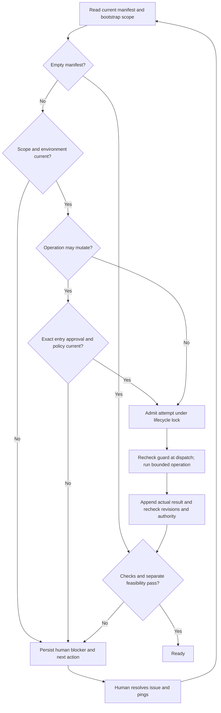

# Authorized bootstrap and resumable dependency checks

## Parent Epic

epic_039

## Scope

Implement slice B of epic_039 on feat_039_001 contracts. Introduce an epic-owned feature-zero bootstrap record (not an ordinary feature or tier), narrow human-reviewed feasibility scope, independent per-entry human installation approvals, current-policy checks, and bounded environment-specific verification/setup. Scope binds exact pinned operations, sources and integrity, paths, feasibility artifacts, limits, cleanup, and authorization provenance. No silent sudo/system-default changes, credentials, license acceptance, publishing, or latest references. Model unchecked, awaiting_authorization, checking, dependency_blocked, and ready; installation success must not imply adapter feasibility. Persist actionable human guidance. Route human ping/resume through existing run/recovery with deduplication, locked admission and result recheck, partial-state reconciliation, bounded retries, and append-only attempts. Never treat ping as proof or installation authorization. Acceptance: integration coverage for permitted local/container setup, denied system mutation, offline source, checksum mismatch, license/credential prompt, wrong environment, stale result, duplicate ping, partial setup and restart, human install/recheck, circular feasibility gate, and no-dependency path. Include real harmless project-local and pinned-container smoke evidence in an authorized environment. For the approved epic_034 Structurizr scenario, record actual host Java incompatibility, authoritative chosen distribution and immutable container digest, bundled runtime and in-container check, and a separate authorized adapter-feasibility result. Do not build epic_034's production adapter. Unavailable real smoke environment remains an explicit acceptance blocker.

### Per-dependency installation authority

Every dependency installation or upgrade requires explicit human approval bound to dependency ID, exact version, authoritative source, checksum/digest, target environment, install scope/destination, exact operation, and cleanup plan. Persist an independent approval for each entry with human provenance and the reviewed binding. Epic/feature plan approval and bootstrap review alone grant no installation authority. Provider `yolo` and owned-worktree access provide execution capability only. Cascade must enforce the approval at the operation boundary before mutation, independently of the provider sandbox and in addition to current execution policy.

A batch UI may approve several entries in one interaction only if it persists independent per-entry approvals. Any change to dependency ID, version, source, digest, environment, scope/destination, operation, or cleanup plan invalidates only that entry's approval; unchanged entries retain theirs. Read-only discovery and validation may proceed without installation approval. Checks that install, upgrade, or implicitly pull dependencies must pass the installation gate. Plan sign-offs, resume/ping, and successful checks never create installation approval.

Consume slice A's independent approval records and fail closed at every Cascade dependency operation boundary, including setup, provider execution, MCP/UI entry points, and retry/resume. Validate the exact binding immediately before mutation and recheck it when accepting completion; stale queued approvals cannot authorize execution. Retain feasibility-scope authorization separately. Acceptance must demonstrate denial before any install/upgrade under `yolo`, owned-worktree access, or approved epic/feature plans when per-entry approval is missing; rejection for each changed binding field; preservation of unrelated approvals; approved execution; and read-only checks without installation approval. Real local and Structurizr/container installation acceptance requires separately recorded explicit human approval for each exact recipe, including digest and cleanup; this feature plan grants none.

## Data structures

- **Epic bootstrap record:** an epic-owned sidecar keyed by epic ID, with scope revision, manifest revision, dependency IDs, target environment identities, exact check/setup recipes, authorized feasibility artifacts and paths, resource/time limits, cleanup plan, human reviewer and time, and current state. It is a phase record, not a work-item tier or ordinary feature. Scope authorization covers only the reviewed feasibility work; installation approvals remain independent.
- **Blocker projection:** derive `unchecked`, `awaiting_authorization`, `checking`, `dependency_blocked`, or `ready` from current scope, approvals, attempts, and feasibility evidence. Each unresolved entry records the responsible actor, failed operation and actual environment, last attempt/output, why needed, known pinned investigation or setup steps, expected verification, cleanup, and ping action. Unknown recipe facts stay unknown and become an investigation request.
- **Existing slice A records remain canonical:** use `DependencyManifestSnapshot`, `InstallationApproval`/`InstallationBinding`, `CheckAdmission`/`CheckCompletion`, and immutable evidence snapshots. Append attempts; never rewrite history. Feasibility proof has its own scope/revision and result so dependency readiness cannot imply adapter feasibility. An explicit validated empty manifest needs no dependency setup approval or dependency checks; it reaches ready only after every separately required feasibility proof passes.

## API contracts

- **Review scope:** an authenticated human review persists a narrowly bound bootstrap scope and provenance. Scope edits require fresh review for affected operations or feasibility artifacts; they never mint installation approvals. The feature exposes current scope, blockers, and next action through existing board/read-model routes for slice C to display.
- **Request validation/setup:** a trusted Cascade entry point receives epic ID, dependency ID, declared environment, exact operation kind and recipe, scope revision, and approval ID when mutation is possible. Read-only checks need no installation approval. Install, upgrade, and implicit pull must match the current entry's complete `InstallationBinding` and approval, the reviewed scope, and current execution policy at admission and again immediately before dispatch. Missing source, exact version, digest, environment, scope, or authority fails before mutation. Provider `yolo` and worktree access do not relax this guard.
- **Complete attempt:** the runner supplies actual environment identity, outcome, redacted bounded output, integrity/version references, and admitted attempt ID to the slice A evidence boundary. Accept readiness only after rechecking current manifest/recipe, scope, approval binding, policy, and actual environment. Persist a stale or failed completion as history with an actionable blocker.
- **Ping/resume:** existing run and recovery routes accept a stable request identity. A ping queues revalidation only; it grants no authority and is never evidence of installation. Concurrent or repeated delivery coalesces under lifecycle serialization. Reconcile actual installed state after interruption before retry, preserve accepted work/checkpoints, and resume planning only when current dependency and feasibility results pass.

## Logic flow

## Task breakdown

1. `task_039_002_001` — Epic bootstrap scope, authorization, feasibility, and blocker state.
2. `task_039_002_002` — Per-entry installation authority at every mutation boundary; depends on 001.
3. `task_039_002_003` — Bounded environment-specific checks, setup, and feasibility proofs; depends on 001 and 002.
4. `task_039_002_004` — Deduplicated resume and partial-state recovery; depends on 003.
5. `task_039_002_005` — Authorized real local and Structurizr container smoke acceptance; depends on 004.

## Implementation checkpoint

Task 004 merged durable request identities, lifecycle serialization, bounded resume, append-only recovery, and partial-state reconciliation. Task 005 is active. Before real smoke evidence can count as feature acceptance, it must close these remaining integration gaps:

- Give each verification and feasibility recipe a trusted operation classification. Any recipe that can install, upgrade, or implicitly pull must have approval for its own exact operation and use guarded dispatch; a caller supplied `READ_ONLY` kind or feasibility-scope authorization is insufficient. Fail closed when the current binding cannot represent that operation.
- Revalidate current per-entry approval, reviewed bootstrap scope, and execution policy when readiness consumes completed mutating evidence. A later stale or revoked approval must block that evidence; valid read-only evidence remains usable.
- Require the separate bootstrap feasibility projection at every planning entry point that consumes dependency readiness, including plan readiness, sign-off, and feature minting. An explicit empty manifest skips dependency checks but still requires any separately scoped feasibility proof.
- Connect the durable resume request to the existing trusted run/recovery entry point, so a human ping reaches revalidation with a stable request identity. Keep ping distinct from installation approval and evidence.
- Demonstrate the specified local and Structurizr scenarios with actual observations only after each exact operation has independent human approval and the target environment is authorized. If either prerequisite is unavailable, persist the acceptance blocker and leave the scenario unpassed.

The older `invoke_approved_installation` helper checks only approval and cannot serve as the sole mutation boundary.

## Risks & upward questions

- Real project-local installation and the Structurizr container smoke remain acceptance blockers until their exact recipes, immutable integrity references, target environments, cleanup, and separate explicit human approvals are recorded. This approved feature plan grants no installation authority. If an authorized environment is unavailable, keep the blocker visible and do not report smoke acceptance.
- Host Java availability and container runtime/adapter feasibility must be observed in their actual environments; simulated results cannot satisfy the epic_034 scenario. No epic contract change is requested.

## Decision log

None yet.

- `dec_001` · 2026-11-07 · Feature Lead · **Data structures**
  Chose Use an epic-owned bootstrap scope and blocker projection, reusing slice A manifest, independent installation approvals, and append-only evidence; keep feasibility authorization and result separate from dependency readiness..
  Rationale: This implements feature-zero semantics and the circular-feasibility escape without a new work-item tier or duplicate authority store.
  Honors: epic_039 slice B; success criteria 3, 4, 7, and 8; feat_039_002 tasks 001–003..

- `dec_002` · 2026-11-07 · Feature Lead · **API contracts**
  Chose Guard every dependency mutation at admission and dispatch with current per-entry approval, reviewed scope, and policy; recheck authority and actual environment at completion. Treat ping only as a deduplicated request to revalidate..
  Rationale: Queued approvals, provider capability, and human pings cannot establish current authority or proof of installation. Append-only evidence and partial-state reconciliation preserve accurate recovery.
  Honors: epic_039 success criteria 4–7 and 10; feat_039_002 tasks 002–004..

- `dec_003` · 2026-11-07 · Feature Architect · **Implementation checkpoint**
  Chose Use active task_039_002_005 to close the remaining trusted-operation, current-readiness, planning-feasibility, and resume-entry-point gaps before counting real local or Structurizr smoke evidence..
  Rationale: These are existing feature acceptance conditions and the current smoke task is the final integration task; adding another planning layer would delay the smallest shippable slice while leaving unsafe acceptance possible.
  Honors: epic_039 slice B success criteria; feat_039_002 scope and task_039_002_005 acceptance..

## Closeout

Completed child work: `task_039_002_001` (Persist epic bootstrap scope, authorization, feasibility, and blocker state), `task_039_002_002` (Enforce per-entry installation authority at every dependency mutation boundary), `task_039_002_003` (Run bounded environment-specific checks, setup, and feasibility proofs), `task_039_002_004` (Resume blocked dependency checks with deduplication and partial-state recovery), `task_039_002_005` (Prove authorized local and Structurizr container smoke acceptance).
