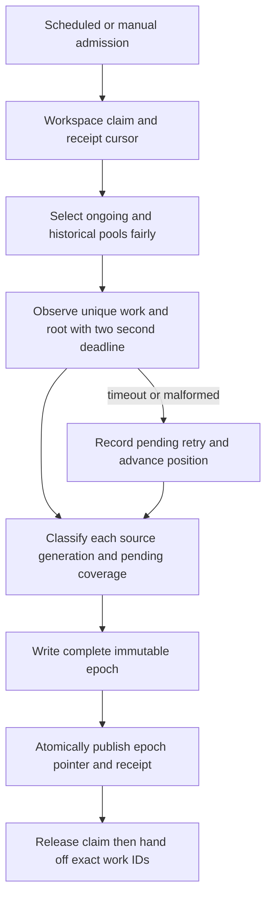

# Persist fair background audit reassessment and truthful incident projections

## Parent Epic

[epic_044](../../epics/2_active/epic_044_make_health_audit_actionable_while_retaining_recovery_histor.md), pinned at `aab5dd4e76caa8dd770c619c64baa34600050dea`. Honor criteria 1, 3, 4, 8, 9 and producer regressions in 10–11. The supervisor produces evidence; War Room consumers read derived snapshots. Existing recovery/admission remains authoritative.

## Scope

Implement a versioned local producer contract for current verified incidents, verification coverage and historical attempts. Extend the existing health-audit lane for persistent fair rotation, isolated candidate deadlines, pass-local evidence reuse, restart-safe coalescing and atomic projection publication. Keep source recovery ledgers and investigation cases intact. Establish fixtures and producer budgets for features 002 and 003.

Do not change the dashboard GET route, browser UI, recovery policy, installation/approval gates, source ledgers, provider defaults, or scheduler ownership.

## Data structures

Projection schema `2` lives under the canonical product root's ignored `.cascade/health_audit/projections/`. A single atomic `current.json` pointer names a complete immutable epoch directory. An epoch contains a small manifest, bounded current and coverage pages, and bounded history index pages. Readers pin one epoch; writers publish files, fsync, then replace the pointer. Missing, corrupt or incompatible pointer/page is pending/unknown, never healthy. Split-workspace manifests carry both resolved product and tracking repository identities; board documents come from tracking and Git/worktree evidence from product.

The manifest includes `schema_version`, `epoch`, `observed_at`, `interval_seconds`, `fresh_until`, per-section page counts and source revision/failure markers. Public rows share `source_ref` (store name, durable row key, and incident-history ordinal when applicable), `work_id`/`owner` when known, `authoritative_generation` and `failure_class` only when proven, `occurred_at`, `last_attempted_at`, `last_verified_at`, `verification_status`, `reason`, `fresh_until`, and `next_attempt_at`. Opaque source references resolve against the original ledger; they do not embed raw prompts, credentials, unbounded evidence, or an arbitrary filesystem path. A row summary that exceeds a page's byte cap becomes a bounded reference plus `detail_truncated: true`.

Current rows require an authoritative `proven_incident` observation matching both generation and failure class and still within the display freshness window. A later authoritative generation supersedes the old attempt; it does not resolve the new one. `healthy` resolves only when the relevant obligation, including completed-work publication/integration, is authoritatively satisfied. `expected_wait` stays pending. Missing/deleted/rerouted work, malformed evidence, timeout, cancellation, stale data or failed source read stays explicit in coverage with prior observation/provenance retained. Request delivery, acknowledgement, result text and `reported_fixed` are follow-up state only.

Coverage is keyed by canonical product/tracking identity and typed work ID, with separate entries for source-level errors and unidentifiable historical rows. It retains pending items across passes/restarts, last attempt, last success, outcome/reason, next attempt, and whether work was deferred by a pass limit. History indexes all readable attempts, including prior generations and legacy rows, without altering their source bytes. Legacy `child_id`/`observed_child_sha`/`supervisor_id` plus outer action/result/reason/time remains historical/unverifiable unless a separate unambiguous durable identity proves modern fields; never reinterpret a child SHA as authoritative generation.

The existing `receipt.json` remains compact scheduler state. Its opaque continuation may version the two pools (ongoing and historical unresolved) and preserve a four-check admission counter. A healthy pass with no material incident/coverage/history change retains the receipt-only silence rule.

## API contracts

- `select_audit_candidates(cursor, CandidateBudget, root=...) -> CandidatePage`: at most 100 unique typed work/root candidates per pass. Rotate Task/Feature/Epic within each pool. When both ongoing and historical unresolved pools are nonempty, admit at least one historical candidate per four admitted checks. Persist independent pool positions; timeouts advance the selected position and retain retry coverage. Coalesce multiple source references for one work/root into one observation while preserving every source generation.
- `run_bounded_audit_pass(root, cursor, cancel_event, ...) -> AuditPassResult`: at most 60 seconds total, at most two seconds for any candidate including Git/subprocess I/O, and a pass-wide cancellation boundary. Reuse a read-only merged board snapshot within a pass where safe; do not carry it into repair/admission. A completed partial pass records exact continuation and deferred coverage. Failed, busy or cancelled passes do not advance completion.
- `publish_audit_projection(root, pass_result, prior_epoch, ...) -> epoch`: consume bounded pass observations and source references, reconcile states and pending coverage, write immutable bounded pages then atomically switch the pointer. Each page has at most 100 rows and a bounded serialized size; oversized evidence is represented by a safe source reference. Producer must not rewrite raw ledgers. Publication failure leaves the previous epoch intact and records failure/pending evidence.
- `read_projection_manifest(root) -> manifest | pending`: read-only, regular-file, no-follow, bounded schema entry point for feature 002. Feature 002 owns HTTP pagination, request ceilings (50 default/100 max, 1 MiB source bytes, 256 KiB response), epoch matching and GET isolation; this producer supplies pages and fixtures sized for those limits.
- Existing `project_audit_observation`, reservation/admission checks and investigation cooldown remain the only authority for repair. Snapshot rows cannot be passed as proof to those operations.

Display freshness expires at `last_verified_at + 2 * configured_interval + 60 seconds`; expiration changes the projection label to stale/pending and never authorizes or blocks a repair. Next attempt uses the existing cadence/manual admission and finite candidate retry. Source ingestion and page generation are bounded by the same pass ceiling; an unreadable or oversized source produces explicit coverage rather than silently disappearing.

## Logic flow

The worker publishes only after its bounded observation has completed; the handoff runs after releasing the workspace claim. Existing owner investigation delivery and cooldown deduplicate repeated suspicious evidence. Every repair/admission reobserves current canonical state and rejects obsolete generation.

## Task breakdown

| Task | Responsibility | Depends on |
| --- | --- | --- |
| task_044_001_001 | Versioned schema, source references and legacy classification | None |
| task_044_001_002 | Fair candidate rotation, two-second isolation and pass-local reuse | task_044_001_001 |
| task_044_001_003 | Atomic current/coverage/history producer and restart reconciliation | task_044_001_001, task_044_001_002 |
| task_044_001_004 | Lane, recovery and investigation integration plus producer acceptance evidence | task_044_001_003 |

Each task owns focused tests at its changed boundary. Feature 002 owns GET/API tests and feature 003 owns browser/live acceptance.

## Risks & upward questions

The current selector rotates tiers but does not reserve historical capacity. The current observer passes its entire remaining budget into one candidate. `audit_status.py` still performs GET-time rechecks; feature 002 must remove that once this producer exists. Large monolithic source ledgers and process termination during publication need explicit bounded failure handling. No Epic contract change is requested.

## Decision log

Decision entries are recorded with `record_decision`.

- `dec_001` · 2026-11-14 · Feature Lead · **Data structures**
  Chose Use a versioned immutable projection epoch with one atomic pointer, source references for all historical attempts, separate current and coverage rows, and explicit pending states for legacy or unavailable identity..
  Rationale: Consumers need one consistent read without probing lifecycle state. Keeping source ledgers untouched and preserving unknown states avoids false current failures and false resolution.
  Honors: epic_044 criteria 1, 4, 8; macro-architecture projection and authority contract; immutable forensic history..

- `dec_002` · 2026-11-14 · Feature Lead · **API contracts**
  Chose Use persistent ongoing and historical candidate positions with at least one historical admission per four checks when both pools are populated; cap each observation at two seconds within a 100-item, 60-second pass..
  Rationale: Tier rotation alone can starve unresolved history, and an observation using all remaining pass time can hide a later current blocker. Independent positions and exact continuations make restart and timeout behavior reviewable.
  Honors: epic_044 criterion 3 and scheduling, freshness and bounds contract; existing audit lane and manual admission semantics..

## Closeout

Completed child work: `task_044_001_001` (Define versioned audit projection and source identity), `task_044_001_002` (Rotate audit candidates fairly and isolate observations), `task_044_001_003` (Publish atomic current coverage and history projections), `task_044_001_004` (Integrate projection production with audit and recovery handoff).
