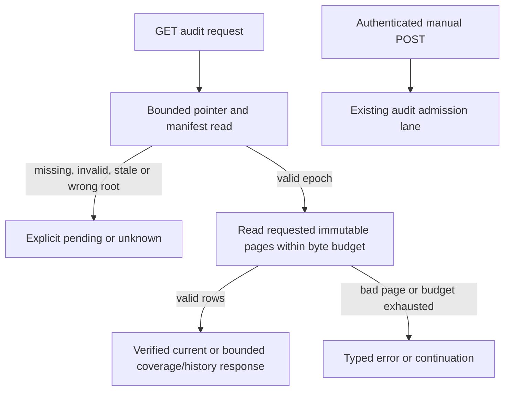

# Serve bounded read-only audit snapshots and paginated history

## Parent Epic

[epic_044](../../epics/2_active/epic_044_make_health_audit_actionable_while_retaining_recovery_histor.md). Honor its schema-2 projection, freshness, immutable source-ledger, split-root, read-budget and authoritative repair boundaries. This feature owns the HTTP consumer; the audit lane remains the only producer and manual admission remains a POST.

## Scope

Expose current verified incidents, an aggregate verification-coverage summary, and demand-loaded coverage/history pages from the published epoch. Preserve stable source references, legacy/unverifiable provenance, occurrence versus verification times, and follow-up state without treating an attempt outcome as resolution. GET uses projection artifacts and bounded receipt/failure metadata only. It does not inspect recovery ledgers, board/worktrees, lifecycle state, Git, providers, or schedule audit/recovery work. Missing, invalid, stale, or wrong-root evidence is pending/unknown. Keep the authenticated manual audit POST unchanged. The later UI feature owns expanded presentation and live acceptance.

## Data structures

- `AuditSnapshotHeader`: schema version 2, epoch, observed_at, fresh_until, interval_seconds, product/tracking repository identities, section page and row counts, and bounded aggregate coverage counts by verification status and reason. The producer writes these aggregates with the immutable epoch; the reader never computes them by scanning all pages.
- `AuditPageRequest`: section (`current`, `coverage`, `history`), optional opaque cursor, limit (default 50, maximum 100), and exact filters for work ID, owner, outcome/verification status, and UTC occurrence-time bounds. Filter spelling and cursor input are validated before file access. Unknown or unavailable fields never match an exact filter.
- `AuditPage`: epoch, rows, next_cursor, scanned/returned counts, complete/truncated flags and a reason when incomplete. A cursor binds section, epoch, normalized filters, page number and row offset; it cannot name a path. The page preserves each producer `source_ref` (store, row_key, optional incident-history ordinal). Large source records remain referenced by this tuple and `detail_truncated`; GET never loads raw detail.
- `AuditSnapshotState`: `ready` or `pending`, with typed reason and last known observation where safe. Freshness is evaluated from the manifest deadline on every request. No cached state authorizes repair.

The consumer opens only regular files without following symlinks, reads at most 1 MiB of projection/metadata bytes per request, and serializes at most 256 KiB. A page has at most 100 rows and 256 KiB. Invalid, missing, incompatible, or oversized requested pages yield pending/unknown or a typed page error without inventing incidents. The producer's full-epoch validator remains a publication check; GET uses bounded header and requested-page validation.

## API contracts

- `GET /api/health/audit` returns a bounded status document: snapshot state, epoch/observation/freshness, current first page, aggregate coverage counts, receipt/failure metadata where safely available, and continuation links/cursors. Keep legacy fields used by the existing client during rollout, but the incident wording means **verified current** only. An empty current page plus incomplete coverage says no verified current incidents, not healthy.
- `GET /api/health/audit/coverage` and `GET /api/health/audit/history` return `AuditPage` for `limit`, `cursor`, `work_id`, `owner`, `status` and `from`/`to` UTC time filters. A changed epoch or cursor/filter mismatch returns a bounded restart response; malformed query input is 400. Every response identifies the epoch and whether unread rows remain.
- `POST /api/health/audit` keeps its existing authenticated admitted/coalesced response and audit-lane scheduling. None of the GET routes calls this path.
- Root identity compares the producer's product and tracking repository keys with this request's resolved product/tracking pair. The consumer must not use a tracking repository as a substitute projection root.

## Logic flow

## Task breakdown
- task_044_002_002
- task_044_002_001

1. Publish aggregate counts and build the bounded, epoch-pinned projection reader. It must avoid full-epoch validation on GET and support filters with explicit continuation within the byte ceiling.
2. Wire read-only health-audit HTTP responses and focused regressions on that reader. This task depends on task 1; preserve manual POST and a safe legacy-client response.

The minted child IDs and their dependency edge are the authoritative task list in frontmatter and below.

## Risks & upward questions

The producer manifest currently records page counts but not row/coverage aggregates; add bounded aggregates without changing the meaning of schema-2 rows. Its existing `read_projection_manifest` validates every page and is unsuitable for GET; keep that producer safeguard while adding a bounded consumer path. Filtered requests may need multiple continuations under a 1 MiB read ceiling, which is explicit in the response. No Epic contract change is needed.

## Decision log

Decisions are recorded through `record_decision`.

- `dec_001` · 2026-11-14 · Feature Architect · **Data structures and API contracts**
  Chose Use a bounded header and requested-page reader for dashboard GET, with producer-published aggregate coverage counts; retain the full-epoch validator for publication checks..
  Rationale: The existing manifest reader visits every page, which scales with retained history and exceeds the GET read budget. Immutable epoch pages and compact aggregates let the consumer remain read-only and bounded.
  Honors: epic_044 success criteria 2, 5, 7, 8 and the 1 MiB source/256 KiB response ceilings..

- `dec_002` · 2026-11-14 · Feature Architect · **API contracts**
  Chose Bind pagination cursors to the epoch, section and normalized filters; stop at the request byte budget and return explicit continuation. Keep large source details behind stable references..
  Rationale: History can exceed one request. Continuing from a precise immutable position avoids mixed generations, hidden omissions and unbounded ledger reads, while legacy rows remain visible as unverifiable history.
  Honors: epic_044 success criteria 7, 8, 10–11 and immutable raw-ledger/provenance constraints..

## Closeout

Completed child work: `task_044_002_001` (Build bounded epoch-pinned audit projection reader), `task_044_002_002` (Serve read-only audit status and paginated HTTP endpoints).
