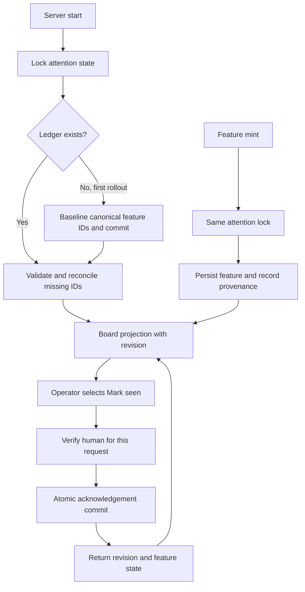

# Highlight newly added features with durable explicit acknowledgement

## Parent Epic

epic_045

## Scope

Deliver durable New markers and explicit Mark seen acknowledgement across the Epic and Feature board views, consuming feat_045_001's activation summary/actions. This feature owns epic success criteria 6–16, including the complete motivating operator journey.

Acceptance:
- Key attention records by stable feature ID within the workspace, recording durable creation/discovery provenance separately from immutable acknowledgement. FeatureMinted provides new-creation evidence; reconcile otherwise legitimately discovered IDs once, without relying on date/order/path/status changes. Replay and worktree relocation cannot recreate acknowledged newness.
- Use a small versioned, atomic, process-locked workspace state store rooted in the canonical tracking workspace (resolved across product/tracking split and managed worktrees). Record creation/discovery provenance, rollout baseline, acknowledgement actor/time and monotonic state revision. No plan edits or lifecycle changes for acknowledgement.
- Acknowledgement is workspace-shared in the current local-operator model, explicitly disclosed in UI/docs; authenticate Mark seen through the existing human verifier and record its subject. No new login/account service. Agent reads, GET/render, expanding/scanning and scroll never acknowledge; invalid/unauthenticated writes fail without mutation.
- Provide explicit feature-level Mark seen from board/review surface. It is idempotent; preserve acknowledgement under stale polls, retry, concurrent clients, restart, event replay, plan revision, relocation and branch rebase. Do not couple approval to acknowledgement in this initial slice.
- One-time rollout baseline: conservatively expose currently open backlog/ready-to-plan features under active, non-cancelling epics as unseen (including 034_008/009 if still in that cohort), regardless of current approval; record all other preexisting identities as baseline so historical work is not rediscovered. No blanket completed/active-history badges. Do not reset approval or emit bootstrap toasts.
- Newly created features after baseline stay New until explicit acknowledgement; completed/cancelled/retired children are excluded from pending-attention counts. Preserve provenance and acknowledgement through terminal transitions and reactivation; plan revisions retain the separate changed-plan indicators.
- Add accessible text New beside feature rows with separate lifecycle status and canonical next action. Collapsed epic rows show accurate new-feature counts and a keyboard-operable reveal control that expands/navigates to those children and opens their plans. Maintain stable asynchronous updates, readable theme contrast and useful screen-reader labels, without repeated toasts or animation.
- Missing/corrupt attention state must be exposed as unavailable rather than silently re-baselining, acknowledging or flooding history; durable acknowledgement writes must report failures accurately.
- Verify one API/state integration matrix spanning corrective minting, initial bootstrap, auth/write separation, repeat acknowledgement, polling, replay, restart, concurrent responses, revisions, completed/cancelled children and split roots. Verify product repository/approvals/status/blockers remain untouched by acknowledgement.
- Demonstrate in a real browser: active epic with completed sibling adds two corrective features; collapsed aggregate reveals them; open plans, understand approval needs, mark each seen, refresh/restart and observe no reappearing badges. Completed sibling remains unchanged and approval stays explicit. Reuse backend invariants rather than duplicate them at every test layer.

Boundaries: depend only on feat_045_001 for the authoritative next-action contract; no general unread/comments system, scheduler changes, notifications, external services or new packages. Preserve inherited Codex defaults. Before task execution, pin exact state ownership, provenance/bootstrap crash recovery and request/response concurrency contract in the feature plan.

## Data structures

The attention ledger is runtime workspace state at `.cascade/feature_attention.json` in `locate_trunk(resolve_tracking_root(root))`, shared by all managed worktrees and split product/tracking roots. It is never a plan document or product-repository write. Version 1 stores `schema_version`, a monotonic `revision`, `baseline_at`, and records by stable feature ID. Each record stores parent Epic ID, immutable first-observed provenance (`baseline`, `FeatureMinted`, or `discovered`), first-observed time, whether that first observation made it attention-eligible, and nullable `seen` with authenticated actor/time. Later status, path, revision, replay, or rebase changes do not rewrite provenance or `seen`.

The store uses a dedicated cross-process file lock plus in-process synchronization, strict schema validation, temporary-file write, fsync, atomic replace, and parent-directory fsync. Every committed state change advances `revision`; no-op acknowledgement leaves it unchanged. A durable initialization marker is written only after the first ledger commit. On startup: valid ledger with missing marker finalizes the marker; marker with missing ledger or a corrupt/unsupported ledger is unavailable and cannot be reset by GET or POST. An interrupted first commit before either artifact exists can retry bootstrap. Preserve the last valid file on failed writes and surface the failure.

## API contracts

At first startup under the same attention lock used by minting, scan one canonical merged board and atomically baseline all known feature IDs. Only open backlog/ready-to-plan children of active, non-cancelling Epics get initial attention eligibility; all other known IDs are recorded as historical. Approval does not affect eligibility. Mint takes this lock before feature persistence and records `FeatureMinted` after durable creation. If event emission or attention persistence fails after feature creation, startup reconciliation records the missing ID once as `discovered` and eligible; it never changes an existing record. Reconciliation also handles legitimate IDs created outside the mint hook. Bootstrap and mint must serialize so a new post-baseline ID cannot be silently categorized as history. Recovery never invents acknowledgement. A missing event is a recoverable provenance gap and may be labelled `discovered`.

`GET /api/board` includes `feature_attention: {schema_version: 1, state, revision, features, epic_new_counts}` from one locked ledger snapshot and the same board snapshot used for rows. A feature is `new` iff its immutable eligibility is true, `seen` is null, and its current board status is nonterminal; collapsed counts additionally require an active, non-cancelling parent. Completed/cancelled/retired children remain in the ledger but leave pending counts. Unavailable state is explicit; no badge or count is inferred. Board GET and render do not acknowledge. They do not run baseline or mutate lifecycle/approval. Reconciliation is a startup/mint concern.

`POST /api/feature_attention/mark_seen` accepts exactly one valid feature ID. It verifies the human independently for that request via `human_identity_verifier.verify_request`; process-wide identity and agent reads have no authority. It validates feature identity against the canonical board, writes `seen={actor, at}` once, and returns `{ok, feature_id, revision, attention}`. Repeats return the original acknowledgement and current revision. Invalid body/ID gives 400/404, unauthenticated gives 401, storage failure gives 503, with no acknowledgement mutation. No approval, dispatch, plan edit, status change or blocker clearing occurs.

The browser keeps the highest attention revision observed. A successful Mark seen response updates its local feature state immediately. An older in-flight board response may refresh other board data, but its older attention projection cannot replace the newer local attention state or count. A newer board projection supersedes the local projection. A failed POST leaves the marker and reports the failure.

## Logic flow

## Task breakdown

1. **task_045_002_001** — Durable attention ledger, first-rollout bootstrap, mint provenance and startup recovery; focused state tests including split roots and crash windows.
2. **task_045_002_002** — Board projection and authenticated idempotent Mark seen API; one API/state integration matrix for invariants and concurrent responses. Depends on task_045_002_001.
3. **task_045_002_003** — Accessible board/review attention UI and real-browser corrective-feature journey, consuming the existing feature activation summary/actions. Depends on task_045_002_002.

## Risks & upward questions

The mint path currently persists the feature before emitting `FeatureMinted`; reconciliation covers that crash gap. A crash or manual loss after initialization must surface unavailable state, because silently re-baselining could turn historical features New or erase acknowledgements. The plan keeps attention independent of approval and preserves existing action-boundary rechecks. No upward contract change is needed.

## Decision log

- `dec_001` · 2026-11-13 · Feature Architect · **Attention state ownership and rollout**
  Chose Store versioned attention state under the canonical tracking trunk with atomic locked writes and a post-commit initialization marker; baseline all known IDs once, exposing only open children of active non-cancelling Epics..
  Rationale: One workspace-shared store survives managed worktrees and split roots. The marker distinguishes a first rollout from a lost initialized ledger, so missing or corrupt state cannot silently erase acknowledgement or flood historical work.
  Honors: epic_045 success criteria 6-9; feat_045_002 acceptance.

- `dec_002` · 2026-11-13 · Feature Architect · **Feature provenance and recovery**
  Chose Serialize first-rollout bootstrap with feature mint; record FeatureMinted provenance for new IDs, and reconcile otherwise missing canonical IDs once as discovered without changing existing provenance or acknowledgement..
  Rationale: The existing mint path writes a feature before emitting its event. Startup reconciliation closes that crash gap while stable IDs prevent replay, relocation, and plan edits from recreating New state.
  Honors: epic_045 success criteria 6, 8, 11; feat_045_002 acceptance.

- `dec_003` · 2026-11-13 · Feature Architect · **Acknowledgement and response concurrency**
  Chose Use request-scoped local human verification for an idempotent Mark seen POST, return monotonic attention revisions in POST and board GET, and keep the latest attention projection when an older board poll arrives..
  Rationale: The write remains explicit and workspace-shared. Revision ordering prevents a stale in-flight response from resurrecting a cleared badge while preserving the existing board freshness flow.
  Honors: epic_045 success criteria 10-16; feat_045_002 acceptance.

## Closeout

Completed child work: `task_045_002_001` (Persist feature attention ledger and reconcile mint provenance), `task_045_002_002` (Expose feature attention and authenticated Mark seen API), `task_045_002_003` (Render accessible New attention and verify corrective-feature browser journey).
