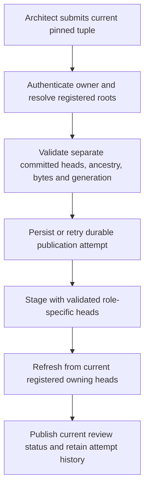

# Repair architecture publication for owned planning worktree lineage

## Parent Epic

epic_045

## Scope

# Repair architecture publication for owned planning worktree lineage

## Intent

Restore normal revision-pinned architecture review publication from an epic or feature integration worktree without requiring its unapproved plan to already exist on trunk. This is scoped orchestration repair discovered while investigating audit case investigation_4ca123bb9bd945fb98958705e01035af, not a third product slice or an audit-dashboard redesign. Feature Lead should mint a bounded SWE repair task after normal human approval; do not implement through the Epic Manager planning turn.

## Evidence

On 2026-11-12, epic_045 plan 48c4ce6ee0ca6aed8c6bba9ca1de7256f8ef83ef is an ancestor of owned epic HEAD d6148184bb10c5db69896ad4e5ba87c60421167a but not product/tracking trunk HEAD 646dc4cc9e68ea186725be13001c540c6489ae26. The plan remains current via read_doc and both planning sign-offs. Publication architecture-publication-8c50299f2d09024614cc747b5675c39fee6fd8faefa3622c2aa3b8c9a193e936 is superseded/artifact_changed with message 'pinned review plan revision is not in the current lineage', and no review unit exists. Exact proposal is retained at .cascade/epic_045_architecture_publication.json in the epic worktree; DESIGN.md is committed at 470b40632a065594ef499c5650b98e5fb74d4d72.

cascade/workspace/architecture_publication.py::_publish_validated stages without an owned lineage revision. cascade/workspace/architecture_review.py::_validate_current_artifacts resolves tracking-role plan validation against the configured repository HEAD, even when target and tracking share a repository with an owned integration worktree. Fix the canonical resolution, not these specific IDs. A separate publication using changed repository-role identities failed destination_changed; role relabeling is not an authorized workaround.

Fresh bounded project_audit_observation for epic_045 succeeds with expected_wait/plan_approval and no evidence errors; do not conflate that recovered missing-revision observation with this durable publication failure. No duplicate live architecture-publication repair was found in the merged board inventory.

## Current reproduction references

The epic publication `architecture-publication-54cb62ce2796bbd3f644a64468202fefb3878d2270cc54ceda336fde1f808c4e` returned `no_diagram_change` for plan `693476beb0accecbcfb4ab1f36ac9f9a4e84fd59` and design `0e3b0651d8b5c667649884ffd68da9839789968f`. Its review unit `architecture-review-55f435ccdcccafdf2ef920a43f19cdcc6ccfd0a64e9f19451f5131068bb13b00` later became stale/`artifact_changed`. Feature 001 publication `architecture-publication-e386befca2918b6723467733c0b9ec8f051fb7222e1f5af38b5472af10e4ba45` for plan `d4c70116ed7d3fa02a4ff6e610a2ba41214156cc` failed owned-lineage ancestry. Feature 002 publication `architecture-publication-747c3532ef458cb616cf19f3b2f2ae76a288568bd9fce40dcd953cc8aed84ed8` failed the same check for plan `f28248a58653d180f139b48c07311070aaad2207`, design `0e3b0651d8b5c667649884ffd68da9839789968f`, and reviewed tuple digest `02cf3090e68b6420e434ce57cde118d5c072e4a0bd393f30e0e418d985335167`. These are historical cases, not current-status claims. The former `8c50299f` attempt is also historical. Retry only a freshly read, then-current reviewed tuple.

## Acceptance criteria

1. Resolve and validate the exact authorized owning plan/design lineage from registered integration and tracking ownership. Normal epic/feature publication can stage current committed artifacts before trunk integration. Preserve repository keys, configured roles/destinations, byte digests, ownership, ancestry, generation and revision checks.
2. Reject genuinely changed, unrelated, missing or stale artifacts. Explicitly cover colocated and split product/tracking repositories; never substitute a product revision for a separate tracking revision.
3. Recover a previously terminal publication through the supported canonical recovery/publication path once the defect is repaired. Preserve its failure history and pinned proposal; no manual ledger edits, invented generation, main rewrite, early merge or approval bypass. Define the smallest safe retry behavior if identical idempotent replay would otherwise remain superseded forever.
4. Add focused regressions in existing architecture publication/review tests using distinct trunk and owned branch heads, current and changed plan/design bytes, and split roots. Run relevant checks in an isolated SWE worktree and publish the repair review canonically. No new dependencies or installations.
5. After accepted repair is available, the Epic Architect retries epic_045's exact current proposal through its authorized tool and records the review unit/status. Do not claim operational recovery merely from passing tests or queuing this feature.
6. Refresh a successfully staged review using the same registered owning lineages and repository identities as staging. Resolve their current heads on each refresh, so later changes to an owned plan or design make the review stale. Unrelated trunk movement alone must not stale unchanged owned artifacts.
7. Terminal retry must create or resume a supported validation attempt for the exact currently authorized tuple, retaining previous terminal status, reason and proposal in durable history. An idempotent replay of the old terminal result, or replay of a successful publication that leaves a stale review unit, is insufficient.

## Boundaries and handoff

Approved repair with Task 001 active in its isolated SWE worktree. The Feature Lead owns the contract and integration review; the SWE owns implementation. Reconcile any runtime uncommitted lineage edits with their owner before code changes. Preserve inherited Codex role/model/reasoning defaults. No changes to activation/readiness product scope, attention state, audit scheduling, or approval policy. It has no artificial dependency on Features 001/002; their product dependency remains 002 on 001. This repair does not authorize activating those features. Report validation, review and runtime recovery separately to epic_045.

## Data structures

Keep the pinned proposal immutable: work/actor, plan and design references, repository keys and roles, destination, byte digests, expected generation, and reviewed tuple digest. Carry an explicit validated head for each repository role/root through staging, and resolve the current head from the same registered owner on refresh; tracking and product heads may differ. A terminal retry needs durable attempt history linked to the original publication so earlier failure evidence remains inspectable.

## API contracts

The authenticated Epic/Feature Architect publication boundary supplies the owner and exact current reviewed tuple. Resolve the registered owning worktree for each referenced repository, require its committed HEAD and check that the pinned revision is an ancestor with unchanged path bytes. Do not infer a tracking revision from the product lineage merely because roots are colocated. Use those heads for staging. On each subsequent refresh, resolve fresh heads from the same registered owning lineages and repository identities, and compare the pinned artifacts again; do not resolve against an unrelated configured trunk or freeze staging SHAs indefinitely. Recheck plan revision, destination, ownership, generation and accepted baseline at the action boundary and before final publication.

A supported retry of a terminal architecture publication must reauthenticate and revalidate the exact current tuple, create or resume a durable attempt, and preserve the original proposal and terminal outcome. Refuse changed, missing, unrelated, or stale tuples with explicit reasons. The feature recovery tool named `retry_owned_publication` handles branch/review recovery actions; it is not by itself an architecture-publication retry.

## Logic flow

## Task breakdown

- task_045_003_001: implement bounded lineage and terminal retry repair, focused regressions, checks, and canonical SWE review in its isolated worktree.

## Risks & upward questions

None.

## Decision log

- `dec_001` · 2026-11-13 · Feature Architect · **Decision log**
  Chose Use registered owner-specific committed heads for each repository role through both architecture publication staging and review refresh. Recover terminal architecture attempts only through an authenticated, revalidated durable retry that retains the earlier proposal and failure outcome.
  Rationale: The epic no_diagram_change publication later produced a stale review unit, while Feature 001 failed plan ancestry against an unrelated head. Cached terminal replay cannot repair either case. Separate tracking/product revisions and retained attempt history preserve the original safety checks.
  Honors: Epic 045 decision dec_005 and the approved Feature 003 bounded repair; no repository-role relabeling, manual ledger edits, early merge, approval bypass, or change to product scope.

## Closeout

Completed child work: `task_045_003_001` (Repair owned-lineage architecture publication and terminal retry).
