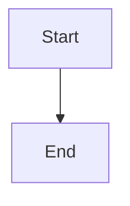

# Connect normal architecture planning to revision-pinned HTTP review

## Parent Epic

epic_046

## Scope

# Connect normal architecture planning to revision-pinned HTTP review

## Intent
A normally planned feature or epic must expose its real immutable architecture review to the running War Room without manually constructing review stores or injecting UI payloads.

## Scope and contract
Own epic_046 requirements 1 and 2, plus the backend provenance, semantic target inventory, drill destinations, diff metadata and readable source/diff resources needed by later slices. Trace creation, scoped authoring, publication, accepted-lineage baseline resolution, bounded rendering and restart recovery through actual team tools. Extend existing Epic 034 contracts; do not introduce another store.
Supply an explicit paired_review envelope from the real /api/doc/{id} handler. The Epic Architect must lock the delivery schema and bounded inline versus immutable artifact-URL choice in the epic before implementation. Every state must retain plan/comment usability, exact review-unit/tuple provenance, and an actionable explanation.
Publish validated semantic inventories and deterministic zero/one/many drill destinations based on containment plus view membership. Provide per-element AND per-relationship semantic changes. Source/model/plan/design links must resolve readable content at pinned revisions.
Render work belongs to the existing bounded operation, never synchronous unbounded page work. Cache/publication state must be durable or reconstructible. Preserve safe SVG validation, scope authorization and accepted integration lineage.
Handle pending, ready, no diagram change, empty current baseline, missing/removed view, unsupported input, render/binding failure, legacy missing unit, stale baseline/revision, missing artifact and partial acceptance explicitly. A claimed change cannot degrade to successful no-change.

## Acceptance
- Fresh feature and epic planning through supported tools produces discoverable review evidence at exact plan/design/model refs; handler tests exercise production HTTP and real composition.
- A first browser/real-renderer smoke opens a normally created feature via its plan URL and displays actual current/proposed SVG; this scaffold becomes the final journey, not a second fabricated-payload test suite.
- Tampered artifact identity/scope, stale revisions and invalid bindings fail closed without breaking plan text.
- Restart recovers pending/ready work; repeated requests reuse bounded work.
- Repair the existing real-renderer test fixture inventory defect: test_c4_render._closure copies nested final-validation files but declares only root.iterdir files. Keep closure validation strict and use a minimal valid fixture inventory.
- Run targeted publication/HTTP/cache tests and the real renderer smoke; retain exact commands and limitations.

## Boundaries
Later slices own full viewer/thread/approval UX, branch browsing and the contextual documentation panel. Define their data seams here. Do not weaken any epic acceptance scenario or install software without exact human authorization.

## Data structures

TBD.

## API contracts

TBD.

## Logic flow

## Task breakdown

1. `task_046_001_001` — bounded durable rendering, recovery, and strict renderer fixture repair.
2. `task_046_001_002` — authenticated epic/feature publication through normal tools and exact review-unit discovery; depends on 001.
3. `task_046_001_003` — authorized revision-pinned review projection, state mapping, semantic inventory, diff classes, and drill choices; depends on 002.
4. `task_046_001_004` — production document envelope, lazy review projection, scoped immutable SVG and readable resources; depends on 003.
5. `task_046_001_005` — fresh planning-to-browser real-renderer journey, restart and race evidence; depends on 004.

## Risks & upward questions

None.

## Decision log

None yet.

## Closeout

Completed child work: `task_046_001_001` (Make C4 rendering bounded, durable, and recoverable), `task_046_001_002` (Publish exact architecture reviews through normal epic and feature tools), `task_046_001_003` (Resolve and compose revision-pinned review state and semantic inventory), `task_046_001_004` (Serve the paired review envelope and scoped immutable HTTP resources), `task_046_001_005` (Prove normal planning-to-browser architecture review and restart recovery).
