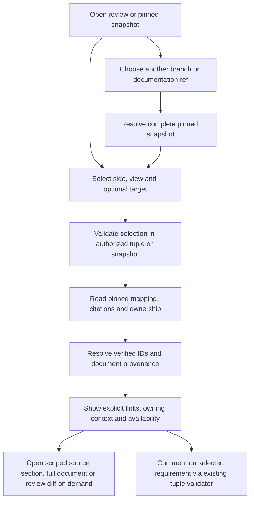

# Show verified requirements and decisions beside C4 views

## Parent Epic

epic_046

## Scope

# Show verified requirements and decisions beside C4 views

## Intent
Reviewers and branch explorers can read the requirements and rationale linked to a selected C4 target, with trustworthy document provenance.

## Scope
Own epic_046 requirement 6 across paired review and the Architecture tab. Add a bounded, lazy Requirements & decisions panel with full-document/source-section access. Consume existing stable requirement/decision IDs, explicit citations, design mappings, model ownership and reviewed associations. Extend mapping only where necessary, preserving pinned document refs and provenance.
Model the relationships many-to-many: DESIGN.md boundaries follow ownership/behavior/interfaces and do not correspond one-to-one to C4 levels. On target selection show explicitly linked requirements, decisions/rationale and owning designs. With no selection show view links and a clearly labeled broader index.
Keep explicit target coverage distinct from owner/directory context. If no explicit mapping exists, say so and offer owning designs. Never infer links from similar names or prose.
Proposal review shows proposed documents plus current/diff access. Branch browsing uses the selected pinned snapshot or recorded cross-repository association. Missing/stale references remain visible. Reuse existing safe Markdown presentation.
Selected requirements can start the existing semantic proposal thread; decisions are readable and linkable without adding a decision-specific anchor.

## Acceptance
- Same view/element/relationship selection produces verified contextual documents on both surfaces, including many-to-many examples and source-section links.
- Unmapped targets, stale/missing citations and broader ownership context are explicitly differentiated.
- Branch/ref switch changes diagram and context together; split repositories never silently substitute tracking HEAD.
- Requirement commenting routes through feat_046_002 authoritative tuple validation.
- Lazy loading remains bounded and does not read every design file per board refresh.
- Add focused mapping/provenance tests and extend the primary real browser journey to open requirement/decision content and current/proposed diffs.

## Boundaries
No per-C4-level design duplication, inferred semantic coverage, general search/indexing platform or new comment anchor type.

## Data structures

- One request identifies an existing review unit and reviewed tuple, or an immutable Architecture snapshot, plus side, view key/level, and optional semantic element or relationship ID. The server validates the selection against that scope's actual view and hit-target manifest. Clients do not send repository paths or Git expressions.
- The shared context result contains separate bounded collections for **explicit target links**, **view links**, **owning-design context**, and a labeled **broader index** used when no target is selected. A target with no verified explicit link has an explicit unmapped state; owner/directory context never becomes target coverage.
- Each requirement, decision, or design descriptor carries its stable ID, kind, relation and evidence (citation/mapping/review association), view and target identity where applicable, document repository key, full pinned commit, repository path, verified section, and availability state. One target can link to multiple documents and one document to multiple targets. Preserve missing and stale citation rows with their reason rather than silently dropping them.
- Resolve mapping at the code/mapping commit and document content at its own documentation commit. A split repository uses the snapshot's recorded association or a labeled, catalog-validated user-selected ref. Source documents and Markdown are fetched only when opened; the context projection remains size bounded.

## API contracts

- Add lazy context reads under the existing owner-scoped review and snapshot HTTP routes. Review requests bind to the active reviewed tuple and selected current/proposed side. Snapshot requests bind to the opaque snapshot ID and its pinned code, mapping, and documentation revisions. Reject forged view/target IDs, foreign scopes, stale descriptors, and raw path/revision input; expose missing or stale documented references as data where the authorized scope itself remains valid.
- Return the four relationship collections and provenance above with bounded pagination/metadata consistent with the existing architecture routes. Emit only server-derived, scoped immutable resource URLs. Opening a descriptor serves its verified source section and full Markdown from the exact repository/commit/path; review descriptors also offer current/proposed document and diff resources when counterparts exist. Apply the existing resource byte limits and safe Markdown renderer.
- A requirement comment uses the existing semantic proposal-thread endpoint and its authoritative reviewed-tuple validation. The anchor retains the requirement document's own source repository, commit, path and section, plus the existing target/view/side identity. Decisions remain readable and linkable without a new anchor type.
- Branch/ref changes create or select a complete snapshot first, then replace diagram, selection, context, and provenance together. A missing split-document association yields a labeled ref-required state and no documentation fetch; tracking HEAD is never a fallback.

## Logic flow

## Task breakdown

1. **task_046_004_001 — Resolve explicit C4 documentation links from pinned evidence.** Build shared many-to-many mapping and provenance resolution, with focused tests.
2. **task_046_004_002 — Expose bounded context and document resources for review and snapshots.** Add scoped lazy HTTP access to pinned content, source sections, and review diffs; depends on 001.
3. **task_046_004_003 — Show contextual requirements and decisions in paired C4 review.** Add the panel and route requirement comments through the existing semantic thread contract; depends on 002.
4. **task_046_004_004 — Show contextual requirements and decisions in Architecture tab.** Add the panel bound to the selected snapshot and documentation association; depends on 002.
5. **task_046_004_005 — Verify contextual C4 documents in the real browser journey.** Exercise both surfaces and current/proposed diffs; depends on 003 and 004.

## Risks & upward questions

None.

## Decision log

None yet.

## Closeout

Completed child work: `task_046_004_001` (Resolve explicit C4 documentation links from pinned evidence), `task_046_004_002` (Expose bounded context and document resources for review and snapshots), `task_046_004_003` (Show contextual requirements and decisions in paired C4 review), `task_046_004_004` (Show contextual requirements and decisions in Architecture tab), `task_046_004_005` (Verify contextual C4 documents in the real browser journey).
