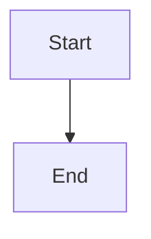

# Prove the complete C4 review and branch exploration journeys

## Parent Epic

epic_046

## Scope

# Prove the complete C4 review and branch exploration journeys

## Intent
Close epic_046 only with reproducible production-path evidence that new proposals and branch architecture work in a real War Room.

## Scope
Own the epic's required acceptance evidence A-D and final completion criteria. Consolidate the progressively developed real renderer/browser scaffold; repair remaining integration defects necessary for those criteria and update user/operator guidance. Do not substitute more helper-only tests for the journeys.

## Required proof
- Fresh fixture project with accepted versioned architecture; normally create epic/feature and propose meaningful container/component and relationship changes plus linked requirements/decisions through supported team planning tools. Begin with a clean render cache.
- Launch War Room using its documented command. Through its real board/plan routes show nonempty, independently revision-checked current/proposed SVG adjacent to the plan. Real local pinned Structurizr and native Chromium are required. No manual review JSON injection, endpoint mocks, fabricated paired payloads or placeholder SVG in the primary scenario.
- Complete A1-A10: counterpart/added/removed selection, element/relationship diff styling, changed views, drill/back, real source/model/plan/design diff destinations, requirement/decision reading, all four semantic root kinds, reply/incoming reply/reload persistence, blocking approval and authorized resolution, stale tuple rejection, removed-target outdated blocking behavior, restart recovery, and an epic proposal.
- Complete B1-B5: actual default branch and pinned commit, browsing interactions, second differing branch, deep-link restoration, HEAD update and explicit refresh, detached/dirty/missing states, and distinct split code/doc refs with absent-association handling.
- Cover C failures and gates with focused backend/HTTP tests where browser repetition adds little value: first/empty baseline, justified no-change, legacy missing unit, pending/failed renderer, invalid bindings, stale baseline, missing artifact, stale comment and partial acceptance; unrelated work stays available. Check desktop/narrow layout and native SVG hit/fit/zoom in real browser.
- Retain D evidence: exact commands, renderer digest/settings, fixture/source revisions, code/doc refs, review-unit/tuple identity, pass/fail results and screenshots or recording of paired review AND branch browsing. Document reproducible prerequisites and launch steps.

## Acceptance / release gate
All epic completion criteria and A-D evidence pass against the final integrated revision. A skipped real-browser/real-renderer scenario is unmet acceptance. Report existing failures honestly; document each fix and rerun its relevant proof. Existing unit/DOM suites support but do not replace acceptance. No additional dependency installation without exact human authorization.

## Boundaries
Only epic-critical integration fixes and evidence; no unrelated refactoring or expansion into a new architecture platform.

## Data structures

TBD.

## API contracts

TBD.

## Logic flow

## Task breakdown
- task_046_005_001 — Prove the live paired C4 review journey in a fresh project.
- task_046_005_002 — Prove real branch architecture browsing and context recovery.
- task_046_005_003 — Verify architecture failure gates and responsive SVG interaction.
- task_046_005_004 — Consolidate final A–D evidence and operator guidance after the first three tasks.

## Risks & upward questions

None.

## Decision log

None yet.

## Closeout

Completed child work: `task_046_005_001` (Prove the live paired C4 review journey in a fresh project), `task_046_005_002` (Prove real branch architecture browsing and context recovery), `task_046_005_003` (Verify architecture failure gates and responsive SVG interaction), `task_046_005_004` (Consolidate final A–D evidence and operator guidance).
