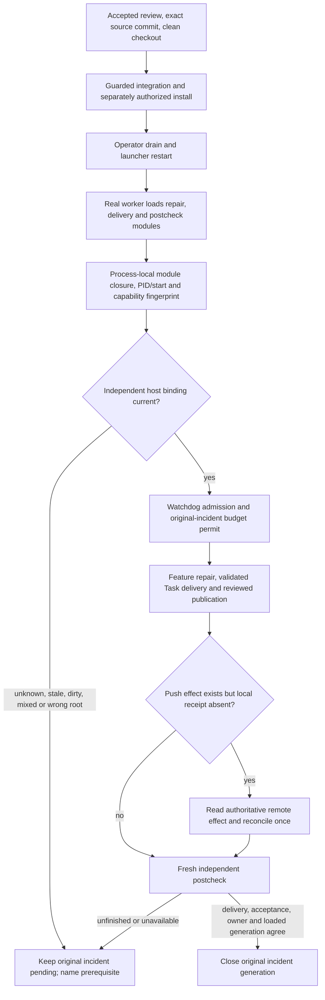

# Prove reviewed repairs are loaded and survive cross-stage delivery

## Parent Epic

epic_048

## Scope

### Outcome

Recovery of orchestration code has a supported bootstrap route and exact reviewed, integrated, installed and loaded revision evidence. The completed-parent/late-child journey remains correct across delivery, cleanup, split roots and process restart.

### Scope and ownership

Build on the README runtime handoff, `cascade/workspace/worker.py`, supervisor/launcher lifecycle, health evidence, capability registry, Feature repair adapter, pending Task delivery and `incident_postcheck`. Reuse the late-repair and ownership implementation already present; fix integration gaps demonstrated by this journey. No duplicate late-child or audit-dashboard project.

## Acceptance criteria

- Epic criteria 7–8, 10, 12–13: independently bind reviewed source, integrated source, installed artifact/source, loaded worker PID/start identity and capability generation. A healthy endpoint or source-tree HEAD alone does not prove loaded code.
- Normal reviewed deployment and a bootstrap path that does not depend solely on the broken adapter preserve approval, installation and credential authority. If no supported authorized path is available, return the exact external prerequisite; never hotpatch site-packages, dirty operator trunk or forge runtime evidence.
- Harness starts a real worker process from the reviewed repair revision in an isolated prepared workspace and checks its own loaded-revision report independently. Exercise repair to a recovery adapter itself and stale, dirty or unknown runtime rejection; do not replace the deployed postcheck with a successful mock.
- Cross-stage owner-tool journey composes existing completed-parent/late-child repair, immutable acceptance generations, parent integration, descendant-safe retirement and split product/tracking roots. After restart, board, execution record, pending delivery, owner, review registry, loaded capability and original historical incident agree.
- Crash after push and before receipt reconciles remote effect without another publication. A live owner, changed target, unavailable authoritative evidence, outstanding acceptance or unintegrated follow-up head remains pending. Original incidents stay candidates until verified.
- Concrete preflight for the later controlled operational exercise identifies target environment, exact runtime artifact/revision, authorized actor and supported entry points. New software or installation needs a separately approved manifest/authority before execution.

## Designs and diagrams

Proposed `REQ-WORKSPACE-RUNTIME-001`: a runtime repair is verified only when accepted review and integration identities, installed source/artifact binding and the live worker's PID/start, loaded origin and capability generation agree through independently inspected evidence. Unknown, stale, dirty and conflicting bindings stay pending. Proposed `DEC-WORKSPACE-RUNTIME-001`: keep evidence in the existing supervision/health and recovery receipt boundaries; use the separately authorized stop/install/restart path to bootstrap a broken adapter. These become current design facts in `cascade/workspace/DESIGN.md` only after implementation is reconciled.

Link existing `REQ-WORKSPACE-OWNER-001`, `REQ-WORKSPACE-RETIRE-001`, `REQ-TASK-DELIVERY-002` and `REQ-WATCHDOG-REPAIR-001`. Reconcile README operation instructions and package, Feature, Task, Watchdog and War Room interfaces only where changed.

### Diagram-impact inventory

| Level / view | Owning design and source boundary | Required update and verification |
|---|---|---|
| `cascade-landscape`, `cascade-context` | Root `DESIGN.md`; operator, reviewed forge and installation authority | Recheck actual external boundary; update changed relationships or record a source-backed no-change reason. |
| `cascade-containers` | Root/cascade `DESIGN.md`; launcher, worker, artifact, product/tracking roots and durable stores | Recheck runtime/data and process boundaries; do not imply OS isolation from C4 containers. |
| `cascade-cli-components`, `cascade-supervisor-components`, `cascade-team-components` | `cascade/workspace/DESIGN.md`, `cascade/DESIGN.md`; `run_launcher_loop`, `run_worker`, owner adapters, postcheck | Show changed responsibilities and collaborating interfaces; verify context-to-component navigation. |
| `cascade-workspace-commands-code`, `cascade-workspace-code` | `cascade/workspace/DESIGN.md`; `run_launcher_loop`, `run_worker`, `_worker_supervisor_status`, identity/ownership/retirement entries | Update real symbols, declaration kinds, relationships, source contract and view keys where structure changes. Verify Code explore, Level up, deep links and pinned source. |
| `cascade-watchdog-code`, `cascade-feature-code`, `cascade-task-code` and affected review Code view | Owning Watchdog, Feature, Task designs; `dispatch_audit_recovery`, `feature_repair`, `recover_task`, `retry_pending_task_merges`, `reconcile_parent_lifecycle_incident`, publication entries | Trace current acceptance, remote-effect and postcheck edges; synchronize model.dsl, views.dsl and workspace.contract.json for structural changes; validate/render and navigate representative nodes. |
| Supplementary normal/failure/restart flows | `cascade/workspace/DESIGN.md` and changed owner designs | Explain inputs, outputs, durable state, authority gates, process limits, stale/unavailable evidence and post-push reconciliation against final code. |

Native custom Code views must use `cascade.codeComponent`, `cascade.parent`, `cascade.sourcePath`, `cascade.sourceSymbol` and the correct native declaration kind. Do not rewrite accepted snapshots. Task 001 owns the runtime/launcher/health rows across all levels. Task 002 owns the Feature, Task, Watchdog, Workspace and publication rows across all levels. Task 003 reconciles the merged runtime and cross-stage diff, operational preflight, and integrated navigation. Task 004 closes the post-push and original-budget proof gaps, then rechecks any design/C4 changes it makes. Each implementer records its view's update or concrete no-change result in the Task closeout.

## Required Task acceptance contract

Task acceptance includes its applicable diagram-impact rows, owning design, source-linked structure, execution flow, persistence/recovery, authority and process isolation limits. Verify source contracts, supported local rendering and representative browser navigation. Use production tool adapters, durable stores and real temporary repositories/processes for integration proof. Scripted external provider/forge transport is permitted; fake successful repair, validation, publication or final verification is not. No raw success setters or lifecycle-file edits force progress. Tests count effects independently. Keep product acceptance separate from review validation. Preserve Codex and the parent's explicit role/model/reasoning assignments. No dependency installation or live deployment is authorized by this feature.

## Integrated authority and evidence contract

This branch contains the F1/F2 implementation through completed F2 revision `65f542713de31c9d13bf90fe022851e152f849af`. The live contracts are `bind_incident_budget`, `reserve_incident_operation`, `settle_incident_operation`, `read_incident_budget` and authenticated finite `extend_incident_budget` in `cascade/task/incident_budget.py`; `feature_repair(feature_id, request_id, *, root, operation, task_id, approval_reference, scope_reference, expected_generation, claim_owner)` in `cascade/feature/repair.py`; `recover_task` in `cascade/feature/recovery.py`; `queue_task_merge` and `retry_pending_task_merges` in `cascade/task_rollup.py`; `publish_integration_review` and `retry_owned_publication` in `cascade/feature/audit_recovery.py`; and `reconcile_parent_lifecycle_incident(task_id, generation, *, root)` in `cascade/watchdog/incident_postcheck.py`. Watchdog's `default_capability_registry().fingerprint()` is the current descriptor-generation value. These are integrated source contracts, not proof that a later worker imported them. The original incident ID and its Task-owned budget survive replacement action/generation; no new allowance is minted by a restart or bootstrap.

## Data structures

The loaded-runtime receipt joins separately observed facts with their evidence references: accepted review URL/source commit and a clean reviewed checkout; guarded integrated target commit and repository identity; authorized installed source or artifact digest, installation receipt, environment and import-root selection; live worker PID, host boot ID and process-start identity; worker-reported loaded module origins and content digests; exact capability-registry fingerprint and observation time. The import closure covers the modules that implement Feature repair, Task delivery, Watchdog admission/postcheck and their registered callable targets, including lazy imports when used. The report must reject a mixed source closure, mutation during startup, unknown or unbound module origin, dirty source, stale PID/start, wrong checkout or missing installed-review binding. A later HEAD, caller-supplied expected SHA, health state or status-file PID cannot fill a missing fact. Restart invalidates the process-local portion and requires a new observation.

The existing tracking-root `.cascade/executions.json` owns action, original-incident budget and repair receipts; pending Task merges retain their validated deliverable/Feature-base pair and repair-generation link. Review registry, board, registered worktrees and incident history retain their own authority. No new lifecycle ledger is added. The runtime receipt is evidence for independent postcheck; it cannot set `verified` directly.

## API contracts

- `cascade up --root <product trunk>` is the supported launcher path. `_spawn_worker` selects `_CASCADE_SOURCE_PARENT` for `PYTHONPATH`; `run_worker` currently imports recovery modules before `_source_fingerprint()`. Task 001 must capture the actual imported artifact/module closure and process identity before admission. Source fingerprint and `supervisor_status.json` remain update/liveness signals, not loaded-code proof.
- Extend the executing worker's bounded read-only health path (`GET /api/health`, `supervisor_health_http_payload`) with a loaded-runtime report. A separate host-side verifier compares that report with OS process identity, import origin, installed artifact/receipt and trusted reviewed/integrated evidence. It returns a typed current/pending/refused result with exact reason and evidence references; endpoint self-report is never sufficient alone.
- The normal route requires accepted review, guarded integration, separate installation authority, supervised drain/restart and fresh host verification. The broken-adapter bootstrap uses a clean prepared reviewed checkout and the existing `cascade up` operator drain/restart boundary, independent of `feature_repair`. If installation authority, exact artifact binding or credentials are absent, return that prerequisite and keep queued work pending.
- Recovery resumes through `feature_repair` and `recover_task`, then validated Task delivery, review publication and parent integration. Remote-effect reconciliation reads the authoritative forge/remote state before any replay after a push with missing local receipt. The independent `reconcile_parent_lifecycle_incident` re-reads the original generation's board, action, validation, review, owner and retirement evidence; its runtime-binding extension must compare a fresh loaded process report. An outstanding product acceptance or unintegrated follow-up remains pending even after review validation passes.
- `reserve_incident_operation` and `settle_incident_operation` wrap each expensive recovery operation with the original incident claim and stable operation ID. Replay, split roots, bootstrap and crash reconciliation retain the original finite budget and escalation identity.

## Logic flow

The launcher retains the listening socket across worker restarts. Action/incident receipts and queued delivery survive in their existing stores; worker loaded evidence is observed again after every restart. A live owner, changed head, split-root ambiguity or unavailable authoritative remote state remains pending.

## Task breakdown
- task_048_003_004

- `task_048_003_001` — Bind reviewed/integrated/installed source to a live worker and capability generation. Its active Task cannot be revised; this feature's integrated-authority, data, API and flow sections are its detailed acceptance: a real isolated worker, independent process/artifact check, stale/dirty/unknown/mixed-source and restart refusals, safe bootstrap, README and Workspace design, and the context/container/component/Code impact rows above.
- `task_048_003_002` (depends on 001) — Prove the production completed-parent repair journey through split roots, adapter repair, immutable generations, Task delivery, review, parent integration, retirement and restart; reconcile post-push lost receipt and pending blockers. Its own Task acceptance carries the affected diagram rows.
- `task_048_003_003` (depends on 002) — Prepare the read-only controlled-exercise preflight and reconcile final designs, C4 source/view contracts, render and browser navigation against the implemented diff.
- `task_048_003_004` (depends on 003) — Inject the post-push/pre-receipt interruption and prove authoritative remote replay plus continuity of the original incident budget across bootstrap and restart; reconcile any resulting code/design/C4 changes.

## Planning design review

Reviewed `DESIGN.md`, `cascade/DESIGN.md`, `cascade/workspace/DESIGN.md`, `cascade/feature/DESIGN.md`, `cascade/task/DESIGN.md`, `cascade/watchdog/DESIGN.md`, `cascade/war_room/DESIGN.md`, the architecture README, and current model.dsl/views.dsl/workspace.contract.json against the worker, launcher, status, health, capability, repair, delivery and postcheck source entries. No design file changed in this planning turn: the worker currently publishes lifecycle/PID status without a loaded-source binding, while existing owner, retirement, delivery and postcheck contracts already have their own design owners. The Task owners must reconcile implemented behavior at those boundaries. The current C4 workspace source contract validated locally; render and browser navigation are assigned to the implementing Tasks because no architecture source changed in this turn. The active first Task's contract-edit guard prevents changing its own acceptance; the exact runtime contract above and a direct-child handoff govern its implementation. Local source-contract validation passed on the pinned architecture directory; render and browser verification remain Task acceptance.

## Integration review after Task 002

Task 002 merged at `f238169dfcb8a32768fb5d13c9314a8b1a49de72`. The changed `cascade/watchdog/incident_postcheck.py` now rechecks the launcher-verified worker receipt through `verify_current_loaded_runtime_identity` before closing an original incident. The real-worker convergence test covers both colocated and split-root repositories, worker restart, accepted review, retirement and one incident closure. The affected Workspace and Watchdog designs and native Code source contract changed with that implementation. In `tests/test_late_repair_convergence.py`, the remote push is followed by repeated reconciliation without an injected interruption before local receipt, and the test does not read the original Task incident budget. Task 004 owns those two remaining proofs. Task 003 owns the read-only operational preflight and architecture/browser verification of the merged implementation; Task 004 must recheck any later structural change. No live deployment or installation is authorized by this feature.

## Risks & upward questions

- The first Task became active immediately after minting and `revise_task` refused an active contract edit. Its detailed acceptance is therefore retained here for the active implementer and final review; the two backlog Tasks carry their own revised acceptance contracts.
- A target installation receipt or authorized actor may be unavailable in this planning worktree. The controlled-exercise preflight must name the exact missing prerequisite; it must not infer deployment from a reviewed branch or healthy endpoint.

## Decision log

None yet.

- `dec_001` · 2026-11-24 · Feature Lead · **Runtime provenance and bootstrap**
  Chose Join reviewed, integrated, installed and worker-loaded identities through existing supervision and recovery stores; require a separately authorized stop, installation and restart when the recovery adapter cannot admit its own repair..
  Rationale: Current worker status reports liveness and PID but lacks loaded-source proof. A separate recovery ledger or adapter self-call would not establish deployment and could bypass authority gates.
  Honors: Epic 048 criteria 7–8, 10, 12–13; proposed REQ-WORKSPACE-RUNTIME-001 and DEC-WORKSPACE-RUNTIME-001; existing REQ-WATCHDOG-REPAIR-001..

- `dec_002` · 2026-11-24 · Feature Architect · **Runtime provenance and independent postcheck**
  Chose Bind the worker's loaded repair, delivery and postcheck module closure, PID/host boot/process-start identity and capability fingerprint to accepted review, guarded integration and authorized installed artifact evidence; verify from the host before admitting repair or closing the original incident..
  Rationale: The launcher chooses its own import root and the worker imports recovery modules before computing its source fingerprint. Current supervisor status and health expose liveness but cannot prove the code already imported by the process. F1/F2 receipts retain the original incident budget and delivery authority, so runtime evidence must join those stores without becoming a new success setter.
  Honors: Epic 048 criteria 7–8, 10, 12–13; proposed REQ-WORKSPACE-RUNTIME-001 and DEC-WORKSPACE-RUNTIME-001; existing REQ-RECOVERY-BUDGET-001, REQ-WORKSPACE-RETIRE-001 and REQ-WATCHDOG-REPAIR-001..

## Closeout

Completed child work: `task_048_003_001` (Bind reviewed repair source to the loaded worker and bootstrap it safely), `task_048_003_002` (Prove completed-parent repair through delivery, retirement and restart), `task_048_003_003` (Document controlled runtime exercise preflight and verify architecture closure), `task_048_003_004` (Prove post-push replay and original incident budget across restart).
