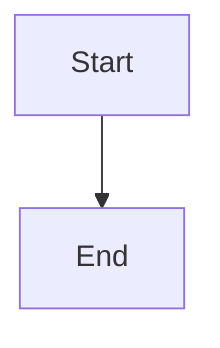

# Correct material-evidence retries without renewing incident budgets

## Parent Epic

epic_048

## Scope

## Outcome and ownership

Correct the deterministic-failure retry regression reported by the operator on PR #251 under existing Epic criteria 3–7, 11–12, 14 and 16–19. Feature Lead owns production correction, focused regression and normal corrective review delivery; Feature Architect owns the source-backed contract and final diagram reconciliation. Epic Manager owns coordination and PR #251/final Epic CI disposition. F4 (feat_048_004) retains the shared harness, workflow and final acceptance dossier. Do not duplicate F4's harness or independently modify its active Task work.

## Evidence and scope

Failing revision: ff3cd399d1523ba6c4e123825c811f8c0b700e7c. GitHub job: https://github.com/vincentc-b/CascadeCode/actions/runs/45503157539/job/138831403366?pr=251. PR #251 remains open with that head as independently observed during Epic assessment. The operator reports 53 passed, 1 failed. Epic Manager independently reproduced the unchanged regression tests/test_review_health.py::test_validation_and_publication_failures_remain_owned_and_retryable in an isolated archive of that revision: 1 failed in 2.67s, expected completed but got awaiting_owner_decision.

At that revision run_review_validation classifies a nonzero exit as deterministic; settle_incident_operation calls _exhaust for that classification; reserve_incident_operation unconditionally refuses exhausted status. bind_incident_budget records another canonical binding but cannot restore eligibility. Generation admission therefore does not permit a changed approved validation command to use remaining original allowance. The operator's durable evidence reports two publication generations, one attempt, one process-second and deterministic failure exhausted / bounded_extension_required. Keep reported evidence distinct from independently inspected results.

Inspect delivered F1–F3 and any integrated F4 changes before implementation. Required entry points: cascade/task/incident_budget.py bind_incident_budget, reserve_incident_operation, settle_incident_operation and extension/recovery paths; cascade/task/action_recovery.py admit_review_publication_generation and resume_action; cascade/team_review_recovery.py publish_team_review_resolution; cascade/review_validation.py reserve_review_validation/run_review_validation; cascade/review_rebase.py check_and_publish_review_rebase. Trace budget consumers in Agent and Watchdog if shared state semantics change.

## Acceptance criteria

1. An unchanged deterministic failure admits no second expensive validator/provider operation, creates no repeated resolved owner decisions and does not burn remaining original allowance. Preserve refusal across repeated calls, independent worker restart, new operation/action/claim IDs, cosmetic commits and A→B→A policy cycling. Derive relevant material identity from current authoritative source/target, approved policy and relevant capability/environment evidence; caller strings, clock/report timestamps, incidental receipt/state changes and mere generation-number increments grant no eligibility. Returning to already-failed material evidence must not bypass its retained failure fence.
2. A genuinely changed, current, authorized material repair/policy/environment can be reconsidered and run exactly the bounded next necessary check within the remaining original cumulative allowance. Bind each failure/operation to its authoritative material evidence and original lineage. Account for the distinction between incident authoritative generation and publication material generation; a ledger update caused by the failed operation is not itself a repair. Select the smallest compatible API/schema correction, documented before Task dispatch, rather than infer material identity from a new operation ID.
3. Separate evidence-specific deterministic blocking from numerical exhaustion and independently controlled waits. Recompute all charged, reserved and elapsed limits before admission under the existing lifecycle lock. Exhausted attempts/process/model/turn/token/time budgets still refuse; authorized bounded extensions remain independently approved and retain history. Preserve action-specific bounds, transient retry/backoff limits, concurrency/live-claim constraints and human approval/comment/credential/policy gates. No general reopen-on-change, budget reset, new incident identity, deleted history or weaker validator.
4. Retain original incident/action identity, admission time, cumulative charges, reservations, operation receipts, generation/decision/attempt history and extension provenance through restart, linked actions and split product/tracking roots. Reconcile already-persisted records marked deterministic failure exhausted only through a validated supported path with reconstructable failed-material evidence and sufficient original allowance. Ambiguous/legacy/unavailable/in-flight evidence and unrelated terminal/human-gated states remain fail-closed with a named owner and next action. Historical exhaustion/escalation facts remain inspectable.
5. Retain the existing failing regression unchanged in intent and mandatory selection. Add high-signal real-validator/real temporary Git and bare-remote integration coverage: first real nonzero exit; unchanged refusal with independently counted no-spawn/no-push; authorized material correction via actual governed policy or real repair (not only monkeypatched validation_command); one successful bounded retry and exact tested-SHA leased publication; repeat/restart with no duplicate effect. Include preserved red attempt and aggregate charges before/after. Do not use an empty successful validator as the new proof.
6. Negative coverage proves material drift, changed unauthoritative evidence, cosmetic/source-only metadata change, policy cycling, changed evidence with numerical exhaustion, elapsed expiry, human gate, exhausted operation retry bound, concurrent callers and ambiguous legacy accounting cannot spend improperly. Reuse existing coverage where it exercises the real correction path. Cover independent authorized extension retaining previous charges where applicable; do not create redundant mock-heavy tests.
7. Run the complete review-recovery selection that failed PR #251 (tests/test_review_recovery_journey.py, tests/test_review_health.py, tests/test_review_rebase.py, tests/test_resolution_actions.py), focused incident-budget/generation/publication safeguards and affected consumer tests. Keep exact SHA/commands/results and bounded failure artifacts. F4 incorporates the new regression into its mandatory bounded Recovery contract check and final integrated acceptance run. No test deletion/exclusion, budget reset, or unchanged CI rerun counts as the fix.
8. Deliver through normal Task→Feature→Epic review/integration, with exact reviewed/fixed/tested SHA and fresh hosted check links. Epic Manager coordinates the supported publication route to refresh PR #251's failing head with the correction if permitted, or a formally linked reviewed corrective successor/supersession when lifecycle prevents that update. Never directly edit the completed F1 record/branch, force-push, bypass reviews or silently accept its red check. Historical job remains historical failure; resolution requires passing checks on the actual corrected review head and final Epic integration head, plus explicit PR #251 disposition.
9. No dependency install, live deployment, forced lifecycle rollback or architecture publication recovery is granted here. The separately failed architecture publication and F4 operational authority/evidence remain independent open gates.

## Planning and Task boundaries

Prefer one cohesive implementation Task covering state/API correction, focused real-process/Git proof and owning design/model updates, followed only if needed by a separate integration/review evidence Task. Feature Lead must specify concrete data fields, source contracts, typed refusals, migration/reconciliation and normal/failure/restart flow before dispatch. Populate each Task's own acceptance/test plan through Cascade before it becomes active; no TBD contract. Keep source changes and their required design/Code coverage together.

Depends on delivered F1–F3, not F4's separately gated operational exercise. Consume F4 artifacts through supported coordination and current branch integration; do not mutate another team's worktree. F4 remains sole workflow/harness owner; any overlapping changes require an explicit handoff through the Epic, since siblings may not message directly. Preserve inherited provider/model/reasoning.

## Diagram-impact inventory and design acceptance

| Level / views | Owner / source | Required reconciliation |
|---|---|---|
| Landscape/context: cascade-landscape, cascade-context | root DESIGN.md | Feature Architect checks operator/authority boundary. No new external system is proposed; record concrete unchanged reason if final diff retains it. |
| Containers: cascade-containers | root and cascade/DESIGN.md; existing supervisor and tracking-root ledger | Preserve one spendable tracking-trunk store and existing process boundaries; no new service. Verify restart/split-root ownership; no OS isolation claim from containers. |
| Components: cascade-supervisor-components, cascade-team-components | cascade/DESIGN.md and cascade/task/DESIGN.md; budget and shared publication collaborators | Reconcile material admission → budget reservation → validator settlement → retry/publication; inspect Agent/Watchdog consumers on both sides if result/status contract changes. |
| Native Code: cascade-task-code, cascade-teams-code | cascade/task/DESIGN.md owns REQ-RECOVERY-BUDGET-001 / DEC-RECOVERY-BUDGET-001; cascade/DESIGN.md owns REQ-REVIEW-PUBLISH-001. Source entries listed above. | Update real schema/functions/relationships and correct native declaration kinds, cascade.codeComponent/parent/sourcePath/sourceSymbol in model.dsl, views.dsl and workspace.contract.json together as needed. Resolve stale/deleted symbols and changed component ownership. Do not duplicate requirement owners. |
| Affected consumer Code: cascade-agent-code, cascade-watchdog-code; cascade-dashboard-code and cascade-war-room-http-code only if projections change | cascade/agent/DESIGN.md, cascade/watchdog/DESIGN.md, cascade/war_room/DESIGN.md | Verify new refusal semantics cannot admit paid work or turn budget reads into authority; update producer/consumer links for actual deltas, record concrete unchanged reasons otherwise. No UI redesign. |
| Supplementary behavior | Task budget flow and shared publication flow in owning designs | Explain deterministic material fence versus cumulative exhaustion, authorized change, historical fencing, extension/human refusal and persistence/restart. Trace one normal changed-material retry and one unchanged/exhausted restart refusal against code. |

Feature Lead/Architect must copy applicable rows into Task acceptance and budget the work. Reconcile final diff including later F4 integration; designs describe current source without delivery history. Verify source contracts and checkout links, supported pinned rendering, actual context→container→component→Code, Level up, deep-link restoration and pinned-source opening for affected views; verify warm reuse and record measured timing without per-view startup or weakened render bounds. Record checks and gaps in work records. Existing accepted snapshots and revision-pinned publication guards remain intact.

## Completion evidence

Provide exact corrective source/review revision, original regression red→green, the real-policy/validator/Git journey, independent effect and cumulative accounting snapshots, retained negative gates, focused/full named CI selections, design/view reconciliation and fresh hosted results. Epic Manager owns unresolved PR #251 disposition and final Epic CI; F4 owns integrated acceptance/operational dossier. A minted Feature or passing helper alone is not resolution.

## Data structures

TBD.

## API contracts

TBD.

## Logic flow

## Task breakdown

_(empty — Feature Team mints tasks after dispatch)_

## Risks & upward questions

None.

## Decision log

None yet.
