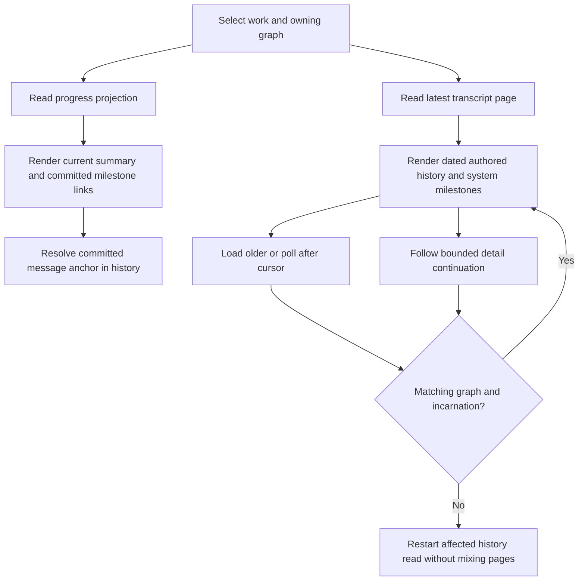

# Show coherent recovery progress on board and Historical transcript

## Parent Epic

epic_049

## Scope

Deliver epic_049 success criteria 4, 7 and 8 using the frozen shared projection and transcript page contracts from feat_049_001 and feat_049_002. Own operator integration and deterministic operational acceptance, not a separate recovery state machine.

Required Task acceptance:
- Show the current summary persistently on board and beside Historical: supported state/stage, owner, action/review, occurrence/freshness, attempt, prerequisite and safe next step. Preserve/link concurrent incidents. An old no-recovery-needed message stays dated authored history.
- Label milestones System · Recovery; distinguish authored manager/architect summaries. Link summary to stable milestone anchors and review; safely render text/URLs. Support keyboard navigation and load-older/incremental paging while preserving history/scroll.
- Board and room consume identical server semantics with action/generation/projection identity. Older async responses cannot regress current state or switch incidents silently; show freshness/lag explicitly.
- Deterministic fixture reproduces the supplied 03:58:01 queued, 03:58:10 acknowledged and 04:02:25 started timeline. Hold a role's final reply pending and prove through real supported HTTP/UI entry points that the live attempt and its milestone appear first.
- API and Chromium journey covers queued idle, acknowledgement, live investigation versus execution, checks/publication waits, expired/dead/inaccessible owners, failure/retry/exhaustion, new generation and authoritative verification. Publication success alone stays verification pending.
- Refresh, navigation, two-process duplicate delivery and service/worker restart preserve identity and exactly one milestone per material source transition. Include unknown legacy times, older authored health statements and competing incidents. Drive real notification/publication boundaries, not only prewritten expected UI fixtures.
- Assert recovery and chat GETs are read-only/bounded and make no provider/Git/process probes, raw full-history scans or paid turns. Record response/source bytes and representative warm navigation measurements. Existing tests may be extended; do not add redundant micro-tests or require a full repository suite by default.

Architecture closeout: reconcile the epic inventory against the integrated diff across context, container, components, cascade-dashboard-code, cascade-task-code, cascade-watchdog-code and affected workspace/teams Code views. Review root and War Room/Task/Watchdog/Workspace/Recovery Progress designs and interface owners. Verify model/source contract, real declaration kinds, supported pinned local rendering, context → container → component → Code, Level up, deep-link restore, opening pinned sources, renamed/deleted-symbol rejection and warm artifact reuse without per-view startup. Current model render success alone does not prove new coverage. Keep history in work records; do not rewrite accepted architecture artifacts. Report exact gaps rather than claim deployment or live tool-output streaming.

Preserve Codex feature_lead/feature_architect gpt-6-sol high and SWE gpt-5.6-sol medium. Use verified local Python/Node/Playwright/Chromium and pinned Structurizr tools without installation. Return focused commands/results and supported-entry-point evidence for Epic acceptance.

Architecture contract resolved by Epic decisions dec_004–dec_006. Required Task acceptance consumes the selected immutable progress/transcript pages and their distinct revision/incarnation contracts, renders pending milestone delivery and incomplete legacy import, preserves older-page cursors across ordinary appends, and rejects stale incarnation/cross-graph cursors. Test execution evidence with a queued live worker lacking an invocation token as a negative case. Verify both start fast path and supervisor replay while the authored final reply is held. Reconcile the current-source planning baseline's 13 Code nodes against actual producer/index/page implementations; no proposed function may remain represented as an implemented node.

## Data structures

### Confirmed upstream planning handoff

Feature 2's planning acknowledgement is historical context. This worktree contains Feature 4's final handoff `a3d4a42b3df92a553206c300c42142600183eaef`, with the atomic mapping patch integrated as equivalent commit `2e9fe23e` (stable patch ID `e24afbbe865d97c4e36541295f22815edd6af942` for original `469f0fa5f0bd99cf38351e26d6d7feb952bb26d3`) and the UTF-8 cursor fix from `ecd390f4d1819d72bc65e2ea4960000a48e50a67`. Implemented route and error fixtures, not earlier planning prose, bind this consumer.

Consume `tests/war_room/fixtures/recovery_progress_v1_epic_044.json` with `tests/war_room/test_recovery_progress_api.py` and `tests/war_room/test_http_read.py` on the integrated baseline above. That fixture covers a waiting blocker, not the full operational timeline required above. Preserve receipt_id and entry_id unchanged, nullable legacy occurrence, safe target/provenance and ordered references. Success includes entry_count and entry schema_version/entry_revision; pending omits entry_count.

Feature 2 Task 002 owns `append_committed_recovery_receipt(root, receipt, snapshot)` and `recovery_progress.publisher.record_transcript_milestone(root, ack)`. The acknowledgement carries receipt_id, entry_id, graph_id, message_id, incarnation and append_sequence. JSONL fsync and index commit precede graph-fence release and publisher mapping; replay retries the same receipt through an append-before-ack crash and advances its source cursor only after durable mapping. UI consumes committed milestone_refs and renders delivery lag honestly; it must not synthesize anchors from unacknowledged receipts. Final fixtures must demonstrate an anchor resolving after replay without duplicate lines.

Transcript items distinguish recovery_milestone, role_reply and human, with nullable occurred_at separate from appended_at and direct/reconciled/legacy_unknown provenance. Feature 2 owns serialization; UI preserves these distinctions and safe rendering.

## API contracts

Consume Feature 1's completed `GET /api/recovery/progress?work_id=<id>&cursor=<opaque>`. Progress cursors bind work and projection revision; 400 invalid_request and 409 revision_changed remain distinct, with restart plus previous_revision/current_revision on conflict. Preserve typed pending evidence states rather than interpreting them as healthy empty recovery.

The completed Feature 2 provides these endpoints:
- `GET /api/transcript/v1/<graph_id>?direction=older|after&cursor=<opaque>&limit=<n>`: latest 50 by default, maximum 100; envelope includes schema_version, graph_id, incarnation, high_water_mark, completeness, observed_at, items, older_cursor, after_cursor and has_more. Older paging retains its high-water across appends; incremental paging follows committed append sequence.
- `GET /api/chat/<graph_id>`: bounded legacy array with Link continuation and X-Transcript-Completeness, X-Transcript-Incarnation and X-Transcript-Has-More headers. Typed 503 transcript_unavailable must not appear as a healthy empty history.
- `GET /api/transcript/v1/<graph_id>/items/<message_id>/detail?cursor=<opaque>`: detail_truncated/detail_url/detail_cursor preview metadata leads to immutable UTF-8-aligned chunks of at most 64 KiB. Envelope contains schema_version, graph_id, message_id, incarnation, encoding, chunk, next_cursor and complete; the implemented `chunk` field is UTF-8 aligned and advances its byte offset positively for each incomplete read.

Transcript page cursors bind graph/incarnation/direction/position/high-water; detail cursors bind graph/incarnation/message/digest/offset. Consume typed 400 `invalid_request`, 409 `cursor_restart` and 503 `history_pending` as exercised by `tests/war_room/test_transcript_pages_api.py::test_typed_invalid_restart_pending_and_get_is_projection_only` and `::test_oversized_detail_reconstructs_utf8_and_rejects_foreign_or_stale_cursor`; restart conflicts include `restart`, `current_incarnation` and `restart_url` for transcript pages. The compatible legacy chat route uses `Link`, `X-Transcript-Completeness`, `X-Transcript-Incarnation` and `X-Transcript-Has-More`, with 503 `transcript_unavailable` on missing history. `tests/recovery_progress/test_transcript_milestones.py` governs fenced mapping, replay, nullable occurrence and ordered references; `tests/war_room/test_durable_chat_store.py::test_fenced_source_lookup_leaves_pending_intent_for_writer_repair` governs pending source lookup. Reject late responses from a replaced graph/incarnation, keep progress revision separate from transcript incarnation, and never splice incompatible detail chunks. Explicitly show incomplete import and pending history.

Required UI acceptance includes preview-to-detail continuation, stale detail cursor recovery and a wrong-graph rejection. All endpoints retain 1 MiB aggregate source and 256 KiB response budgets and read only immutable projections. No UI refresh repairs storage or invokes providers, Git, checkpoints or recovery.

## Logic flow

Consumer flow to implement against the pinned route fixtures:

## Task breakdown
- task_049_003_004
- task_049_003_003
- task_049_003_002
- task_049_003_001

### Planning baseline

Completed upstream code supplies immutable work progress pages in `cascade/recovery_progress/publisher.py` and `cascade/war_room/recovery_progress.py`, and durable transcript pages, detail, routing and acknowledgements in `cascade/war_room/{chat_store,transcript_pages,recovery_milestones,sidecar_routes}.py`. Feature 4's integrated fenced mapping prevents stale routing acknowledgements from replacing current room identity. The current `cascade/war_room/static/war_room.js` reads the bounded legacy chat array, redraws Historical, and displays the coarse board `recovery_incident`. This feature consumes existing authority and changes operator presentation and proof. Final implemented route/error fixtures govern exact payloads.

### Task 1 — Present current progress on board and beside Historical

Owner: SWE. Consume the identical server semantics of `GET /api/recovery/progress` and board `recovery_progress` with its compatible `recovery_incident`. Retain work, graph, action, generation, entry and projection revision identity. Persistently show supported state/stage, owner, occurrence or time unavailable, observation freshness and lag, attempt, prerequisite, safe next step, safe review/action link and committed milestone references. Show ordered concurrent incidents and continuation. Explicitly show pending, incomplete, expired and inaccessible evidence; a queued live worker without an invocation token is not executing. Publication success remains verification pending until authoritative postcheck. Reject stale asynchronous responses and prior-graph responses; handle 400 invalid_request and 409 revision_changed with safe restart. Render only text nodes and allowlisted local URLs. Extend focused API/browser tests for identity, competing incidents, freshness and safe rendering. Reconcile `cascade-war-room-components`, `cascade-dashboard-code`, affected `cascade-war-room-http-code` and War Room design against actual source changes. Preserve `REQ-RECOVERY-PROGRESS-001` through `004` and `DEC-RECOVERY-PROGRESS-001` through `002` as producer-owned in `cascade/recovery_progress/DESIGN.md`; War Room owns consumer and transcript behavior.

### Task 1 delivery review

Merged implementation `5dc6e60e680f9e49f1f7f4c1fc9976fb3ddc79c5` adds a compact board primary from the same progress projection, a persistent room panel, ordered concurrent entries, local-link/text safety and a Dashboard Code node. Focused verification on this integrated branch: `python -m pytest -q tests/war_room/test_recovery_progress_api.py tests/war_room/test_ui_render.py -k 'recovery_progress or recovery_incident or get_home'` passed 11 cases; `python -m pytest -q tests/workspace/test_c4_source.py` passed 14; `node tests/war_room/recovery_progress_current_cases.mjs` and `git diff --check b47b1b78..5dc6e60e` passed. Reviewed `cascade/war_room/DESIGN.md`, Dashboard `model.dsl`, `views.dsl` and `workspace.contract.json`: the new source symbol and Function kind are present; context/container topology has no change because the diff adds presentation inside the existing Dashboard and immutable GET boundary. This review does not claim rendered Code navigation or integrated operational acceptance.

Task 2 resolved the open-room refresh and provisional-anchor follow-ups from this review. The completed Task 1 record retains placeholder acceptance/test sections; its concrete acceptance evidence is recorded here because that completed record is not writable by the Feature team.

### Task 2 — Render durable Historical pages and milestones

Owner: SWE; depends on Task 1 for shared focus and milestone anchors. Use `GET /api/transcript/v1/<graph_id>` for latest, older and after paging. Retain older-page high-water across ordinary appends, preserve scroll on prepend and message IDs across refresh/navigation. Label recovery_milestone “System · Recovery”; keep role_reply manager/architect and human authors distinct, including older dated no-recovery-needed messages and unknown legacy occurrence. Follow only committed milestone_refs to stable anchors; show pending delivery and incomplete import. Support keyboard navigation and safe links, bounded preview-to-detail continuation, stale detail cursor recovery and wrong-graph rejection. Handle typed 400 invalid_request, 409 cursor_restart and 503 history_pending, plus late responses after graph/incarnation change without mixing pages or detail chunks. Keep progress revision separate from transcript incarnation. Update War Room design and affected Dashboard Code nodes; extend focused UI tests using final upstream fixtures.

### Task 2 delivery review

Merged implementation `6b1087165e3132be0e944d453749c0b381feeca7` with follow-up `1727c75779dcb5ef95e609f252568029904245f0` changes Historical to versioned latest/older/after pages, durable message anchors, typed pending/restart handling and bounded detail continuation. The follow-up adds a single-flight background current-progress read to open-room transcript polling without clearing the displayed projection or resetting scroll/high-water. `cascade/war_room/DESIGN.md` now owns the current consumer flow and `REQ-WARROOM-TRANSCRIPT-006`; `cascade-dashboard-code` maps `loadCurrentRecoveryProgress` and `pollChatSidecar` to real Function declarations, with model, view and source contract updated together. Context and container views remain unchanged because this diff adds browser behavior within the existing War Room GET boundary and no actor, service, store or deployment edge.

The Task 2 supervised clean-tree validation reported 73 passed in 124.44 seconds. On this integration branch, `node tests/war_room/war_room_refresh_races.mjs` passed, `python -m pytest -q tests/war_room/test_transcript_pages_api.py -k historical_ui_pages_milestones_and_bounded_detail` passed (1 case), `python -m pytest -q tests/workspace/test_c4_source.py` passed (14 cases), and `git diff --check 1c7fbea9..HEAD` passed. Reviewed `cascade/war_room/DESIGN.md`, the Dashboard entries in `model.dsl`, `views.dsl` and `workspace.contract.json`, and the JS/Chromium scenarios. These checks establish the local browser paging, anchor, detail and source-symbol behavior; they do not establish the held-final-reply notification journey, cross-process replay, Feature 5 contention bound, rendered C4 navigation or live deployment. Task 3 owns the operational proof and Task 4 owns the final architecture navigation and design closeout.

### Task 3 — Prove operational acceptance through supported entry points

Owner: SWE; depends on Tasks 1 and 2. Use deterministic fixtures, real producer notification/publication boundaries, supported HTTP routes and Chromium. Reproduce 03:58:01 queued, 03:58:10 acknowledged and 04:02:25 started while holding the role's final reply; prove both start fast path and supervisor replay show the live attempt and committed milestone first. Cover queued idle, acknowledged, investigating versus executing, checks/publication waits, expired/dead/inaccessible owner, failure/retry/exhaustion, new generation and authoritative verification. Exercise pending delivery, incomplete legacy import, old authored health statements, competing incidents, refresh/navigation, two-process duplicate delivery and service/worker restart, with exactly one milestone per material source transition. Verify ordinary append versus stale incarnation/cross-graph cursors and preview/detail restart. Assert progress/chat GETs remain read-only and within row/source/response budgets, with no provider, Git, process, checkpoint, raw-history scan or paid turn. Record focused commands/results, source and response bytes, representative warm navigation timing and limits of local proof. Extend existing integration tests where practical.

### Task 3 delivery review

Merged operational journey `d436a933` and validated deliverable `6cf5b7724038c58d3956bfd8c4fa759d350d31f2` are ancestors of this feature branch. The source change recognizes timestamped `owner_acknowledged` receipts and nested routing markers, and registers the exact executor live token before publishing the committed execution start. The Task design sequence matches that order. The [Task 3 closeout](../../task_artifacts/task_049_003_003_operational_recovery_closeout.md) traces queued 03:58:01, acknowledged 03:58:10 and started 04:02:25 through after-commit notification, immutable publication, loopback HTTP and Chromium while the final role reply is held. It also distinguishes direct start from bounded replay and records duplicate/restart, identity, pending and read-only evidence.

The Task 3 supervised clean-tree validation reported 93 passed in 86.20 seconds. On this merged feature branch, `python -m pytest -q tests/war_room/test_transcript_pages_api.py::test_epic_044_held_reply_fast_path_replay_http_and_chromium` passed (1 case), `python -m pytest -q tests/workspace/test_c4_source.py` passed (14 cases), and `git diff --check 96f36fa0..HEAD` passed. The scoped journey measured progress source/response 4,077/4,514 bytes for 3 rows and transcript source/response 5,885/5,760 bytes for 6 rows, below the 1 MiB source and 256 KiB response ceilings. Local warm Chromium reads measured 37.0 ms for board and 7.8 ms for room. These are local observations, not deployment latency guarantees.

Reviewed `cascade/task/DESIGN.md` and `cascade/recovery_progress/DESIGN.md` against `action_recovery.py`, `publisher.py`, the test and the Task closeout. The changed Task behavior stays within existing Task and Watchdog Code nodes; context and container boundaries, persistent stores and HTTP interfaces did not change in this diff. The producer design still owns `REQ-RECOVERY-PROGRESS-001` through `004` and `DEC-RECOVERY-PROGRESS-001` through `002`; Task 4 must reconcile its full integrated design and rendered navigation. The broader Feature 4 documentation-refresh assertion remains unverified. Feature 5's contention-bound repair and Task 4's exact integrated architecture publication remain final acceptance gates.

### Task 4 — Reconcile architecture and integrated closeout

Owner: feature architect/SWE; depends on Task 3. Review the final diff against root `DESIGN.md`, `cascade/DESIGN.md`, War Room, Task, Watchdog, Workspace and Recovery Progress designs and interface owners. Reconcile `model.dsl`, `views.dsl` and `workspace.contract.json` together against implemented UI, producer, index and page symbols. Every native Code node needs the correct `cascade.codeComponent`, `cascade.parent`, source path/symbol and declaration kind; remove any baseline node without a real declaration. Trace held-reply publication, pending/replay, stale owner and incarnation failure through source-linked structure, state, persistence and recovery. Validate source contract and supported pinned local render; inspect context → container → component → Code, Level up, deep-link restore and pinned source opening. Reject renamed/deleted symbols and ownership drift; measure warm artifact reuse and bounded render operations without per-view startup. Record changed designs, exact view keys, checks, concrete no-change reasons and remaining gaps in closeout. Preserve accepted architecture snapshots.

### Task 4 delivery review

Merged Task 4 deliverable `d05eca4fb68ffc21157f9f224e205f6d6aa5fd28` is an ancestor of this feature branch. Its [architecture closeout](../../task_artifacts/task_049_003_004_recovery_ui_architecture_closeout.md) reviews `DESIGN.md`, `cascade/DESIGN.md`, and the War Room, Task, Watchdog, Workspace and Recovery Progress designs against the final source diff. Task 3 changed acknowledgement classification and exact token-before-notification ordering inside existing components; `cascade/task/DESIGN.md` already records that sequence. No further design, model or source-contract edit is justified by this diff. Landscape/context and container responsibilities, persistence and runtime boundaries are unchanged; Dashboard, HTTP, Task, Watchdog, Workspace and Teams Code symbols remain real declarations with current owners.

Task 4's supervised clean-tree validation reported 18 passing tests in 184.86 seconds, including source-contract checks, a pinned 24-view render and cache reuse. Its Chromium navigation test uses a reduced four-view Agent fixture and proves browser mechanics only. I then ran Chromium against the unmodified full model in an isolated clone of merged feature revision `3d0691e2d51dd5b5b27717a659143fce3778148d`: five context → container → component → native Code paths passed for Dashboard, Task, Watchdog, Workspace and Teams. Each selected a Code node, restored its snapshot/view/target deep link, loaded pinned source text and used Level up to context. The closeout records the exact nodes. This is scoped local evidence, not deployment acceptance.

`architecture/design-mappings.json` still assigns `cascade/recovery_progress` to the Cascade design despite its child design; Epic architecture reconciliation owns that mapping gap. Earlier Task 1 architecture publication failed and Task 2 was reported pending without an exact replay payload; neither is approval. A fresh exact proposal pinned to the final feature plan/source revision and its terminal publication result remain with the Feature architect. The completed Task 1/2 canonical records remain unchanged despite their correction handoffs. Feature 5's bounded graph-lock and existing-index-only repair is absent from this branch, so final integrated Feature/Epic acceptance remains withheld. Feature 4's broader documentation-refresh assertion remains separately unverified.

### Diagram-impact inventory

| Level / view key | Owner and source boundary | Update and verification |
|---|---|---|
| Landscape / `cascade-landscape`, context / `cascade-context` | Root design; operator, Cascade, repository and forge | No planned new actor/system/dependency; verify responsibility boundary against final diff. |
| Containers / `cascade-containers` | Root and Cascade designs; War Room, supervisor, repository artifacts | Preserve runtime/data topology; verify immutable progress/transcript read boundary and no extra service. |
| Components / `cascade-war-room-components`, `cascade-supervisor-components`, `cascade-team-components` | War Room, Task, Watchdog, Workspace and Recovery Progress designs | Verify consumer, producer/write, invocation and graph routing responsibilities; update only changed relationships. |
| Code / `cascade-dashboard-code`, affected `cascade-war-room-http-code` | War Room design; `war_room.js`, route and projection readers | Reconcile actual board/history entry points, page/detail calls, typed errors, source links, anchors and navigation. |
| Code / `cascade-task-code`, `cascade-watchdog-code`, `cascade-workspace-code`, `cascade-teams-code` | Task, Watchdog, Workspace, Recovery Progress and parent designs | Verify receipt, invocation, publisher and routing nodes against final source; change actual symbols/relationships only, with one owner and real kinds. |
| Supplementary behavior | War Room paging; Task/Watchdog/Workspace source and replay flows | Trace held reply, replay, cursor restart and stale owner, including state, persistence and failure gates. |

### Planning design review

Reviewed `DESIGN.md`, `cascade/DESIGN.md`, `cascade/war_room/DESIGN.md`, `cascade/board/DESIGN.md`, `cascade/recovery_progress/DESIGN.md`, and the Task/Watchdog/Workspace boundaries named in the epic inventory against current route, producer, transcript-page and browser entry points. No design or C4 edit is justified by this plan-only diff: current documents describe the completed producer/storage behavior; browser presentation and integrated evidence remain Task obligations. The War Room consumer description must be reconciled when Task 2 changes the legacy-array/full-redraw code. `cascade/recovery_progress/DESIGN.md` is the producer owner; Dashboard/War Room diagrams and source links are consumer obligations. The integrated source includes Feature 4's fenced mapping and UTF-8 fixtures; Feature 5's writer-contention bounds remain an upstream acceptance gap. Final source-contract, render and navigation verification belongs to Task 4 and is not claimed complete here.

## Risks & upward questions

The fenced source lookup still takes blocking graph locks and opens an index connection that may initialize schema with a 30-second SQLite timeout. Feature 5 owns the producer deadline and existing-index-only repair. This UI must show pending evidence without inventing a routing workaround. Final integrated Feature/Epic acceptance requires Feature 5 repair verification on this delivered baseline; its lifecycle state alone is insufficient. Feature 4's scoped browser navigation passed, while the broader documentation-refresh assertion remains unverified.

## Decision log

- `dec_001` · 2026-11-26 · Feature Lead · **Integrated consumer contract**
  Chose Bind board and Historical consumers to the Feature 4 integrated route fixtures and fenced mapping source; keep progress revision distinct from transcript incarnation and accept committed milestone anchors only.
  Rationale: The integrated worktree contains equivalent atomic mapping code and the UTF-8 detail fix; earlier planning descriptions do not define current payloads or routing. Producer contention limits remain owned by Feature 5.
  Honors: Epic decisions dec_004–dec_006; Feature 4 handoff a3d4a42b3df92a553206c300c42142600183eaef; tests/war_room/test_transcript_pages_api.py; tests/recovery_progress/test_transcript_milestones.py.

## Closeout

Completed child work: `task_049_003_001` (Present current recovery progress on board and beside Historical), `task_049_003_002` (Render durable Historical transcript pages and recovery milestones), `task_049_003_003` (Prove recovery progress and transcript behavior through operational journeys), `task_049_003_004` (Reconcile recovery UI architecture and integrated feature closeout).
