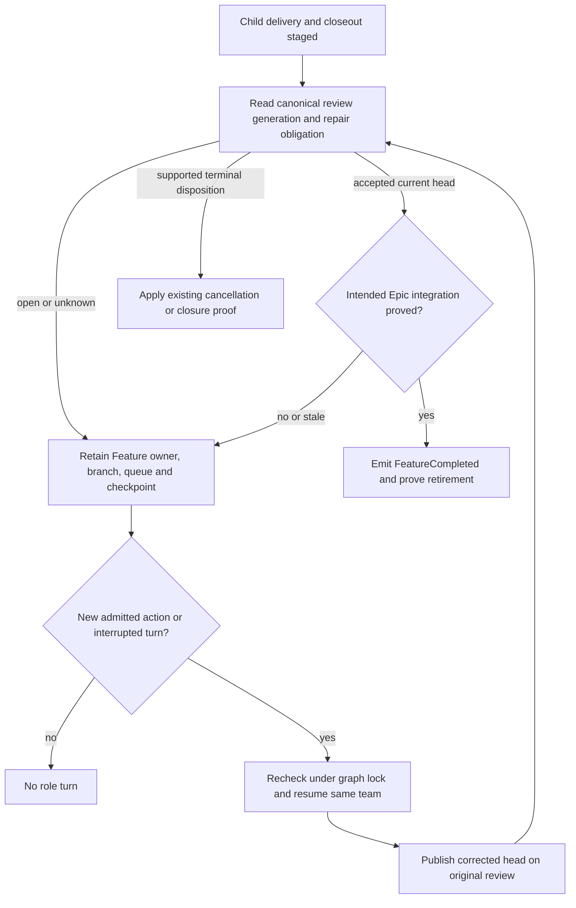

# Keep Feature delivery ownership alive until verified integration

## Parent Epic

epic_051

## Scope

Define one additive Feature delivery lifecycle over the existing review registry and current obligation/repair evidence. Separate implementation readiness, review pending, repair requested/in progress, merge verification pending, verified integration and supported terminal cancellation/closure. Preserve the existing board status schema and completed-source-document publication convention; completed Markdown staging is not authority to retire a team or satisfy downstream integration. The public delivery projection must make that distinction explicit.

Own review.py lifecycle/projection and generation compatibility; boss/rollup.py completion/retirement consumers; workspace/kickoff.py ordinary delivery, startup resume and locked invocation eligibility; integration_worktree.py retention/retirement proof where required. Retain the Feature ID, registered branch/path, checkpoints, queue and original review while its delivery obligation is nonterminal. A dormant owner is eligible only for a new actionable event/current admitted repair or interrupted turn; a polling pass alone launches no role turn. Nonterminal ownership does not grant permission to mint a repair Task without admission. Read-only projection never polls the forge or writes lifecycle state.

Acceptance: all children completed plus an open PR retains ownership and integration-dependent blockers; no premature FeatureCompleted/retirement; duplicate polls produce zero paid turns; a new authorized event or interrupted delivery can resume the same team under one writer. Legacy completed-but-open records normalize to nonterminal review ownership without inventing accepted heads, resetting history or opening a PR. Unknown/missing review evidence stays explicit and retains resources. Verified direct or supported stacked integration into the intended Epic is required before normal retirement. Closed-unmerged reviews remain blocked unless an explicit supported terminal disposition exists; cancellation must retain its existing proof and parent-disposition gates. Preserve review-disabled/local-integration behavior and split product/tracking ownership.

Extend focused completion, review-generation, completed-recovery-kickoff, rollup and retirement tests using real temporary Git where identity/integration matters. Design owners: cascade/DESIGN.md (shared review lifecycle), cascade/boss/DESIGN.md (closeout), cascade/workspace/DESIGN.md (wakeup and retained ownership); root DESIGN.md summarizes. Views: cascade-boss-code, cascade-workspace-code, cascade-supervisor-components and cascade-team-components; add or update source-linked nodes for shared review predicates, completion, queue admission and retirement. Link existing REQ-REVIEW-REPAIR-001/002, REQ-BOSS-CLOSEOUT-001 and REQ-WORKSPACE-RETIRE-001; allocate any new local IDs in the single owner.

### Required Task acceptance and design handoff

Feature planners must carry the relevant acceptance cases below into executable Task specifications. Tasks update the owning DESIGN.md, affected parent/consumer links, model.dsl, views.dsl and workspace.contract.json together where behavior changes. Stable requirement/decision IDs have exactly one design owner. Preserve the existing revision-pinned architecture review workflow and accepted artifacts. Each changed component needs a native Structurizr Code view with real source paths/symbols, correct declaration kinds, and matching cascade.codeComponent/cascade.parent metadata. Record normal and failure/restart traces, source-contract checks, pinned render evidence, and actual context → container → component → Code / Level up / deep-link / pinned-source verification in work closeout; a render alone is insufficient. No delivery chronology belongs in DESIGN.md. Do not add a scheduler, recovery ledger, provider launcher, approval bypass, or new review for an already-open original review. No software installation or deployment is authorized.

## Data structures

A derived Feature delivery view owns the public phase: `implementation_ready`, `review_pending`, `repair_requested`, `repair_in_progress`, `merge_verification_pending`, `verified_integrated`, or `terminal_cancelled`/`terminal_closed` only with an explicit supported disposition. Include Feature ID, accountable owner, existing review URL, current generation, evidence status, blocker/next prerequisite, and whether a new event is actionable. Unknown or closed-unmerged forge evidence has a nonterminal blocker, never an inferred accepted head. Derive this from the canonical board owner, existing review generations, current repair obligation, completion event and target Git evidence; do not add a ledger or change board status values. Keep immutable generation history and top-level compatibility fields.

## API contracts

- `cascade.review.feature_delivery_view(s)`: read-only, no forge poll or lifecycle write. A completed-path source with an open original review projects nonterminal review ownership. Missing evidence is explicit. Bulk callers share loaded registry state.
- `cascade.boss.rollup.current_feature_obligation` and `try_complete_feature`: use current delivery evidence before the completed-path fast path and before FeatureCompleted/retirement. Only exact current-generation acceptance plus intended Epic integration, or supported local integration and terminal disposition, can release normal closeout. Preserve cancellation's parent and cleanup gates.
- `cascade.workspace.kickoff`: allow the retained Feature graph to consume a new authorized queue event, current admitted repair or interrupted checkpoint under the existing graph lock. Queue advancement and staged input remain durable; an unchanged idle review poll schedules no role turn. Generic messages cannot admit repair or authorize Task minting.
- `cascade.workspace.integration_worktree`: refuse retirement while the derived Feature delivery obligation is nonterminal, while preserving existing exact-owner, cleanliness, descendant, merge and transcript proof. Normal review-enabled and review-disabled paths keep their respective integration evidence.

## Logic flow

## Diagram-impact inventory and design handoff

| Level and view | Owner, source symbols and required reconciliation | Verification |
|---|---|---|
| Landscape `cascade-landscape`, context `cascade-context` | Root `DESIGN.md`: existing people, forge and responsibility boundaries remain; inspect final diff and retain view unless a boundary actually changes. | Confirm model/source links and context navigation. |
| Containers `cascade-containers` | Root and `cascade/DESIGN.md`: review registry, action store, graph checkpoint and Git target remain within current local runtime/repository containers; no new deployment boundary. | Confirm persistence and communication against final source. |
| Components `cascade-supervisor-components`, `cascade-team-components` | `cascade/DESIGN.md`, Boss and Workspace child designs: show shared review predicate flowing to closeout, queue admission and retirement; update component relationships only where final diff changes them. | Trace one open-review and one failed/unknown or restart path. |
| Integrated Code `cascade-boss-code`, `cascade-workspace-code` | `cascade/review.py` delivery projection/generation, `cascade/boss/rollup.py` obligation/completion, `cascade/workspace/kickoff.py` queue/resume/locked gate, `integration_worktree.py` proof. Update `model.dsl`, `views.dsl`, `workspace.contract.json` and owning designs together. Keep real source paths/symbols and correct declaration kinds/semantic parent. | Validate source contract and pinned render; navigate context → container → component → Code, Level up, deep link and pinned source. |
| Supplementary flow | `cascade/DESIGN.md` owns delivery state, Boss owns closeout, Workspace owns event and restart behavior; root only summarizes and links. | Compare diagrams with normal and failure/restart code traces. |

The existing requirements `REQ-REVIEW-REPAIR-001/002`, `REQ-BOSS-CLOSEOUT-001` and `REQ-WORKSPACE-RETIRE-001` remain with their current owners. Add local IDs only for genuinely new durable contracts. Each Task closeout records reviewed design paths, exact model view changes or concrete no-change reasons, checks and unresolved gaps; do not put delivery history in a design. Do not rewrite accepted architecture snapshots or bypass revision-pinned publication.

## Task breakdown
- task_051_001_003
- task_051_001_002
- task_051_001_001

1. **Derive Feature delivery lifecycle from existing evidence.** Implement read-only shared phase and compatibility projection in `cascade/review.py`; retain original review/generation behavior and legacy normalization. Update `cascade/DESIGN.md` and the Boss Code view's source-linked review nodes. Focused review-generation and projection tests cover open, missing, closed-unmerged, stale callback, repaired and integrated evidence.
2. **Gate Feature closeout and retirement on verified delivery.** Consume the shared projection in `cascade/boss/rollup.py`; prevent the completed fast path, FeatureCompleted and retirement from treating staging as integration. Preserve local integration, stacked review and cancellation rules. Update `cascade/boss/DESIGN.md`, the Boss Code view/contract and focused completion/rollup tests with real Git where target identity matters. Depends on Task 1.
3. **Wake retained owners only for actionable work and finish integration proof.** Update `cascade/workspace/kickoff.py` and, where required, `integration_worktree.py` for ordinary delivery, startup resume, locked recheck and retirement proof. Update `cascade/workspace/DESIGN.md`, root summary and Workspace/affected component Code views/contract. Focused kickoff, retirement and end-to-end tests prove open review retention, one authorized wakeup, zero duplicate idle turns, restart, missing evidence, accepted intended-target integration and review-disabled behavior. Reconcile and verify all four named views. Depends on Task 2.

## Risks & upward questions

The current review registry has legacy rows without accepted heads. Treat them as unresolved and retain original identity; never fabricate acceptance or open a second PR during read-only normalization. A forge merge can precede local target synchronization, so final closeout waits for independent intended-Epic evidence. No scope or dependency change is requested from the Epic.

## Decision log

None yet.

## Closeout

Completed child work: `task_051_001_001` (Derive Feature delivery lifecycle from existing review evidence), `task_051_001_002` (Gate Feature closeout on verified integration), `task_051_001_003` (Wake retained Feature owners and verify retirement).
