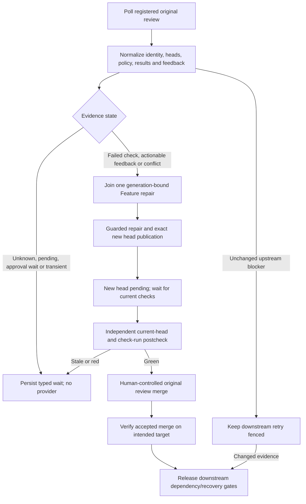

# Route actionable review health without idle or downstream retry loops

## Parent Epic

epic_051

## Scope

Extend tracking.merge_request_snapshot and review_health.reconcile_open_review_health to normalize fresh review identity/head pair, mergeability, required CI requirements/results and review feedback for GitHub and GitLab. Preserve unknown/unavailable evidence explicitly. Identify required checks from authoritative forge policy/evidence; absence of reported checks is not proof of no required checks. CI results bind their source/check-run generation and relevant target evidence. Pending checks, unavailable policy/data, transient forge errors, approval waits, fixable failed checks and conflicts remain distinct. A mergeable PR with a failed required check must never be healthy.

Reuse current Watchdog review polling, resolution-action routing, incident/claim budgets and the preceding durable repair API. Normalize material observation identity from original review, head pair, failing/check-run or feedback identity and current repair generation. Repeated identical evidence reuses the admitted request without another Task, model turn or budget reset. New source/target/check-run/feedback evidence may justify bounded reevaluation. Preserve safe existing conflict validation/republication and required human merge policy; do not launch arbitrary CI commands from forge text, blindly rerun failed checks, merge PRs or override protections.

Acceptance: classify failed/pending/missing/stale/green required checks, approval-only waits, actionable human feedback, conflicting/moving target, transient forge outage and terminal disposition using production normalization with scripted transport. Changed heads or a green result for an old source cannot satisfy repair or closeout; transient/pending/unchanged polling launches no provider. Conflicts and failed checks share one generation-bound Feature repair owner instead of competing writers. Independent observation reconciles the exact corrected head and all known required checks before success, then verifies intended-target merge. Persist the upstream review blocker/evidence generation on affected downstream recovery so unchanged upstream CI cannot repeatedly redispatch the downstream Task; changed evidence releases reevaluation once through current dependency/recovery gates. Never suppress an unrelated downstream failure. Restart preserves deduplication, budgets, latest evidence and pending delivery.

Tests: tracking adapter, review health/rebase, resolution actions, Watchdog reservations/postchecks, downstream queued-delivery/recovery and publication safeguard cases. Design owners: cascade/DESIGN.md (forge/check contract), cascade/watchdog/DESIGN.md (observation/recovery), cascade/task/DESIGN.md where downstream retry semantics change. Views: cascade-watchdog-code, cascade-boss-code, cascade-teams-code and cascade-task-code as affected, plus component relationships. Show normal red → admitted repair → new head pending → green → verified merge and unknown/human gate/restart paths in owning designs. Prefer a small extension to existing records and adapters; no second scheduler or CI service.

### Required Task acceptance and design handoff

Feature planners must carry the relevant acceptance cases below into executable Task specifications. Tasks update the owning DESIGN.md, affected parent/consumer links, model.dsl, views.dsl and workspace.contract.json together where behavior changes. Stable requirement/decision IDs have exactly one design owner. Preserve the existing revision-pinned architecture review workflow and accepted artifacts. Each changed component needs a native Structurizr Code view with real source paths/symbols, correct declaration kinds, and matching cascade.codeComponent/cascade.parent metadata. Record normal and failure/restart traces, source-contract checks, pinned render evidence, and actual context → container → component → Code / Level up / deep-link / pinned-source verification in work closeout; a render alone is insufficient. No delivery chronology belongs in DESIGN.md. Do not add a scheduler, recovery ledger, provider launcher, approval bypass, or new review for an already-open original review. No software installation or deployment is authorized.

## Data structures

- The normalized review observation carries the original forge URL/number and refs, open/merged/closed state, exact source and target heads, mergeability, required-check policy, results, feedback and availability for each field. A policy records the target/head it governs and the authoritative set of required check names. A confirmed empty set is distinct from unavailable policy.
- Each required result binds check identity, conclusion/state, source head, applicable target/policy evidence, and forge run or pipeline generation. A later run supersedes an old green result. Missing results are explicit and never count as green.
- The existing resolution action/Feature repair receipt stores a digest of original review identity, source/target pair, failing check/run or feedback identity, and current repair generation. The existing downstream recovery action records the upstream blocker and evidence generation separately from its own Task failure. No new ledger is introduced.

## API contracts

- `tracking.merge_request_snapshot(root, mr, runner=...)` returns normalized evidence for GitHub and GitLab; transport errors remain typed unavailable observations for callers. Required checks come from authoritative target policy. Forge output is data only.
- `review_health.reconcile_open_review_health(root, owner_id=...)` classifies terminal, actionable, pending/human, unknown and transient states. It routes actionable conflicts, failed checks and feedback through one existing Feature repair owner; identical evidence rejoins the admitted request.
- Watchdog postcheck and Boss closeout independently reread the original review. They require matching corrected source and target evidence, all known required checks green at the current run generation, forge acceptance and intended-target integration before terminal success.
- Task queued-delivery/recovery reads the persisted upstream blocker generation before retry. Only changed upstream evidence passes to the ordinary dependency and recovery gates; unrelated downstream failures retain their own recovery path.

## Logic flow

## Task breakdown

1. `task_051_003_001` — Normalize authoritative GitHub/GitLab review, policy, CI generation and feedback evidence in the tracking adapter. Owns the shared forge/check contract in `cascade/DESIGN.md` and the review snapshot Code node.
2. `task_051_003_002` — Classify and route actionable review health through one durable repair owner; deduplicate unchanged evidence and preserve budgets. Depends on 001. Owns `cascade/watchdog/DESIGN.md` observation flow and Watchdog/teams Code nodes.
3. `task_051_003_003` — Independently verify corrected review evidence and intended-target merge before repair success or closeout. Depends on 002. Owns Watchdog/Boss postcheck and closeout design and Code nodes.
4. `task_051_003_004` — Persist and enforce upstream blocker-generation fences on downstream Task delivery/recovery; exercise the integrated scripted-transport journey. Depends on 003. Owns `cascade/task/DESIGN.md` retry flow and Task/teams Code nodes.

### Diagram-impact inventory and ownership

| Level / view | Owning design and source | Required update and verification |
|---|---|---|
| Landscape `cascade-landscape`, context `cascade-context` | `cascade/DESIGN.md` and `tracking.merge_request_snapshot` | 001 confirms forge actor and system boundary; update only if real external responsibility changes. Record a concrete no-change reason otherwise. |
| Containers `cascade-containers` | `cascade/DESIGN.md` | 001/002 confirm existing supervisor, repository and forge communication/persistence boundaries; no new CI service or scheduler. Reconcile changed edges if necessary. |
| Components `cascade-supervisor-components` | `cascade/DESIGN.md`; Watchdog, Boss, tier teams and Task designs | 002–004 reconcile observation→repair→postcheck→downstream relationships and both sides of each changed interface. |
| Code `cascade-watchdog-code` | `cascade/watchdog/DESIGN.md`; `tracking.merge_request_snapshot`, `review_health.reconcile_open_review_health`, `incident_postcheck._required_checks` | 001–003 update nodes, source paths/symbols, metadata and relationships; verify navigation and pinned source. |
| Code `cascade-boss-code`, `cascade-teams-code` | `cascade/boss/DESIGN.md`, `cascade/DESIGN.md`; review closeout, repair publication and routing | 002–003 update affected implementation nodes and source contract; verify exact-head acceptance and human merge boundary. |
| Code `cascade-task-code` | `cascade/task/DESIGN.md`; `task_rollup.retry_pending_task_merges` and recovery ledger | 004 update fence owner, source contract and navigation; trace unchanged and changed upstream evidence after restart. |
| Supplementary behavior | Watchdog/Boss/Task owning designs | 002–004 show red→repair→pending→green→verified merge plus unknown, human gate and restart/downstream paths. |

Each Task reconciles `architecture/target-9f61bc6d6f8ae8cb7d196c8b327650d5/{model.dsl,views.dsl,workspace.contract.json}` with its implementation, validates source links and contract, renders locally with the pinned image, and records actual context→container→component→Code, Level up, deep-link and pinned-source checks. The existing `cascade/watchdog/DESIGN.md`, `cascade/task/DESIGN.md`, `cascade/boss/DESIGN.md` and `cascade/DESIGN.md` were reviewed against the planning diff. Their current statements correctly expose the mergeability-only health gap and the existing exact-head delivery gate; implementation Tasks must replace the stale health statement and reconcile changed interfaces. No design file is changed by this planning turn.

## Risks & upward questions

- Forge policy and check APIs may expose partial or inconsistent evidence; classify this as unavailable until the target policy and current run are provable. Do not infer no requirements from an empty listing.
- Review feedback and approval semantics vary by forge; preserve unknown/human waits rather than executing a model repair without actionable identity.
- Downstream fences must be scoped to the exact upstream blocker so an unrelated Task failure still routes normally.
- No epic contract change is needed within the current scope.

## Decision log

See board decision records for the normalized evidence, single repair owner and downstream fence choices.

- `dec_001` · 2026-11-27 · Feature Architect · **Review evidence contract**
  Chose Require authoritative target policy and current source/run-generation results before calling required checks green; keep unknown and confirmed-empty distinct..
  Rationale: A mergeable review or empty check listing does not prove CI is satisfied, and old green results must not authorize a changed head or rerun.
  Honors: Feature scope and original-review closeout gate..

- `dec_002` · 2026-11-27 · Feature Architect · **Repair ownership**
  Chose Route conflicts, failed required checks and actionable feedback for one original review through the existing generation-bound Feature repair action; deduplicate by material evidence..
  Rationale: One writer preserves exact-head publication and finite claim/incident budgets across polling and restart.
  Honors: Existing resolution-action routing, durable repair API and human merge policy..

- `dec_003` · 2026-11-27 · Feature Architect · **Downstream recovery**
  Chose Persist the exact upstream review blocker and evidence generation on affected downstream recovery actions, and release reevaluation only when that evidence changes..
  Rationale: Unchanged upstream CI cannot spend another downstream Task attempt, while separate Task failures remain actionable.
  Honors: Existing dependency and recovery gates without a second scheduler or ledger..

## Closeout

Completed child work: `task_051_003_001` (Normalize authoritative review, CI and feedback evidence), `task_051_003_002` (Route actionable review health through one durable repair owner), `task_051_003_003` (Verify corrected review generation and intended-target merge), `task_051_003_004` (Fence downstream recovery on upstream review evidence).
