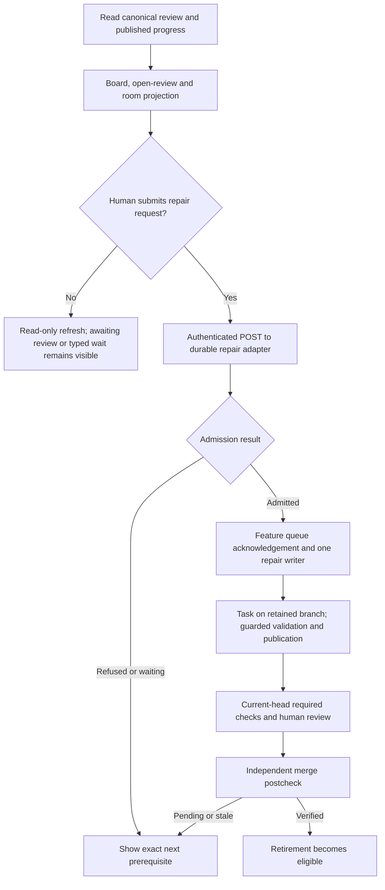

# Expose accountable review state and prove the complete repair journey

## Parent Epic

epic_051

## Scope

Extend existing Feature review projection, War Room board/open-review/room surfaces, recovery progress and committed transcript mechanisms to show original PR URL, accountable Feature, implementation versus delivery state, CI/feedback freshness, repair request/generation, verified status and next prerequisite. Reuse the existing authenticated human action route from durable repair admission and display its typed result. Review-pending must remain visibly awaiting review rather than inactive/terminal. Read-only GET, browser polling, attaching or opening a plan must not poll the forge for authority, mutate records, enqueue work or start a provider. Avoid parallel status stores, transcript formats or new dashboard frameworks.

Own final acceptance spanning the preceding Features: reproduce the motivating implementation-complete Feature/open-red-CI review with a parent fix request, durable admitted Task on the retained Feature branch, production guarded delivery/publication, scripted fresh green CI, human-policy-compatible merge observation into its Epic, independent postcheck and only then retirement. Use real temporary Git repositories and real production orchestration; script forge/check/provider transport as necessary and state that boundary. Assert stable Feature/branch/PR identity, no duplicate PR or Task, no manual board edits, no approval bypass, retained comments, preserved checkpoints/history, no unchanged idle provider turns and no downstream rerun storm. Include split product/tracking coverage.

The acceptance matrix also covers target movement/conflicts, actionable feedback, stale and duplicate requests, restart after admission before wake, one-writer concurrent repairs, missing forge/check policy, required human approval, budget exhaustion, cancellation/closed-unmerged and legacy completed-open review. Extend existing late-repair/review-recovery journey tests instead of cloning a second large harness. Run focused suites and the existing bounded Recovery contract gate; add the new journey to that gate if its coverage is otherwise absent. Exercise UI state transitions with a real browser and prove GET-only activity cannot invoke providers or mutate lifecycle evidence.

Reconcile the entire epic diagram-impact inventory against final code. Design owner cascade/war_room/DESIGN.md; recovery_progress/DESIGN.md changes only if its published contract changes; coordinate other owners through parent artifacts. Views cascade-dashboard-code, cascade-war-room-http-code if action wiring changes, cascade-war-room-components, and final validation of all affected team/Workspace/Watchdog/Boss Code views. Verify source symbols/declaration kinds/ownership, renamed/deleted nodes, context → container → component → Code, Level up, deep links and pinned-source opening. Use the pinned renderer with existing bounds, report cold and warm measurements and cache reuse, and verify no per-view process startup. Preserve accepted snapshots and use revision-pinned publication. Record a concrete reason for each unchanged architecture level and all material limitations in closeout; do not claim new acceptance from baseline tests alone.

### Required Task acceptance and design handoff

Feature planners must carry the relevant acceptance cases below into executable Task specifications. Tasks update the owning DESIGN.md, affected parent/consumer links, model.dsl, views.dsl and workspace.contract.json together where behavior changes. Stable requirement/decision IDs have exactly one design owner. Preserve the existing revision-pinned architecture review workflow and accepted artifacts. Each changed component needs a native Structurizr Code view with real source paths/symbols, correct declaration kinds, and matching cascade.codeComponent/cascade.parent metadata. Record normal and failure/restart traces, source-contract checks, pinned render evidence, and actual context → container → component → Code / Level up / deep-link / pinned-source verification in work closeout; a render alone is insufficient. No delivery chronology belongs in DESIGN.md. Do not add a scheduler, recovery ledger, provider launcher, approval bypass, or new review for an already-open original review. No software installation or deployment is authorized.

## Data structures

- The canonical Feature review registry remains the source for original PR URL/number, source/target refs, open or terminal state and accountable Feature. The existing normalized review-health observation carries required-check policy, current source/check-run generation, feedback and freshness; unknown policy or stale evidence is explicit.
- The existing Feature repair action binds stable request ID and content digest, original review identity, observed heads, generation, admission, acknowledgement, execution, verified postcheck and typed next prerequisite. An identical request rejoins that identity. No browser or GET projection grants repair authority.
- Existing recovery-progress publication and committed transcript pages carry safe status and milestone references. Browser state is response-local; it does not add a lifecycle store or transcript format.

## API contracts

- Board serialization, `GET /api/open-reviews` and the room's current-progress read project canonical records without forge polling or mutation. They distinguish implementation complete, delivery pending, awaiting human review, repair requested, admission, execution and independent verification. Missing/stale evidence stays typed unknown.
- An authenticated human POST uses `request_feature_review_repair` through the existing request verifier. Its accepted body supplies Feature ID, stable request ID and the exact scoped request fields. The response preserves typed admission, queue acknowledgement, live-owner join, execution, refusal, verification and next prerequisite; HTTP success does not imply repair success. Replays return the same action; changed content and stale prerequisites are refused by the adapter.
- Browser board/open-review/room controls render these fields and submit only explicit actions. GET, polling, attachment and plan-open paths never enqueue, launch providers, mutate lifecycle state or seek fresh forge authority.

## Logic flow

## Task breakdown

1. `task_051_004_001` — Project accountable open-review and repair state from the canonical registry, repair action and published progress. Owns read-only API/board evidence and War Room read-design updates.
2. `task_051_004_002` — Expose the authenticated human repair POST and board/open-review/room UI with typed action results and real-browser state checks. Depends on 001; owns War Room HTTP/action/browser design and Code view changes.
3. `task_051_004_003` — Extend the real temporary-Git repair journey and edge matrix through guarded publication, current green CI, intended-target merge and independent postcheck; run the bounded Recovery contract gate. Depends on 002; reconciles any changed owning subsystem designs.
4. `task_051_004_004` — Reconcile the integrated epic diagram inventory and verify source contracts, pinned render, navigation, cache behavior and source links against the final diff. Depends on 003.

### Diagram-impact inventory and ownership

| Level / view | Owning design and source | Required update and verification |
|---|---|---|
| Landscape `cascade-landscape`, context `cascade-context` | `cascade/DESIGN.md`; original forge, operator and repository boundaries | 001–004 check final diff for new actors or communication; update if needed, otherwise record why existing boundaries still describe it. |
| Containers `cascade-containers` | `cascade/DESIGN.md`; War Room, supervisor, tracking/product repository | 001–004 verify runtime, persistence and split-root boundaries; no new scheduler, ledger or service. Reconcile changed relationships or give a specific no-change reason. |
| Components `cascade-war-room-components`, `cascade-supervisor-components`, `cascade-team-components` | `cascade/war_room/DESIGN.md`, `cascade/DESIGN.md`, affected Feature/Watchdog/Boss/Task designs | 001–002 own read/action/browser relationships; 003–004 trace repair and postcheck consumers, updating both sides of changed interfaces. |
| Code `cascade-dashboard-code` | `cascade/war_room/DESIGN.md`; `serialize.py`, `review_routes.py`, `recovery_progress.py`, `static/open_reviews_pane.js`, `static/war_room.js` | 001–002 update affected native source nodes, declaration kinds, owner metadata and links; verify browse/deep-link/source path. |
| Code `cascade-war-room-http-code` | `cascade/war_room/DESIGN.md`; `server.py`, human verifier and repair route | 002 adds/updates action wiring nodes with `cascade.codeComponent` and `cascade.parent`; verify authenticated refusal and replay paths. |
| Code `cascade-feature-code`, `cascade-task-code`, `cascade-teams-code`, `cascade-watchdog-code`, `cascade-boss-code`, `cascade-workspace-code` | Existing owning subsystem designs and source contracts | 003–004 inspect final changed symbols, renamed/deleted nodes and exact ownership; update only affected views, validate all cross-team links and route outside-scope owner gaps through parent artifacts. |
| Supplementary behavior | `cascade/war_room/DESIGN.md` and changed owning subsystem designs | 001–003 describe read-only normal/unknown projection, authenticated refusal/replay, red→repair→current green→human merge→verified retirement and restart/concurrent writer paths. |

Each implementation Task updates its owning design, affected parent/consumer links and `architecture/target-9f61bc6d6f8ae8cb7d196c8b327650d5/{model.dsl,views.dsl,workspace.contract.json}` together when behavior changes. Final verification checks native Code metadata, source/declaration accuracy, source-contract validation, pinned local render, context→container→component→Code, Level up, deep-link restoration and pinned-source opening. Task 004 records actual cold/warm measurements, cache reuse and any process-startup or bound regression. Accepted snapshots remain untouched; publication stays revision-pinned.

Planning review: `cascade/war_room/DESIGN.md`, `cascade/recovery_progress/DESIGN.md`, `cascade/feature/DESIGN.md`, `cascade/DESIGN.md` and the pinned views were read against current code. The current War Room design documents read-only progress/transcript projection, but has no durable human open-review repair route or full accountable review-state contract; Tasks 001–002 own that gap. The recovery-progress published contract is unchanged by this plan, so no planning edit to its design is needed. No design files were changed in this planning turn. No source-contract or rendered-browser check is claimed before implementation.

## Risks & upward questions

- The source review may remain open after Feature implementation completes; every projection and retirement gate must keep that state visible and nonterminal.
- Forge/check policy or feedback can be unavailable or stale. The UI must show a prerequisite instead of inferring success or creating provider work.
- A post-admission crash, moving target or concurrent repair request may race a read snapshot; the action boundary must recheck authority and preserve one durable writer.
- No epic contract amendment is needed within this feature scope.

## Decision log

See board decision records for the canonical projection and authenticated action choices.

- `dec_001` · 2026-11-27 · Feature Architect · **Review-state source of truth**
  Chose Project original review identity and current repair/progress evidence from existing canonical records; keep unavailable or stale evidence explicit and keep GET read-only..
  Rationale: The registry, repair action and published progress already own the facts. A second status store would diverge after restart, while GET-side refresh could accidentally grant execution authority.
  Honors: Feature scope, existing War Room read boundary and generation-bound repair contract..

- `dec_002` · 2026-11-27 · Feature Architect · **Human repair action**
  Chose Expose a narrow authenticated War Room POST that calls request_feature_review_repair and displays its typed result without treating admission or acknowledgement as verification..
  Rationale: The adapter already enforces scope, request digest, one-writer admission and replay. Reusing it preserves the original review and human merge policy.
  Honors: Durable repair admission, authenticated local human boundary and no new review or provider launcher..

- `dec_003` · 2026-11-27 · Feature Architect · **Acceptance and architecture sequencing**
  Chose Extend the existing late-repair and review-recovery harness for the full production journey, then reconcile the integrated C4 and design inventory against the final diff..
  Rationale: One production-path journey catches cross-team failures without a second large test harness; final architecture review can validate actual symbols and ownership after integration.
  Honors: Bounded Recovery contract gate and revision-pinned architecture publication workflow..

## Closeout

Completed child work: `task_051_004_001` (Project accountable open-review and repair state from canonical evidence), `task_051_004_002` (Expose authenticated repair action and review state in War Room), `task_051_004_003` (Prove complete repair journey and bounded recovery contract), `task_051_004_004` (Reconcile integrated design and navigable C4 evidence).
