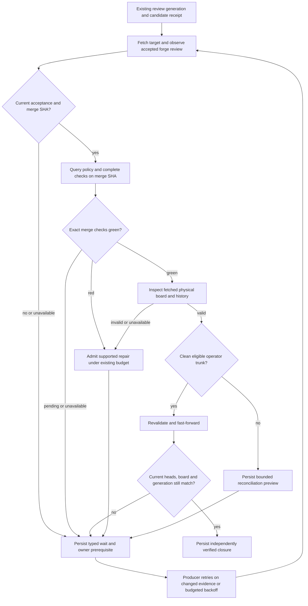

# Verify merged revision CI and converge trunk through accountable recovery

## Parent Epic

epic_054

## Scope

## Outcome
The operator can distinguish prospective validation, forge acceptance, exact merged-revision CI, local trunk synchronization, physical board availability and independent verified closure. A merge callback alone cannot close delivery or abandon a repair owner.

## Scope and owners
Consume feat_054_001 result receipts and feat_054_002 board/provenance gate in tracking.py, review.py, boss/epic_complete.py, workspace/branch_synchronization.py, integration_worktree.py and closeout.py. Reuse Watchdog review polling/postchecks, action/incident budgets, Feature repair admission and War Room persisted projections. No new scheduler, ledger, forge service or replacement owner lifecycle.

## Acceptance criteria
1. Fetch fresh remote target identity; observe exact accepted merge SHA and required CI/check-policy identity on that SHA through production GitHub/GitLab adapters (scripted transport in tests). A later green head or green source check is insufficient. Unknown policy, offline forge, incomplete check pagination or missing merge identity remains unavailable. For squash/rebase/stacked reviews prove supported current acceptance and content/lineage; never infer acceptance from ancestry alone.
2. Persist independent dimensions for prospective status, merged identity, post-merge CI pending/red/green/unknown, local/remote SHAs and sync result, board status, repair owner/prerequisite, verified closure. Reuse current review generations and action receipts. Interrupted observation/commit/notification resumes idempotently; late stale receipts cannot replace newer evidence.
3. Validate fresh remote candidate physical board before admitting trunk/new checkout. Automatically fast-forward only a clean eligible checked-out trunk through normal sync. Dirty/diverged/conflicting/wrong-branch checkout remains intact and gets bounded supported reconciliation/preview with current heads and exact owner prerequisite. Revalidate drift around mutation; never reset, overwrite, discard changes or force push. No trust in a stale remote-tracking ref.
4. Exact merge CI red/unavailable and synchronization/board failures prevent independently verified closure and unsafe retirement. Route fixable failures to an actionable current owner under existing budgets/authority. Completed/open-review work uses retained original review owner. A truly accepted/closed review uses supported corrective scope on current target with required approval, retaining original accepted history; never enqueue an unprocessable fix or reopen unchanged accepted work. Missing capability reports a concrete gate.
5. Poll only in the existing bounded producer lane; generation deduplication/backoff avoids repeated unchanged model turns and repeated validation. War Room GET/polling reads persisted bounded projections without Git/forge/lifecycle mutations. Normal and failure UI paths show exact revisions and actionable status.
6. End-to-end acceptance uses real temporary remotes/worktrees and production review/sync adapters. Reproduce all three incident cases: source green + changed-target boot failure, stale backlog/completed resurrection poisoning a new Epic, same-second equal-size source/cache false result. Prove intended red assertion, correct repair tree and fresh exact merged CI green; final local/remote trunk and board agree with no history loss or unintended checkout mutation.
7. Cover target movement during checks/sync, restart, offline forge, dirty/diverged main, split roots, duplicate delivery, stale review receipts, review-owner recovery and human-only approval gates. Keep focused checks bounded; integrate high-signal scenarios into the repository's existing Recovery contract selection rather than adding a parallel test framework.

## Design ownership
cascade/DESIGN.md owns shared review evidence; cascade/boss/DESIGN.md owns completion; cascade/workspace/DESIGN.md owns sync/provisioning; cascade/watchdog/DESIGN.md owns independent observation and generation/budget admission; cascade/feature/DESIGN.md owns repair admission; cascade/war_room/DESIGN.md owns read-only presentation. Root DESIGN.md summarizes links only. Update cascade-supervisor-components, cascade-team-components, cascade-war-room-components and cascade-boss-code, cascade-workspace-code, cascade-watchdog-code, cascade-feature-code, cascade-dashboard-code, cascade-war-room-http-code for actual collaborators. Add merged → checks/sync/board → verified or actionable-wait behavior diagrams, including interrupted persistence and owner recovery. No new external actor/container/data store; context/container labels need changes only if actual interfaces differ.

## Architecture and delivery acceptance
Feature planners must copy affected architecture updates into Task acceptance criteria, keep one owner per stable requirement/decision, and reconcile actual source and DESIGN.md at delivery. Update the authoritative architecture/target-9f61bc6d6f8ae8cb7d196c8b327650d5/{model.dsl,views.dsl,workspace.contract.json} through the existing revision-pinned workflow; do not rewrite accepted snapshots. Integrated native custom Code views must name cascade.codeComponent; nodes bind real sourcePath/sourceSymbol/parent and correct declaration kind. Validate source contract, local pinned render, context → containers → component → Code, Level up/deep link/source opening, stale renamed/deleted symbols, warm-cache reuse and render bounds. Record measured results and gaps. Diagrams describe implemented behavior, not delivery history. Tests use real temporary repositories/worktrees and production adapters with scripted forge transport; no live forge mutation is required. Preserve human approval, existing Task validation, incident-wide budgets and accepted review lineage. No installation authority is granted.

## Data structures

The current review registry keeps immutable generation rows and a current projection. Extend those bounded receipts with (a) prospective exact-candidate result identity, (b) accepted forge review URL/route and merge SHA, (c) merge-SHA-bound policy and newest check generations with pending/red/green/unknown state, and (d) observed target SHA. Keep local trunk SHA, fetched remote SHA, physical-board proof, sync outcome, repair action/owner/prerequisite and verified-closure state as separately readable evidence. Each receipt names its review and observation generation; stale generations cannot overwrite current evidence. Use existing registry, action/incident and board stores; the Task implementation chooses minimal concrete fields and records compatibility behavior.

## API contracts

- `cascade.tracking.merge_request_snapshot` and the existing GitHub/GitLab Runner boundary provide fresh accepted-review identity, exact merge SHA, target policy and complete merge-commit checks with typed unavailable reasons. `cascade.review` persists bounded generation-aware observations and exposes one current delivery projection; it does not convert a candidate pass into an accepted-merge pass.
- Workspace's verified remote-trunk workspace and branch sync return exact fetched/local heads, physical-board status and safe sync refusal details. Mutating sync rechecks branch, cleanliness, remote identity and proof. A refused sync leaves the operator checkout unchanged.
- Boss closeout consumes current merge CI, board and sync evidence as independent gates. Watchdog produces observations and postchecks in its bounded lane; Feature repair admission owns actionable current review repair. War Room GET consumes persisted bounded projections only. Failures name the current owner and prerequisite or a concrete unsupported capability/approval gate.

## Logic flow

The normal path keeps candidate, acceptance, checks, board, sync and closure receipts separate. After restart the producer re-reads the current generation and remote identity; an interrupted write or notification replays idempotently. A target move or stale receipt returns to observation, while unsupported repair reports its exact gate without creating an unprocessable action.

## Diagram-impact inventory

| Level/view | Owner and source symbols | Required update and verification |
|---|---|---|
| Landscape/context (`cascade-landscape`, `cascade-context`) | Root `DESIGN.md`; forge, operator and local runtime boundaries | No new actor or boundary planned. Verify final diff; update only if external responsibility changes. |
| Containers (`cascade-containers`) | Root and `cascade/DESIGN.md`; existing local runtime, Git/forge and board | No new deployed container or store planned. Check final data/persistence arrows and revise if actual interfaces change. |
| Components (`cascade-supervisor-components`, `cascade-team-components`, `cascade-war-room-components`) | `cascade/DESIGN.md`, Boss, Workspace, Watchdog, Feature and War Room child designs; `merge_request_snapshot`, `_merged_epic_review_landed`, `create_verified_trunk_workspace`, `reconcile_open_review_health`, Feature repair admission, read-only HTTP projections | Show exact merge evidence through board/sync gates, owner recovery and persisted display. Check both sides of every affected interface and parent/child links. Tasks 001–004 own their boundaries; 005 reconciles final diff. |
| Integrated Code (`cascade-boss-code`, `cascade-workspace-code`, `cascade-watchdog-code`, `cascade-feature-code`, `cascade-dashboard-code`, `cascade-war-room-http-code`) | Owning child `DESIGN.md` files and real source symbols in `tracking.py`, `review.py`, `epic_complete.py`, `closeout.py`, `branch_synchronization.py`, `incident_postcheck.py`, `repair.py` and War Room readers | Update native custom nodes/relationships only for actual collaborators; bind `cascade.codeComponent`, `cascade.parent`, `cascade.sourcePath`, `cascade.sourceSymbol` and declaration kind. Validate model, views and contract together, source links, navigation, pinned render, warm reuse and bounds. |
| Behavior | `cascade/DESIGN.md` and owning Boss/Workspace/Watchdog/Feature/War Room designs | Trace merged → exact checks → physical board → safe sync → verified or actionable wait, including persistence interruption, stale generation, target drift, unsupported repair and restart. |

## Task breakdown

1. `task_054_003_001` — exact accepted-merge CI and generation-aware evidence; no Task dependency.
2. `task_054_003_002` — fetched physical-board proof and safe clean-trunk synchronization; no Task dependency, can run alongside 001.
3. `task_054_003_003` — closure gate and actionable post-merge repair; depends on 001 and 002.
4. `task_054_003_004` — bounded read-only War Room status; depends on 003.
5. `task_054_003_005` — three incident journeys, edge cases and final architecture reconciliation; depends on 004.

Each Task carries its affected design, C4 and Code-view updates plus focused verification. The final Task reconciles the complete diff; an unchanged level needs a concrete final-diff reason.

## Planning design review

Inspected the current review evidence and delivery contracts in `cascade/DESIGN.md`, remote-trunk and synchronization flow in `cascade/workspace/DESIGN.md`, Epic acceptance in `cascade/boss/DESIGN.md`, open-review producer in `cascade/watchdog/DESIGN.md`, and the root C4 links. The existing source and pinned model already expose candidate/result receipts, a detached remote workspace and the native Code-view owners. The unimplemented post-merge CI, safe operator sync and verified closure are explicit Task work; no design edit or render is claimed at planning time. Tasks 001–004 update owning designs with actual code, and 005 performs the final source/link/navigation review.

## Integration contract and prerequisites

At planning revision `e099598be3a264c36b01f00922d70526a1692769`, predecessor Feature 1's exact candidate/receipt implementation is inspectable at source commits `f18576db5e6f82adafcb7d7d73f0501b286a8426` and `17f82657a3934d772af00b9b70ba5bffa3d7eb01`. Feature 2's physical inventory and history-proof sources are `6e7c014032b0c0b8c3ed3c9506862ce9c6aa102e`, `bef11e53fb45007c531cff2d5b906f7145b772cc`, `bb3ef8279685b0a75380d509fd2c1eeb45a95be1`, and `bc59cf6b0a82bc6029c9ae1f8134056c153702cf`; its canonical completion is `0232826f` and final architecture artifact is `f7ddd53e`. These references identify inputs, not a claim that merged-revision CI or local trunk convergence is already implemented.

The bounded receipt contract keeps candidate source/target/result commit/tree and validation material separate from original review URL/route/generation, actual accepted merge SHA, merge-SHA required policy identity, newest check generations, observed remote target SHA, physical board/history proof, local trunk SHA/sync result, and independent verified closure. The current review generation owns observation persistence; a writer rechecks review/target/owner identity before commit and notification. Consumers reject legacy or incomplete green receipts and older generations. Restart rejoins the same review/action/operation IDs, rereads remote and board evidence, and does not promote a candidate receipt into merged CI. Watchdog owns bounded observation and independent postcheck; Workspace owns physical Git proof and clean-trunk mutation; Feature owns supported repair admission; Boss owns closure; War Room GET only reads bounded persisted projections.

The active Tasks `task_054_003_001` and `task_054_003_002` contain detailed delivery/design/Code-view requirements in generated Implementation notes, but their primary Acceptance criteria still say `TBD`. Cascade's `revise_task` supports backlog, ready-to-plan and blocked states only, and the Feature `write_doc` cannot write Task records. A lifecycle owner must supply a supported correction before the primary-criteria requirement or final plan sign-off can be claimed. Tasks 003–005 have complete primary criteria. Feature 2's completed Task 001 primary-criteria correction and the failed Epic architecture publication remain separately owned prerequisites; neither changes this Feature's implementation scope.

## Risks & upward questions

- Lifecycle correction of active Tasks 001/002 primary Acceptance criteria requires a supported owner action before final plan sign-off.

## Decision log

None yet.

## Closeout

Completed child work: `task_054_003_001` (Verify exact accepted merge CI and persist independent evidence), `task_054_003_002` (Guard physical remote board and synchronize a clean operator trunk), `task_054_003_003` (Gate verified closure and route actionable post-merge repair), `task_054_003_004` (Expose bounded post-merge delivery status in read-only War Room views), `task_054_003_005` (Prove incident recovery and reconcile architecture against final code).
