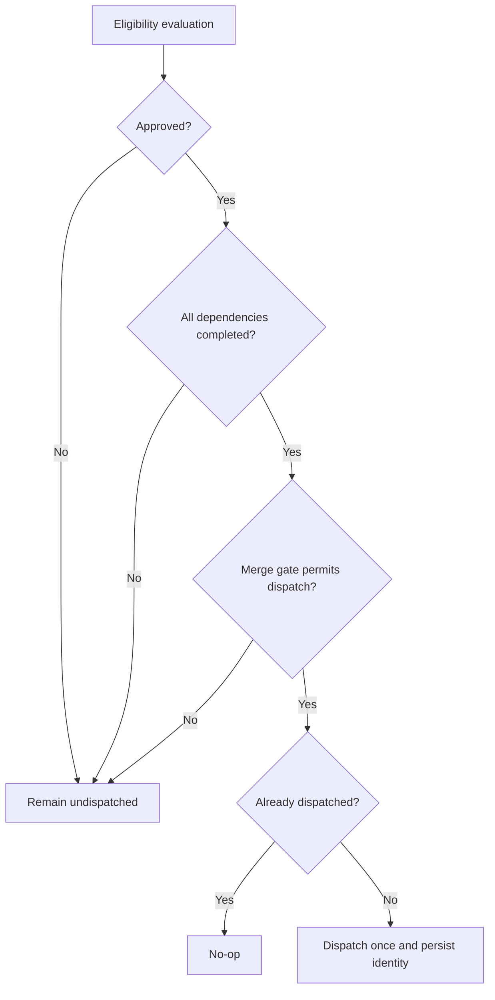

# Approval and dependency dispatch

## Parent Epic

epic_005

## Intent

Allow a feature to be approved independently while ensuring implementation starts only when approval, dependency, and merge-serialization prerequisites are all satisfied. Approving an epic approves the child features that exist at that time.

## Scope

- Persist feature approval independently from board lifecycle status.
- Add per-feature approval and epic-wide approval of current child features.
- Gate the canonical implementation-dispatch path on feature approval and completion of every `depends_on` feature.
- Preserve the existing single-feature-awaiting-merge gate.
- Reconcile safely after restart without duplicate approval or dispatch effects.

## Acceptance criteria

- An unapproved feature is never dispatched.
- An approved feature with an incomplete dependency is never dispatched.
- An approved feature dispatches once all dependencies are completed and the existing merge gate permits it.
- Epic approval approves every child feature present at approval time; later-added children still require explicit approval.
- Restart/reconciliation does not duplicate approval or dispatch effects.
- Focused integration tests exercise approval, dependencies, merge gating, and recovery.

## Out of scope

- Completion rollup.
- Open-MR dashboard.
- A second approval store or alternate dispatch path.

## Data structures

- Feature approval is durable per-feature state stored with the existing feature representation.
- Missing approval state in older persisted records is interpreted as unapproved.
- Existing `depends_on` feature identifiers remain the dependency source of truth; no second dependency model is introduced.
- Existing dispatch identity/idempotency state remains the source of truth for duplicate prevention.

## API contracts

- Feature approval is idempotent: repeated approval produces no additional effect.
- Epic approval applies idempotently to the epic's current child-feature snapshot only.
- Dispatch eligibility requires all three gates: approved feature, every dependency completed, and existing merge serialization permitting dispatch.
- Missing or non-completed dependencies block dispatch according to existing board validation/error conventions.
- Approval, dependency completion, merge-gate changes, and startup reconciliation re-evaluate the same canonical dispatch path.

## Logic flow

## Task breakdown

- `task_001` — Persist approval and expose feature/epic approval operations — completed
- `task_002` — Gate dispatch on approval, dependencies, and merge eligibility — completed; depends on `task_001`
- `task_003` — Add restart reconciliation and focused integration coverage — active; depends on `task_002`

## Risks & upward questions

None.

## Decision log

Decisions are recorded through the board decision log.

- `dec_001` · 2026-10-21 · Feature Lead · **Dispatch architecture**
  Chose Use durable per-feature approval and re-evaluate approval, dependency, merge-gate, and restart events through the existing canonical dispatch path..
  Rationale: This satisfies the feature contract while preserving current merge serialization and idempotency, and avoids a second approval store or alternate dispatch workflow.
  Honors: Feature acceptance criteria; frugal-engineering guidance to make the smallest reliable change..

## Closeout

Completed child work: `task_001` (Persist feature approval and expose feature/epic approval operations), `task_002` (Gate central feature dispatch on approval, dependencies, and merge eligibility), `task_003` (Reconcile approval-driven dispatch after restart and add focused integration coverage).
