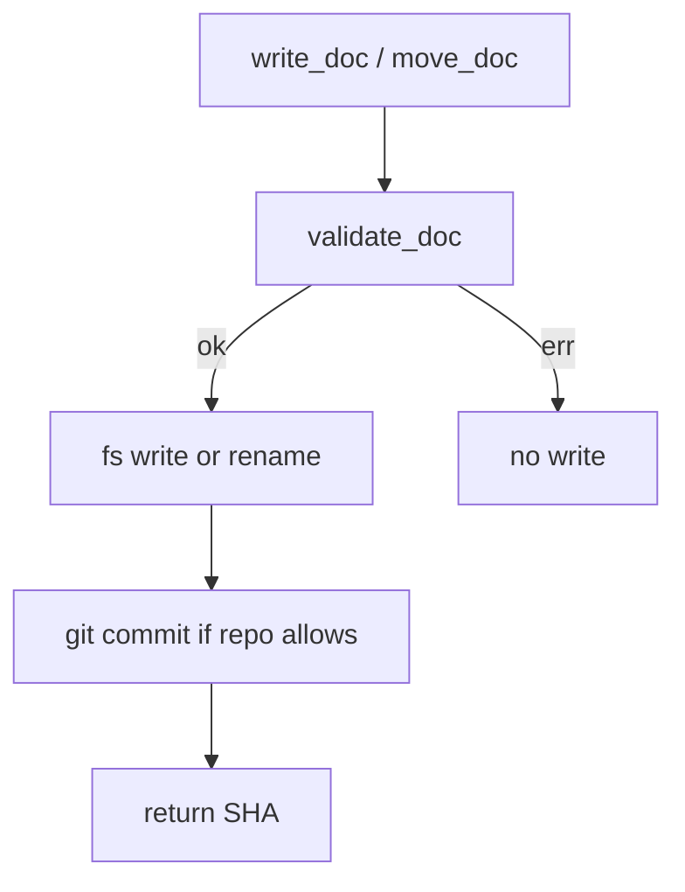

# Board, document contract, and git plan store

## Parent Epic

[epic_001](../../epics/2_active/epic_001_functional_mvp.md) — Functional MVP.

`parent_rev`: null until the repo has a first commit. Re-pin after that commit exists.

Constraints this feature must honor:

- Filesystem is truth; folder membership is lifecycle.
- Shared frontmatter as in DESIGN.md §4.1 (`depends_on` in frontmatter **and** body).
- Plan edits are git commits. `parent_rev` is a SHA. No integer rev.
- Cycles in `depends_on` fail validation.
- Local git only.
- This module does **not** enforce dispatch law. `move_doc` is a dumb rename. feat_002 wraps it.

## Scope

**In**

- Canonical on-disk layout under `/docs`
- Parse / validate / allocate IDs for Epic, Feature, Task markdown
- Move a work object between `1_backlog` / `2_active` / `3_completed` as a single filesystem operation that updates `status`
- Commit plan-file changes and return the SHA
- Read a parent doc at a pinned `parent_rev`

**Out**

- Watchdog, queues, UI, LangGraph, dispatch authority (those consume this API)
- Task code branches (`task/{id}`) — feat_007
- Comment sidecar schema — feat_005 (this feature may reserve `/docs/_comments` as an empty dir only)

## Data structures

Python package: `cascade.board`.

```text
WorkTier     = Literal["epic", "feature", "task"]
WorkStatus   = Literal["backlog", "ready_to_plan", "active", "blocked", "completed"]
Column       = Literal["backlog", "active", "completed"]   # maps to 1_backlog / 2_active / 3_completed
WorkId       = str   # "epic_NNN" | "feat_NNN" | "task_NNN"

WorkMeta
  id: WorkId
  title: str
  tier: WorkTier
  status: WorkStatus
  parent: WorkId | None
  children: list[WorkId]
  depends_on: list[WorkId]
  owners: list[str]
  skills: list[Path]         # in-repo SKILL.md paths; meaningful on tasks
  parent_rev: str | None     # 40-char hex SHA or None
  created: date
  updated: date
  path: Path                 # derived from tier + column on disk, not stored in frontmatter

WorkDoc
  meta: WorkMeta
  body: str                  # markdown after frontmatter
  sha: str | None            # last commit that touched path, if git history exists

BoardIndex
  by_id: dict[WorkId, WorkMeta]
```

Filename rule: `{id}_{slug}.md`. `id` is the key. Never rename an id.

Column path:

```
docs/{epics|features|tasks}/{1_backlog|2_active|3_completed}/{filename}
```

Status/folder pairing (mismatch is `StatusMismatch`):

| status | legal folder |
|---|---|
| backlog, ready_to_plan | `1_backlog` |
| active, blocked | `2_active` |
| completed | `3_completed` |

Exceptions (all inherit `BoardError`): `SchemaError`, `NotFound`, `CycleError`, `StatusMismatch`, `GitError`.

## API contracts

Locked. Callers: feat_002+.

```text
parse_doc(path: Path) -> WorkDoc
    raise SchemaError

validate_doc(doc: WorkDoc, board: BoardIndex) -> None
    required heading names per tier (DESIGN.md §4.2–4.4), not prose quality
    parent required for feature/task
    depends_on ⊆ board.by_id
    reject cycles in depends_on ∪ parent edges
    reject status/folder mismatch
    skills paths, if any, must be relative and stay inside the repo root

allocate_id(tier: WorkTier, board: BoardIndex) -> WorkId
    next free NNN for that tier (scan board + any in-memory reserved); never reuse

write_doc(doc: WorkDoc) -> str
    validate, write file, git add + commit, return SHA
    commit message: "docs: {id} {title}"
    if the repo has no commits yet, still write the file; return None or the new root SHA
    only supervisor/graph tools call this — not the operator's editor save

move_doc(id: WorkId, dest_column: Column) -> str
    rename on disk, rewrite status to the default for that column
      backlog -> status backlog
      active -> status active   # caller may then set blocked / ready_to_plan via write_doc
      completed -> status completed
    validate + commit
    does NOT check dispatch authority

read_doc(id: WorkId, rev: str | None = None) -> WorkDoc
    rev=None reads the working tree
    rev=SHA reads that blob (`git show SHA:path`)

list_board(root: Path) -> BoardIndex
    directory scan, not a durable cache

pin_parent(child_id: WorkId, parent_id: WorkId) -> str
    set child.parent_rev to the SHA of the last commit that touched the parent path
    if parent has no git history, set null and still succeed
```

`move_doc` defaulting `active` to status `active` is intentional. feat_002 sets `blocked` after a failure via `write_doc`.

## Logic flow



`list_board` is a directory scan every call. Callers may memoize for one watchdog tick.

## Task breakdown

| ID | Title | Depends on |
|---|---|---|
| [task_001](../../tasks/3_completed/task_001_board_types.md) | `cascade.board` types, paths, exceptions | — |
| [task_002](../../tasks/3_completed/task_002_parse_validate.md) | `parse_doc` + `validate_doc` | task_001 |
| [task_003](../../tasks/3_completed/task_003_board_store.md) | `allocate_id`, `write_doc`, `move_doc`, `read_doc`, `list_board`, `pin_parent` | task_002 |

## Risks & upward questions

- No git history yet in this repo. `write_doc` / `pin_parent` must tolerate an uninitialized or empty repo without inventing a second version store.
- Validator checks heading names only. Do not fail this Epic's own files on prose.

## Decision log

- `dec_010` · 2026-10-09 · Feature Architect · **API contracts**
  Locked `cascade.board` with typed exceptions and heading-name validation. `move_doc` does not enforce dispatch law.
  Rationale: feat_002 is the supervisor; this feature is truth-on-disk only.
  Honors: epic_001 § filesystem is truth, dispatch law.

- `dec_011` · 2026-10-09 · Feature Architect · **Task breakdown**
  Three Tasks: types, parse/validate, store+git. Each includes its tests. No Task dispatched.
  Rationale: one MR per layer; store cannot land before validate.
  Honors: mint into backlog only.
