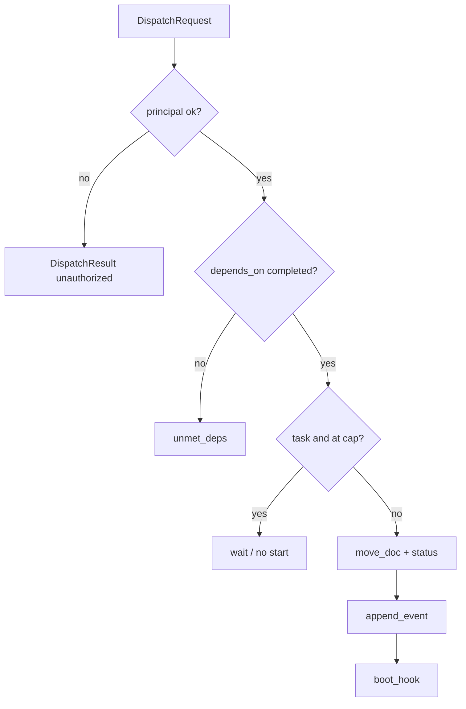

# Watchdog, event queue, and dispatch law

## Parent Epic

[epic_001](../../epics/2_active/epic_001_functional_mvp.md) — Functional MVP.

Constraints this feature must honor:

- Watchdog is not an LLM.
- Dispatch: Epic activate = human only. Feature start and Task dispatch = human or Boss.
- Planning teams cannot `mv` children to `2_active`.
- `depends_on` must be `3_completed` or dispatch is refused.
- `task_parallelism` from `cascade.toml` (default 4); over-cap waits, does not start.
- Queue is typed JSONL under `/docs/_queue/{graph_id}.jsonl`.

## Scope

**In**

- Event schema and append-only per-graph queues
- Watchdog process: fs watch or short poll on `/docs`
- `activate_epic` / `dispatch_feature` / `dispatch_task` with principal + dep + cap checks
- Boot/teardown hooks (interfaces only) for graphs — implementations in feat_004/005/007
- Rejection + toast event on illegal moves

**Out**

- Boss sequencing policy (feat_008 uses these APIs)
- UI chrome (feat_003 consumes events)
- Graph internals

## Data structures

```text
Principal = human | boss

Event
  type: str                  # DESIGN.md §8 names
  ts: datetime
  payload: object
  dest: graph_id             # filename key under /docs/_queue

DispatchRequest
  kind: epic | feature | task
  id: WorkId
  by: Principal

DispatchResult
  ok: bool
  reason: str | null         # unauthorized | unmet_deps | cap | not_found | bad_state
  event: Event | null
```

Queue file: `/docs/_queue/{dest}.jsonl`, one Event per line. Dest ids: `epic_{id}`, `feat_{id}`, `task_{id}`, `war_room`, `boss`.

Watchdog state (process memory, not a second board): last-seen mtimes, count of `/docs/tasks/2_active/*`.

## API contracts

```text
append_event(dest, event) -> None
read_events(dest, after_offset) -> ([Event], new_offset)

activate_epic(id, by: Principal) -> DispatchResult
    refuse unless by == human
    refuse unless status in {backlog, ready_to_plan} and depends_on done
    set ready_to_plan, move_doc(id, active), emit Feature-equivalent EpicActivated
    invoke boot_hook("epic", id)

dispatch_feature(id, by: Principal) -> DispatchResult
    refuse unless by in {human, boss}
    refuse unless depends_on all completed
    set ready_to_plan, move_doc(id, active), emit FeatureReadyToPlan {id, by}
    invoke boot_hook("feature", id)

dispatch_task(id, by: Principal, skills: [Path] | None = None) -> DispatchResult
    refuse unless by in {human, boss}
    refuse unless depends_on all completed
    refuse unless count of 2_active Tasks with status=active < task_parallelism
    (status=blocked does not consume a slot)
    else: do not move; emit nothing (or TaskDispatchQueued) — caller retries
    if skills is not None: write that list onto the Task (override)
    every path in the effective skills list must exist in-repo or refuse
    move_doc(id, active), emit TaskDispatched {id, feature_id, by, skills}
    invoke boot_hook("task", id)

register_boot_hook(tier, fn)
register_teardown_hook(tier, fn)

run_watchdog() -> never
    on illegal column change by a non-supervisor writer: revert or reject + toast
```

`move_doc` from feat_001 is **only** called from this feature for lifecycle transitions (plus completion in feat_008). Planning-graph tools do not import `move_doc` for children.

## Logic flow



## Task breakdown

Tasks minted into `/docs/tasks/1_backlog/` (orchestrator moves them when dispatched). Depends on: feat_001 completed.

| ID | Title | Depends on |
|---|---|---|
| [task_004](../../tasks/3_completed/task_004_event_queue.md) | Event schema and append-only JSONL queues | — |
| [task_005](../../tasks/3_completed/task_005_config_skills_hooks.md) | Parallelism config, skill paths, and boot/teardown hooks | — |
| [task_006](../../tasks/3_completed/task_006_dispatch_law.md) | `activate_epic`, `dispatch_feature`, `dispatch_task` | task_004, task_005 |
| [task_007](../../tasks/3_completed/task_007_watchdog_loop.md) | Watchdog poll, illegal-move revert, and toast | task_006 |

## Risks & upward questions

- "Revert illegal mv" vs "refuse and leave the file where a rogue agent put it." Epic says filesystem is truth — a rogue write that lands in `2_active` would boot work. Watchdog must treat unauthorized appearance in `2_active` as illegal and move back to backlog unless a matching `TaskDispatched` / `FeatureReadyToPlan` / epic activation event exists.
- Intra-run flake retries live in feat_007. This feature must not treat `TaskFailed` as a new `dispatch_task`.

## Decision log

- `dec_012` · 2026-10-09 · Feature Architect · **Task breakdown**
  Four Tasks: queue/types (task_004), config/skills/hooks (task_005), dispatch law (task_006), watchdog loop (task_007). task_004 and task_005 may land in parallel; task_006 depends on both; task_007 depends on dispatch.
  Rationale: separates append-only messaging from deterministic enforcement; dispatch APIs can be tested before the poll loop.
  Honors: feat_002 scope; epic_001 dispatch law and parallelism constraints.
