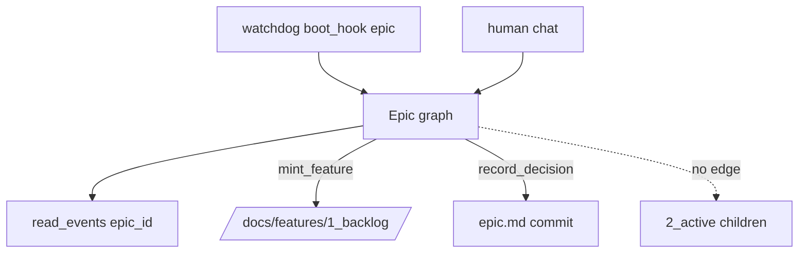

# Epic Team graph

## Parent Epic

[epic_001](../../epics/2_active/epic_001_functional_mvp.md) — Functional MVP.

Constraints this feature must honor:

- Long-lived while the Epic file is in `2_active`.
- Roster: Epic Manager, Epic Architect; human is first-class.
- Reads: Epic doc, its decision log, its comments, child Feature titles/status, amendment diffs.
- Does not read: Task bodies, Feature transcripts, Feature comments, PR/branch diffs.
- Output: Feature `.md` in `/docs/features/1_backlog/` only.
- No `dispatch_*`, no `set_feature_ready`, no `activate_epic`.
- `write_doc` commits (feat_001) and records SHA.
- Path sandbox: cannot write `/docs/tasks` or move children to `2_active`.

## Scope

**In**

- LangGraph subgraph `epic_{id}`, checkpointer namespace per epic
- Tools: `read_doc`, `write_doc` (this epic + feature backlog files it owns), `mint_feature`, `record_decision`, `reply_comment` / `resolve_comment` (epic threads; comment store arrives in feat_005 — stub until then), `list_children`, `resolve_amendment` surface (logic in feat_006; tool may 501)
- Boot via feat_002 `boot_hook("epic")`
- Human messages from War Room `POST /api/chat/epic_{id}`

**Out**

- Feature/Task graphs
- Amendment apply implementation (feat_006)
- Boss

## Data structures

```text
EpicGraphState
  epic_id: WorkId
  messages: [Message]        # this graph only
  last_queue_offset: int
```

`mint_feature` product:

- new `WorkDoc` tier=feature, status=backlog, parent=epic_id, `depends_on` as Manager specifies
- path `/docs/features/1_backlog/{id}_{slug}.md`
- required Feature headings present (may be stub sections)
- `children` on the Epic updated + committed
- event `FeatureMinted {feature_id, epic_id}`

## API contracts

```text
mint_feature(title, depends_on=[], body_stub) -> WorkId
    allocate_id(feature); write_doc; append_event(epic_*, FeatureMinted)
    MUST NOT call dispatch_feature

record_decision(section, choice, rationale, honors) -> decision_id
    append to Epic ## Decision log; write_doc

list_children() -> [WorkMeta]     # features only

tool_guard(path, op) -> bool
    allow write: this epic path, /docs/features/1_backlog/ files whose parent==this
    deny: any 2_active child move, /docs/tasks/**
```

Checkpointer: local, on disk, per `epic_{id}`. Not a cloud store.

## Logic flow



## Task breakdown

Depends on: feat_002, feat_003 completed.

- **[task_012](../../tasks/3_completed/task_012_epic_graph_runtime.md)** — LangGraph epic subgraph, local SQLite checkpointer, boot hook, and deterministic manager/architect turns. Depends on: _(none)_.
- **[task_013](../../tasks/3_completed/task_013_epic_tool_guard.md)** — Path sandbox and scoped `read_doc` / `write_doc` for epic-owned paths only. Depends on: task_012.
- **[task_014](../../tasks/3_completed/task_014_mint_feature.md)** — `mint_feature` and `list_children` with `FeatureMinted` queue events; backlog-only feature files. Depends on: task_012, task_013.
- **[task_015](../../tasks/3_completed/task_015_record_decision.md)** — `record_decision` appends monotonic `dec_NNN` bullets to the Epic decision log. Depends on: task_013.
- **[task_016](../../tasks/3_completed/task_016_comment_amendment_stubs.md)** — 501 stubs for `reply_comment`, `resolve_comment`, and `resolve_amendment` until feat_005/feat_006. Depends on: task_012.
- **[task_017](../../tasks/3_completed/task_017_war_room_epic_chat.md)** — War Room `POST /api/chat/{epic_id}` ingests human messages into the epic graph. Depends on: task_012, task_014, task_015, task_016.

## Risks & upward questions

- Dual-agent roster (Manager vs Architect) can be one graph with two system prompts taking turns, or two nodes. Isolation from Feature graphs matters more than intra-Epic turn-taking. Prefer one subgraph, role-tagged messages, for MVP.
- `resolve_amendment` must not silently land here before feat_006 defines the sidecar format.

## Decision log

_(empty — lock entries when this feature is active)_
