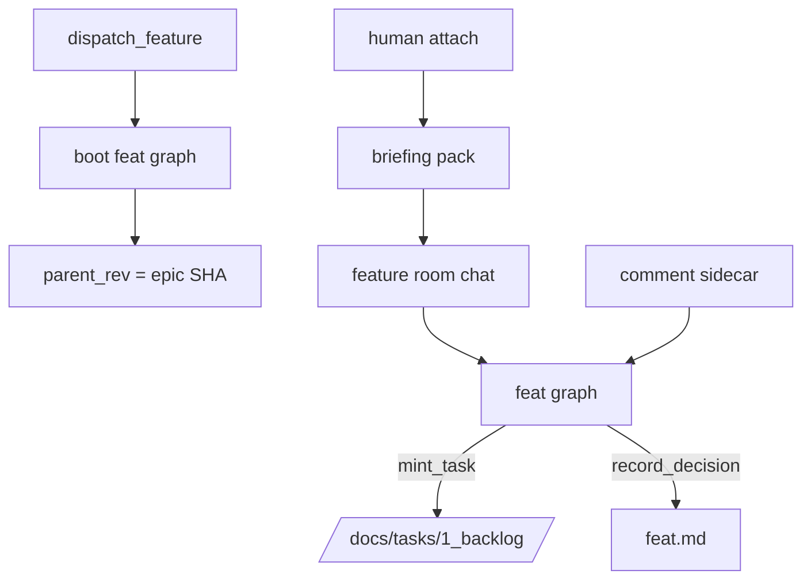

# Feature Team, comments, and drop-in

## Parent Epic

[epic_001](../../epics/2_active/epic_001_functional_mvp.md) — Functional MVP.

Constraints this feature must honor:

- Medium-lived: boot on Feature dispatch; die when children complete and Feature is completed (closeout in feat_008).
- Reads parent Epic at `parent_rev` + that commit's decision log; own doc; own comments; own tasks.
- Does not read other Features' transcripts/comments, Task chats, unrelated Epics, Epic War Room transcript.
- Output: Task `.md` in `/docs/tasks/1_backlog/` only.
- No `dispatch_*`.
- Human may attach; briefing pack, not a token dump.
- Comments in `/docs/_comments/{doc_id}.jsonl`. Default `blocking: false`. Unresolved human threads block Feature completion (feat_008). A human may set `blocking: true`, which makes `mint_task` refuse until that thread is resolved. Dispatch is unaffected. Agents cannot set `blocking`.
- `record_decision` on every locked API / type / flow.

## Scope

**In**

- LangGraph subgraph `feat_{id}`
- Tools: `read_doc` (parent @ parent_rev, self, own tasks, own comments), `write_doc` (self only), `mint_task`, `record_decision`, `reply_comment`, `resolve_comment`, `list_children`
- `propose_epic_amendment` **stub that 501s** until feat_006 (do not invent sidecar format here)
- Comment sidecar read/write
- `attach` / `detach` + briefing pack for feat_003
- Pin `parent_rev` on boot to the Epic SHA at that moment

**Out**

- Amendment apply (feat_006)
- Task SWE (feat_007)
- Completion move to `3_completed` (feat_008)

## Data structures

```text
Comment
  id: "cmt_NNN"
  doc_id: WorkId
  section: str
  anchor: str | null
  author: human | feature_lead | feature_architect | epic_manager | epic_architect
  body: str
  parent: comment_id | null
  state: open | resolved
  blocking: bool             # default false; human-only to set true
  created: datetime

BriefingPack
  doc: WorkDoc
  decision_log: str          # extracted section
  open_comments: [Comment]
  parent_constraints: WorkDoc | null   # epic at parent_rev
  recent_messages: [Message] # last N of THIS graph only
```

`mint_task` product: Task doc in `/docs/tasks/1_backlog/`, parent=feat_id, `depends_on` listed in frontmatter and **Depends on** body section, `parent_rev` set, optional in-repo `skills` paths (may be empty).

## API contracts

```text
mint_task(title, depends_on=[], skills=[], body_stub) -> WorkId
    MUST NOT call dispatch_task
    refuse if this Feature has any open human comment with blocking=true
    skills paths must be in-repo if provided; empty is valid

comment(doc_id, section, body, anchor=null, blocking=false) -> comment_id
    blocking=true allowed only when author=human
    append sidecar; CommentPosted to owning graph only
    toast war_room if human is not attached there

reply_comment / resolve_comment(...)
    owning team only; Feature tools cannot resolve Epic threads

attach(graph_id) -> BriefingPack
detach(graph_id) -> None
    events HumanAttached / HumanDetached
```

Path sandbox: write own Feature path + `/docs/tasks/1_backlog/` tasks with this parent + own comment sidecar. Deny Epic writes. Deny `2_active` task moves.

## Logic flow



## Task breakdown

Depends on: feat_004 completed.

- **[task_018](../../tasks/3_completed/task_018_feature_graph_runtime.md)** — Feature LangGraph runtime, SQLite checkpointer, boot hook, and `parent_rev` pin on boot. Depends on: _(none)_.
- **[task_019](../../tasks/3_completed/task_019_feature_tool_guard.md)** — Path sandbox for feature-owned writes and comment sidecar. Depends on: task_018.
- **[task_020](../../tasks/3_completed/task_020_feature_scoped_docs.md)** — Scoped `read_doc` / `write_doc` / `list_children`. Depends on: task_018, task_019.
- **[task_021](../../tasks/3_completed/task_021_mint_task.md)** — `mint_task`, backlog-only task files, `TasksMinted`. Depends on: task_018, task_019, task_020.
- **[task_022](../../tasks/3_completed/task_022_feature_record_decision.md)** — Feature `record_decision` on the decision log. Depends on: task_020.
- **[task_023](../../tasks/3_completed/task_023_comment_sidecar_store.md)** — Comment JSONL store, human/feature/epic thread tools, epic stub replacement. Depends on: task_018, task_019.
- **[task_024](../../tasks/3_completed/task_024_feature_attach_briefing.md)** — Attach/detach briefing pack and feature war-room graph wiring. Depends on: task_020, task_023.
- **[task_025](../../tasks/3_completed/task_025_propose_epic_amendment_stub.md)** — `propose_epic_amendment` stable 501 until feat_006. Depends on: task_018, task_019.

## Risks & upward questions

- `blocking` is human-only. A Feature agent that sets it is a sandbox/tool-guard defect.
- Drop-in must not leak this transcript into the Epic graph via the UI attachment.

## Decision log

- `dec_001` · 2026-10-10 · Feature Architect · **Package layout**
  New tactical runtime lives in `cascade/feature/` (state, checkpoint, graph, boot, registry, guard, scoped docs, mint, decisions, wiring, stubs). Shared comment persistence lives in `cascade/comments/`.
  Rationale: mirror feat_004 epic seams without overloading `cascade/epic/`.
  Honors: epic_001 context isolation; feat_004 precedent.

- `dec_002` · 2026-10-10 · Feature Architect · **Reuse vs new**
  Reuse LangGraph/checkpoint patterns, `cascade.board.store` read/write/pin_parent, queue helpers, and war-room sidecar chat layout from epic/watchdog. Do not duplicate dispatch law or epic guard rules inside feature code.
  Rationale: one board git store and one queue contract.
  Honors: DESIGN.md §6, §8.

- `dec_003` · 2026-10-10 · Feature Architect · **Comment sidecar ownership**
  One JSONL file per `doc_id` under `docs/_comments/`; `cascade/comments/` owns append/read/validate. Epic and Feature tools call into the store with tier-specific ownership checks.
  Rationale: DESIGN.md §10.3 single sidecar per doc.
  Honors: feat_005 Comment schema.

- `dec_004` · 2026-10-10 · Feature Architect · **Amendment stub**
  `propose_epic_amendment` registers on the feature tool registry but returns HTTP-semantics 501 until feat_006; no `_amendments` diff format or `AmendmentProposed` emission in this feature.
  Rationale: §7 sidecar and apply protocol are feat_006 scope.
  Honors: feat_005 Out; epic_001 feat_006 row.

- `dec_005` · 2026-10-10 · Feature Architect · **Blocking flag**
  Only `author=human` may set `blocking: true` on comment create. Feature graph tools and agents cannot set blocking; enforcement in comment store and tests, not prompts alone.
  Rationale: epic_001 dec_005 / DESIGN.md §10.3.
  Honors: `mint_task` gate without blocking dispatch.
