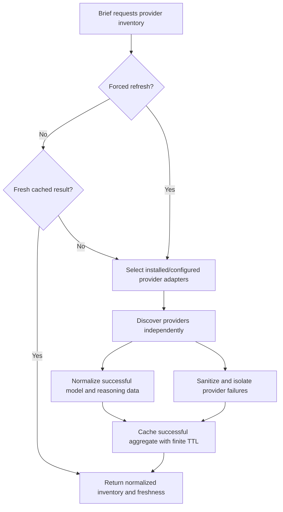

# Discover available providers and models

## Parent Epic

epic_006

## Scope

## Intent

Provide one authoritative backend inventory of providers that are installed, authenticated, and currently usable, with model identifiers sourced from each provider's real API.

## Scope

- Add a provider capability/discovery boundary implemented by provider adapters.
- Probe only configured or installed providers; authentication or API failures make that provider unavailable without breaking discovery for others.
- Normalize provider and model identifiers for consumers.
- Report supported reasoning levels and default behavior for provider/model combinations that expose configurable reasoning; indicate when no override is available.
- Use a small bounded cache around successful discovery so opening the brief does not repeatedly call external APIs; refresh on expiry or explicit request.
- Expose the inventory through the application boundary used by the brief UI.
- Add high-signal adapter and boundary tests for filtering, partial failure, and cache refresh.

## Acceptance criteria

- The inventory returns only providers that pass availability discovery.
- Every offered model originates from that provider's API response, not a static UI list.
- Reasoning capabilities are supplied by the provider integration and are scoped to the selected model; consumers can distinguish default-only models from those with supported overrides.
- A failure in one provider does not suppress healthy providers.
- The UI-facing response identifies refresh/loading failure without leaking credentials.
- Cached data has an explicit freshness policy and can be refreshed.

## Data structures

The implementation may use repository-native names, but the normalized boundary must express:

- **Provider inventory:** stable provider identifier, display metadata already owned by the provider integration, and a non-empty list of discovered models.
- **Model inventory item:** provider-scoped model identifier plus reasoning capability.
- **Reasoning capability:** the provider-defined default and either a finite set of supported overrides or an explicit default-only marker.
- **Inventory result:** available providers, freshness metadata sufficient to identify cached versus newly fetched data, and sanitized provider-level failures for unavailable providers.

Secret values, authentication material, and raw provider error payloads are never part of the normalized result.

## API contracts

- Each provider adapter exposes discovery that returns normalized models and model-scoped reasoning capabilities, or a typed unavailable result.
- The aggregation service invokes only installed/configured adapters and isolates each adapter failure.
- Only successful aggregate discovery results are cached. The cache uses an explicit finite TTL and a bounded footprint; expired entries are rediscovered.
- The application boundary supports ordinary reads and an explicit forced refresh that bypasses the cached value.
- The UI-facing result preserves healthy providers during partial failure and exposes only sanitized failure state.

Exact transport and type names should follow existing repository conventions; this feature does not introduce a second discovery endpoint or a parallel provider registry.

## Logic flow

## Task breakdown

1. `task_006_001_001` — Define provider discovery contracts and adapter capabilities.
2. `task_006_001_002` — Build resilient provider inventory aggregation and bounded cache; depends on task 001.
3. `task_006_001_003` — Expose the inventory through the brief application boundary and add an integration contract test; depends on task 002.

## Risks & upward questions

- Provider APIs may not expose reasoning metadata uniformly. Adapters own that mapping and must represent unknown or non-configurable behavior conservatively rather than inventing options.
- Raw upstream errors may contain sensitive context. Only typed, sanitized failure information crosses the application boundary.
- No upward contract change is currently required.

## Decision log

- Keep discovery, aggregation/cache, and UI boundary work in three dependency-ordered tasks; this is the smallest separation that preserves clear contracts and high-signal tests.
- Treat reasoning support as provider- and model-scoped data, with an explicit default-only representation.
- Cache only successful aggregate results with a finite TTL, while forced refresh bypasses the cache.

- `dec_001` · 2026-10-24 · Feature Lead · **Task decomposition**
  Chose Use three dependency-ordered tasks: adapter contracts, aggregation/cache, then the brief application boundary..
  Rationale: This is the smallest shippable separation that gives each layer a stable contract and keeps tests high-signal without duplicating coverage.
  Honors: Feature acceptance criteria for real provider discovery, resilient aggregation, caching, and UI exposure..

- `dec_002` · 2026-10-24 · Feature Lead · **Reasoning capability contract**
  Chose Represent reasoning support as provider- and model-scoped data with an explicit default-only state..
  Rationale: Provider capabilities differ by model; a conservative explicit state prevents the UI from inventing unsupported overrides.
  Honors: Acceptance criterion requiring consumers to distinguish supported overrides from default-only behavior..

- `dec_003` · 2026-10-24 · Feature Lead · **Discovery cache policy**
  Chose Cache only successful aggregate results with a finite TTL, and make explicit refresh bypass the cached value..
  Rationale: This bounds repeated external calls without persisting failed discovery as authoritative or weakening the refresh contract.
  Honors: Acceptance criteria for explicit freshness and refresh while preserving healthy providers during partial failure..

## Closeout

Completed child work: `task_006_001_001` (Define provider discovery contracts and adapter capabilities), `task_006_001_002` (Build resilient provider inventory discovery and cache), `task_006_001_003` (Expose provider inventory through the brief application boundary).
