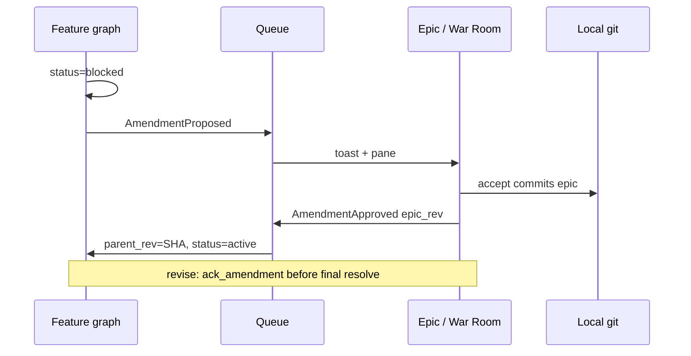

# Amendment protocol

## Parent Epic

[epic_001](../../epics/2_active/epic_001_functional_mvp.md) — Functional MVP.

Constraints this feature must honor:

- Feature Teams cannot patch Epic constraints in place.
- `propose_epic_amendment` blocks the Feature (`status: blocked`, still in `2_active`) and stops task **minting** (dispatch was already not theirs).
- Sidecar diff, not a board column: `/docs/epics/2_active/_amendments/...`
- Human + Epic Architect resolve in War Room: Accept / Reject / Revise.
- Accept **commits** the Epic; `AmendmentApproved.epic_rev` is that SHA.
- Feature cannot leave `blocked` without Approve / Reject / Revise-ack.
- On approve, Feature updates `parent_rev` and re-reads that commit.

## Scope

**In**

- `propose_epic_amendment` tool on Feature graphs
- Sidecar unified-diff documents
- `resolve_amendment` tool on Epic graph
- `ack_amendment` tool on Feature graphs (revise path only)
- War Room amendment pane wired to feat_003 chrome
- Events: `AmendmentProposed`, `AmendmentApproved`, `AmendmentRejected`
- Decision-log + amendment-log entries on the Epic

**Out**

- Letting Feature graphs write the Epic path directly
- Auto-accept

## Data structures

```text
Amendment
  id: "amd_NNN"
  feature_id: WorkId
  epic_id: WorkId
  section: str
  diff_path: Path
  proposed_text: str
  rationale: str
  state: pending | accepted | rejected | revise_pending
  created: datetime

# sidecar pair (not work objects)
docs/epics/2_active/_amendments/{feature_id}_{section_slug}.diff.md   # unified diff body
docs/epics/2_active/_amendments/{feature_id}_{section_slug}.meta.json  # Amendment record + revised_text when applicable
```

Sidecar files are **not** work objects. Watchdog scans only `docs/{epics,features,tasks}/2_active/*.md`; it must not treat `_amendments/**` as board columns.

## API contracts

```text
propose_epic_amendment(target_file, section, proposed_text, rationale) -> amd_id
    Feature status -> blocked; write sidecar pair; AmendmentProposed to epic queue (dest = epic_id)
    Also append Toast { kind: amendment, ... } to war_room queue for feat_003 chrome
    Feature graph pauses mint_task until unblocked
    Second pending amendment for same (epic_id, section) -> conflict error (no wait-queue, no 3-way merge)

resolve_amendment(amd_id, decision: accept|reject|revise, note?, revised_text?) -> Sha | None
    accept: apply section text, write_doc epic (commit), amendment log + decision log,
            AmendmentApproved {feature_id, epic_id, epic_rev=SHA} to feature queue
            Feature: parent_rev=SHA, status=active
    reject: Epic unchanged; AmendmentRejected {feature_id, epic_id, reason} to feature queue;
            Feature status=active (not blocked); Feature must redesign — old minted Tasks are NOT
            auto-validated for dispatch; Feature decision log must note redesign obligation
    revise: store revised_text on record, state=revise_pending, feature stays blocked until ack

ack_amendment(amd_id) -> None
    Feature-only; allowed when state=revise_pending and feature_id matches caller
    After ack: state returns to pending for Epic resolution OR transitions per locked flow in dec_006
    (Epic re-adjudicates revised text); on ack Feature remains blocked until Approve/Reject on resolve
```

DESIGN.md §7.2: Reject → Epic unchanged, Feature redesigns; Revise → Feature acknowledges counter-proposal before unblocking. Accept is the only path that mutates the Epic.

## Logic flow



## Task breakdown

Depends on: feat_005 completed.

- **[task_026](../../tasks/3_completed/task_026_amendment_record_sidecar_store.md)** — Amendment type, `amd_NNN` ids, unified-diff sidecar + `.meta.json` persistence. Depends on: _(none)_.
- **[task_027](../../tasks/3_completed/task_027_propose_epic_amendment.md)** — Replace feature 501 stub; block feature, enqueue `AmendmentProposed`, `mint_task` gate, section conflict rule. Depends on: task_026.
- **[task_028](../../tasks/3_completed/task_028_resolve_amendment.md)** — Replace epic 501 stub; accept/reject/revise, git commit, logs, queue events, `ack_amendment`. Depends on: task_026, task_027.
- **[task_029](../../tasks/3_completed/task_029_war_room_amendment_pane.md)** — War Room toast + split-diff pane; wire Accept/Reject/Revise to `resolve_amendment`. Depends on: task_027, task_028.

## Risks & upward questions

- Concurrent amendments to the same Epic section: serialize on the Epic graph; **second proposal while one is pending is rejected as conflict** (see dec_004). Do not three-way-merge LLM prose.
- Reject unblocks (status=active) so the Feature can mint a different design; it does not unblock task **dispatch** of old tasks that assumed the proposed text — Feature must revise those Task docs. Call that out in the Feature decision log (dec_005).

## Decision log

- `dec_001` · 2026-10-10 · Feature Architect · **Package layout**
  Shared persistence and types live in `cascade/amendments/` (store, diff, types). Feature propose + `ack_amendment` live in `cascade/feature/amendments.py` (registered via `cascade/feature/wiring.py`; remove `propose_epic_amendment` from `cascade/feature/stubs.py`). Epic resolve lives in `cascade/epic/amendments.py` (remove `resolve_amendment` from `cascade/epic/stubs.py`). Reuse `cascade.watchdog.events.append_event`, `cascade.board.store` / `cascade.board.gitutil` for commits, and existing epic/feature scoped doc writers — no parallel queue or git layer.
  Rationale: one amendment store, tier-specific tools mirror feat_004/feat_005 split.
  Honors: epic_001 isolation; feat_005 registry pattern.

- `dec_002` · 2026-10-10 · Feature Architect · **Amendment persistence**
  One pair per proposal: `{feature_id}_{section_slug}.diff.md` (unified diff text only) and sibling `{feature_id}_{section_slug}.meta.json` (full `Amendment` record, including `revised_text` when in revise flow). No central amendments index file.
  Rationale: colocated artifacts; watchdog already ignores `_amendments/` subtree; avoids index merge races.
  Honors: DESIGN.md §7 sidecar path; feat_006 data structures.

- `dec_003` · 2026-10-10 · Feature Architect · **Unified diff sidecar format**
  `.diff.md` contains a unified diff (RFC-style hunk headers) representing replacement of the named Epic `section` body with `proposed_text`, generated against the Epic file at `parent_rev` (or HEAD of epic path when pinning). Human-readable title line optional as a markdown comment above the diff. Epic tools may read diff paths per existing epic guard rules.
  Rationale: War Room split pane expects a diff, not opaque JSON.
  Honors: DESIGN.md §7; feat_003 amendment chrome.

- `dec_004` · 2026-10-10 · Feature Architect · **Section conflict rule**
  At most one amendment in `pending` or `revise_pending` per `(epic_id, section)` (normalize section with `slugify` for filename only; match on exact section string in meta). A second `propose_epic_amendment` targeting the same pair while such a record exists returns a conflict error — **do not wait-queue** and do not LLM-merge prose.
  Rationale: Epic graph serializes resolution; ambiguous concurrent edits are a protocol violation.
  Honors: epic_001 risks; user mandate.

- `dec_005` · 2026-10-10 · Feature Architect · **Reject unblocks to active**
  On `reject`, set Feature `status: active` (leave file in `2_active`), enqueue `AmendmentRejected`, and append a Feature `record_decision` entry stating that previously minted Tasks remain as-is and are **not** auto-unblocked for dispatch — the Feature Team must revise or replace Task specs that assumed the rejected proposal.
  Rationale: DESIGN.md §7.2 redesign obligation without leaving the graph stuck in `blocked`.
  Honors: DESIGN.md §7.2; epic_001 feat_006 risks.

- `dec_006` · 2026-10-10 · Feature Architect · **Revise + ack**
  `resolve_amendment(..., decision=revise, revised_text=...)` sets record `state=revise_pending`, stores `revised_text`, leaves Feature `status: blocked`. Feature calls `ack_amendment(amd_id)` to acknowledge the counter-proposal; on success record returns to `pending` with `proposed_text` updated to `revised_text` (or equivalent single field the Epic pane displays) while Feature **stays blocked** until a subsequent `accept` or `reject` on `resolve_amendment`. No auto-accept after ack.
  Rationale: DESIGN.md §7.2 explicit Feature acknowledgment before unblocking.
  Honors: §7.2; no auto-accept constraint.

- `dec_007` · 2026-10-10 · Feature Architect · **Epic write path**
  Only `resolve_amendment` with `accept` may mutate the Epic `.md` (via `epic_write_doc` / board git commit). `propose_epic_amendment` writes only `_amendments/**` sidecars and Feature status — never the Epic path. Feature guard continues to deny Epic writes.
  Rationale: upward negotiation protocol.
  Honors: epic_001 cross-module constraints; feat_005 guard.

- `dec_008` · 2026-10-10 · Feature Architect · **Queue event payloads**
  `AmendmentProposed` → epic queue (`dest=epic_id`): `{ feature_id, epic_id, section, diff_path, amd_id }`. `AmendmentApproved` → feature queue: `{ feature_id, epic_id, epic_rev }` where `epic_rev` is the post-commit SHA. `AmendmentRejected` → feature queue: `{ feature_id, epic_id, reason }` (use `note` or default string). Match DESIGN.md §8 field names; extra keys allowed only if tests document them.
  Rationale: single cross-tier contract.
  Honors: DESIGN.md §8; `cascade/watchdog/events.py`.

- `dec_009` · 2026-10-10 · Feature Architect · **Amendment id allocation**
  Monotonic `amd_NNN` via scanning existing `.meta.json` files under `_amendments/` (same pattern as comment ids per sidecar file scope). Id stored in meta and referenced by tools/events.
  Rationale: filesystem-visible ids without a separate counter service.
  Honors: feat_005 comment id precedent.
