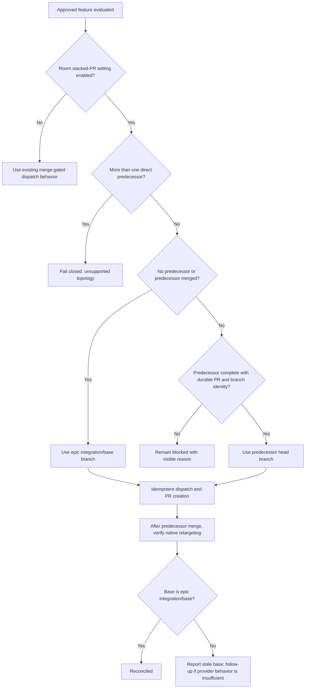

# Dispatch and retarget stacked feature PRs

## Parent Epic

epic_007

## Intent

Allow an approved feature in a linear dependency stack to begin before its single completed predecessor merges, while preserving declared feature order and making the predecessor's branch the pull request base. This behavior is opt-in per Cascade room through a persisted slider that defaults to off.

## Scope

- Add a Cascade-room slider backed by a persisted stacked-PR setting that defaults to disabled.
- Gate stacked dispatch on that room setting; when disabled, preserve existing dependency behavior for future dispatch decisions and do not rewrite pull requests already created.
- Require a durable feature-to-pull-request link in project state before a feature can enter the completed state.
- When the setting is enabled, treat a single declared predecessor that is complete but unmerged as eligible for stacking.
- Use that predecessor's head branch as the new feature pull request base; use the epic's normal integration/base branch when there is no predecessor or the predecessor is already merged.
- Preserve the selected predecessor and base in durable feature/dispatch state so retries and restarts remain deterministic.
- After the predecessor merges, reconcile the downstream pull request by verifying that GitHub's native retargeting moved it to the epic's normal integration/base branch.
- Surface clear blocked or stale-state reasons when pull-request identity, predecessor branch, topology, or native retargeting cannot be safely resolved.

## Out of scope

- Dependency fan-in; features with more than one direct predecessor fail closed as an unsupported topology.
- Rewriting existing pull requests when the room setting is disabled.
- Explicit provider-side pull request retargeting. If implementation evidence shows native retargeting is unavailable or unreliable, handle it in a follow-up feature.
- Arbitrary user-authored stack reordering.
- Stacks across different epics.
- Dispatch while a predecessor is implementing, failed, blocked, unapproved, or otherwise incomplete.
- A new merge queue or custom replacement for GitHub's pull request behavior.
- More than the minimal room control, status, and diagnostic changes needed to opt in and explain dispatch eligibility and stale retargeting.

## Acceptance criteria

1. Each Cascade room exposes a persisted stacked-PR slider that defaults to off.
2. When the room setting is disabled, downstream features continue to wait for predecessor merge under existing dispatch behavior.
3. Disabling the setting affects future dispatch eligibility decisions without rewriting pull requests already created.
4. A feature cannot enter the completed state until its durable feature-to-pull-request link has been populated.
5. Given linear features A then B in an enabled room, with A complete and unmerged and B approved, B is dispatched without waiting for A to merge.
6. B's pull request targets A's head branch while A remains unmerged.
7. B is not dispatched while A is implementing, failed, blocked, unapproved, or otherwise incomplete.
8. Once A merges, reconciliation verifies that GitHub's native retargeting moved B to the epic's normal integration/base branch; a stale base is reported visibly and is not explicitly retargeted in this feature.
9. For A → B → C in an enabled room, each newly dispatched feature targets its single direct completed-but-unmerged predecessor, without skipping an incomplete predecessor.
10. A feature with dependency fan-in is not eligible for stacked dispatch and fails closed with a visible unsupported-topology reason.
11. Missing or unresolvable predecessor pull-request or branch identity fails closed with a visible reason.
12. Dispatch and reconciliation are idempotent: retries do not duplicate work or create another pull request.
13. Existing first-feature dispatch behavior remains unchanged.

## Verification

Prefer focused integration tests around room settings, the feature lifecycle, scheduler/dispatcher, and pull-request adapter:

- the slider persists per room and defaults to off;
- the disabled path retains existing merge-gated dispatch behavior;
- disabling affects future decisions without rewriting existing pull requests;
- completion is rejected until the durable feature-to-pull-request link exists;
- in an enabled room, a complete-but-unmerged predecessor permits dispatch and supplies its branch as base;
- an incomplete or otherwise blocking predecessor still blocks;
- a merged predecessor falls back to the normal base;
- a three-feature linear chain selects each single direct predecessor;
- dependency fan-in blocks with a visible unsupported-topology reason;
- missing pull-request or branch identity fails closed;
- post-merge reconciliation accepts native retargeting and visibly reports a stale base;
- repeated dispatch and reconciliation remain idempotent.

Add lower-level tests only where these integration boundaries cannot exercise a consequential branch.

## Data structures

TBD.

## API contracts

TBD.

## Logic flow

## Task breakdown

- `task_007_001_001` — Add persisted room stacked-PR opt-in.
- `task_007_001_002` — Implement durable PR identity and stacked dispatch selection.
- `task_007_001_003` — Verify native retargeting and stacked-flow regressions; depends on tasks 001 and 002.

## Risks & upward questions

None.

## Decision log

- `dec_001` · 2026-10-22 · Feature Lead · **Implementation task decomposition**
  Chose Run room-setting persistence and durable stacked-dispatch selection as independent tasks, then gate native-retarget reconciliation and integrated regression verification on both..
  Rationale: The first two changes occupy distinct seams and can execute concurrently. Reconciliation consumes both the persisted opt-in and dispatch state, so sequencing it last minimizes coordination while keeping the task graph to three acceptance-aligned units.
  Honors: Approved feature scope, explicit exclusions on provider-side retargeting and fan-in, and the frugal-engineering preference for focused integration tests..

## Closeout

Completed child work: `task_007_001_001` (Add persisted room stacked-PR opt-in), `task_007_001_002` (Implement durable PR identity and stacked dispatch selection), `task_007_001_003` (Verify native retargeting and stacked-flow regressions).
