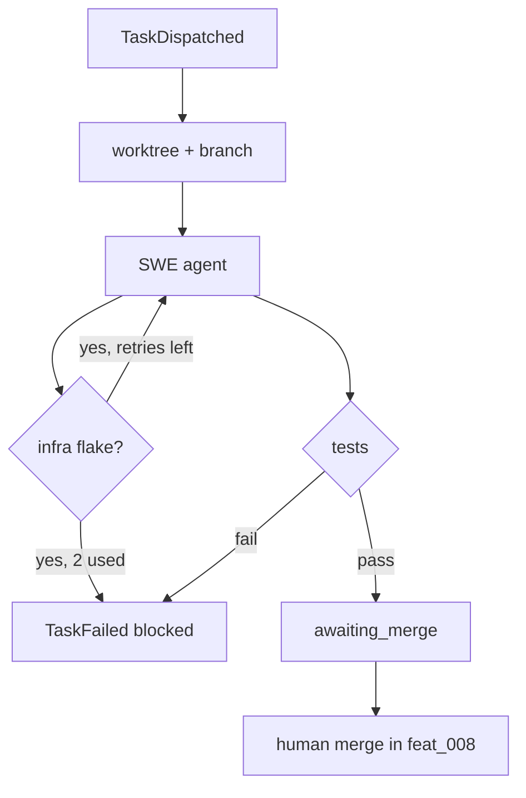

# Task execution and local branches

> **Current workflow update (2026-10-20):** Later automation work superseded the manual handoff described in this completed plan. Cursor Task turns now receive guarded in-process custom tools; CLI providers receive the equivalent stdio MCP tools with active `TaskRun` restoration. A successful Task turn merges automatically into `feat/{parent}`. A failed Task keeps its worktree for diagnosis and wakes the owning Feature Team, which can revise and retry its own blocked child. Pre-execution stale parent pins are refreshed and retried by the watchdog. The original decisions below remain implementation history; [DESIGN.md](../../../DESIGN.md) is the current contract.

## Parent Epic

[epic_001](../../epics/2_active/epic_001_functional_mvp.md) — Functional MVP.

Constraints this feature must honor:

- Ephemeral graph. Boot only after Human/Boss `TaskDispatched`.
- Reads own Task + parent Feature at `parent_rev`. No Epic, no siblings, no comments, no War Room.
- Work in a local worktree. Commits only on `task/{task_id}`. Never commit plan dispatch. Never push a remote.
- No amendment, comment, drop-in, or dispatch tools.
- If Feature contract is wrong: fail closed. Re-dispatch is a new Human/Boss order (feat_002).
- One general SWE agent. At boot, load SWE role-default playbooks plus every path in the Task's `skills` list into context (in-repo `SKILL.md` only). Empty Task `skills` still loads role defaults. Do **not** classify a stack.
- Infra/tool flakes inside this live subgraph: retry at most twice, then `fail_task`. Test or spec misses: `fail_task` immediately. Never call `dispatch_task`.
- Human merges locally. This feature prepares the branch and reports; feat_008 / UI `merge_task_branch` performs the merge-to-mainline.

## Scope

**In**

- `boot_hook("task")` → LangGraph `task_{id}`
- Isolated worktree or branch `task/{task_id}` from current mainline
- Load SWE role-default playbooks and Task `skills` (SKILL.md playbooks) into the SWE system context at boot
- SWE tools: read/edit repo files **except** `/docs/epics`, `/docs/features` (task may not rewrite plans)
- Run tests; git commit on the task branch
- Events: `TaskActivated`, `TaskFailed`; `TaskMerged` is emitted after merge (feat_008)
- Surface branch name + diff summary to War Room toasts / UI
- Classify errors: infra flake (retry ≤2) vs spec/test miss (immediate fail)

**Out**

- GitHub/GitLab MRs
- Auto-merge
- Boss re-dispatch
- Inventing a `stack` enum or classifier

## Data structures

```text
TaskRun
  task_id: WorkId
  branch: "task/{task_id}"
  worktree: Path
  parent_rev: Sha            # feature SHA pinned on the Task doc
  skills: [Path]             # effective list after dispatch override
  state: booting | coding | testing | awaiting_merge | failed | merged
```

If `parent_rev` is stale vs Feature HEAD when the run starts: **fail closed** (`TaskFailed` reason=stale_parent_rev). Feature revises the Task; Human/Boss re-dispatches. Do not silently re-pin.

## API contracts

```text
boot_task(id) -> TaskRun
    create branch/worktree; load each skills path as playbook text
    emit TaskActivated

swe_read / swe_write / swe_run_tests / swe_commit
    path denylist: docs/epics/**, docs/features/**
    commit target: current task branch only

fail_task(id, reason) -> None
    emit TaskFailed to Feature + war_room; teardown graph
    set status=blocked; file stays in 2_active
    blocked does not consume a parallelism slot
    MUST NOT dispatch_task

fail_closed_boot(id, reason) -> None   # boot-time fail-closed; task_035 completes side effects

# merge is not this feature's privilege to call unsupervised
```

## Logic flow



## Task breakdown

Depends on: feat_002, feat_005 completed.

- **[task_030](../../tasks/3_completed/task_030_task_graph_runtime.md)** — Task LangGraph runtime, SQLite checkpointer, boot hook, stale `parent_rev` fail-closed via `fail_closed_boot`, `TaskActivated` on feature queue. Depends on: _(none)_.
- **[task_031](../../tasks/3_completed/task_031_local_branch_worktree.md)** — Branch `task/{task_id}` and isolated git worktree; `TaskRun`; teardown removes worktree only. Depends on: task_030.
- **[task_032](../../tasks/3_completed/task_032_skill_playbooks_boot.md)** — Load Task `skills` as playbook text into graph state; reuse `effective_skill_paths`. Depends on: task_030.
- **[task_033](../../tasks/3_completed/task_033_path_sandbox_swe_io.md)** — Path sandbox; `swe_read` / `swe_write`; scoped `read_doc`. Depends on: task_030, task_031.
- **[task_034](../../tasks/3_completed/task_034_swe_run_tests_commit.md)** — `swe_run_tests` and `swe_commit` on task branch only. Depends on: task_031, task_033.
- **[task_035](../../tasks/3_completed/task_035_failure_policy.md)** — Infra retry ≤2, spec fail immediate, uncertain fail-closed; `fail_task`; `invoke_teardown`; integrates `fail_closed_boot`. Depends on: task_030.
- **[task_036](../../tasks/3_completed/task_036_branch_diff_summary.md)** — `awaiting_merge` + War Room Toast with branch and diff summary. Depends on: task_031, task_034.
- **[task_037](../../tasks/3_completed/task_037_boot_wiring.md)** — End-to-end boot wiring, tool registration, server/loop hook install. Depends on: task_030–task_036.

## Risks & upward questions

- Mis-classifying a spec miss as an infra flake would burn the two retries. Prefer fail-closed when unsure.
- A skill that tells the agent to edit `/docs/epics` does not override the path sandbox.
- Plan-file denylist must not prevent the agent from reading its own Task doc (already via `read_doc`).

## Decision log

- `dec_001` · 2026-10-10 · Feature Architect · **Package layout**
  Task runtime lives in `cascade/task/` (`state`, `checkpoint`, `graph`, `registry`, `boot`, plus worktree, skills, guard, io, git, failure, report, wiring).
  Rationale: mirror feat_005 `cascade/feature/` seams; keep Task SWE isolated from Feature planning code.
  Honors: epic_001 context isolation; feat_005 precedent.

- `dec_002` · 2026-10-10 · Feature Architect · **No external LLM**
  Task subgraph is deterministic LangGraph + registered tool functions, same pattern as `cascade/feature/graph.py` (single SWE node quotes/events; no hosted model call).
  Rationale: DESIGN.md MVP is local supervisor + graphs; Task Team is jobs, not chat rooms.
  Honors: DESIGN.md §6; feat_004/feat_005 runtime precedent.

- `dec_003` · 2026-10-10 · Feature Architect · **Reuse watchdog and board**
  Reuse `dispatch_task` boot path, `register_boot_hook` / `register_teardown_hook`, `effective_skill_paths`, `cascade.board.store` read/pin semantics, and queue `append_event` helpers. Do not duplicate dispatch law or parallelism counting.
  Rationale: one supervisor and one queue contract (DESIGN.md §8–§9).
  Honors: feat_002; epic_001 constraints 10–11.

- `dec_004` · 2026-10-10 · Feature Architect · **Fail-closed classification**
  Uncertain error kind is treated as spec/test miss (immediate `fail_task`, no infra retries). Boot-time stale Feature SHA uses `fail_closed_boot(task_id, reason="stale_parent_rev")` → `fail_task`; never re-pin Task `parent_rev` silently.
  Rationale: epic_001 dec_007 / constraint 11; avoid burning retry budget on bad specs.
  Honors: feat_007 stale-parent rule; DESIGN.md §9.3.

- `dec_005` · 2026-10-10 · Feature Architect · **Worktree and branch**
  Each run uses local branch `task/{task_id}` and an isolated worktree from current mainline HEAD; never push; teardown drops worktree but leaves branch for human merge (feat_008).
  Rationale: DESIGN.md §9.2, §10.1 local branch surface.
  Honors: epic_001 local-only constraint.

- `dec_006` · 2026-10-10 · Feature Architect · **Merge and events out of scope**
  This feature does not emit `TaskMerged` or call `merge_task_branch`; feat_008 owns post-merge board moves and rollup.
  Rationale: feat_007 vs feat_008 split in epic breakdown.
  Honors: DESIGN.md §12 Task completion.

- `dec_007` · 2026-10-10 · Feature Architect · **Skills are context only**
  Task `skills` paths load in-repo `SKILL.md` text at boot; they cannot override the path sandbox (`docs/epics/**`, `docs/features/**` denylist). No stack enum or classifier.
  Rationale: epic_001 constraint 10; human dec_006.
  Honors: DESIGN.md §11 Task Team.

- `dec_008` · 2026-10-10 · Feature Architect · **Teardown on failure**
  `fail_task` must invoke task-tier teardown hooks (`invoke_teardown` in `cascade/watchdog/hooks.py`) so worktrees and graph checkpointers are released; watchdog registers hooks but did not invoke them before this feature.
  Rationale: DESIGN.md §9 watchdog row for `TaskFailed`.
  Honors: feat_007 failure contract.

- `dec_009` · 2026-10-10 · Feature Architect · **Awaiting-merge Toast**
  When tests pass, prefer a War Room `Toast` (body includes `task/{task_id}` + short diff stat/name-status) so feat_003 UI surfaces merge-ready work; extend `toasts.py` mapping only if a new API kind is required.
  Rationale: feat_007 scope “Surface branch name + diff summary”; Toast pipeline already exists for `task_failed`.
  Honors: feat_003 toast mapper.

- `dec_010` · 2026-10-10 · Feature Architect · **Two task boot hooks**
  task_030 `boot_task` owns stale-rev check, graph compile, and `TaskActivated`; task_037 registers a second `register_boot_hook("task", boot_task_wired)` for worktree, skills, tools, and SWE orchestration so `boot.py` stays owned by task_030 only.
  Rationale: disjoint file ownership between runtime and wiring tasks.
  Honors: task split constraints from Feature Team mint.

## Closeout

Task execution boots a local worktree on `task/{id}`, loads SWE role-default philosophy playbooks plus every path in the Task's `skills` list into the SWE context (empty Task `skills` still loads role defaults), and runs sandboxed read/write/test/commit tools that cannot touch plan trees under `/docs/epics` or `/docs/features`. Infra flakes retry at most twice; spec or test misses and uncertain errors fail closed in place with `TaskFailed`, `status: blocked`, and teardown. Green runs surface branch and diff summary for merge-ready toasts; human merge and `TaskMerged` rollup remain **feat_008**.
